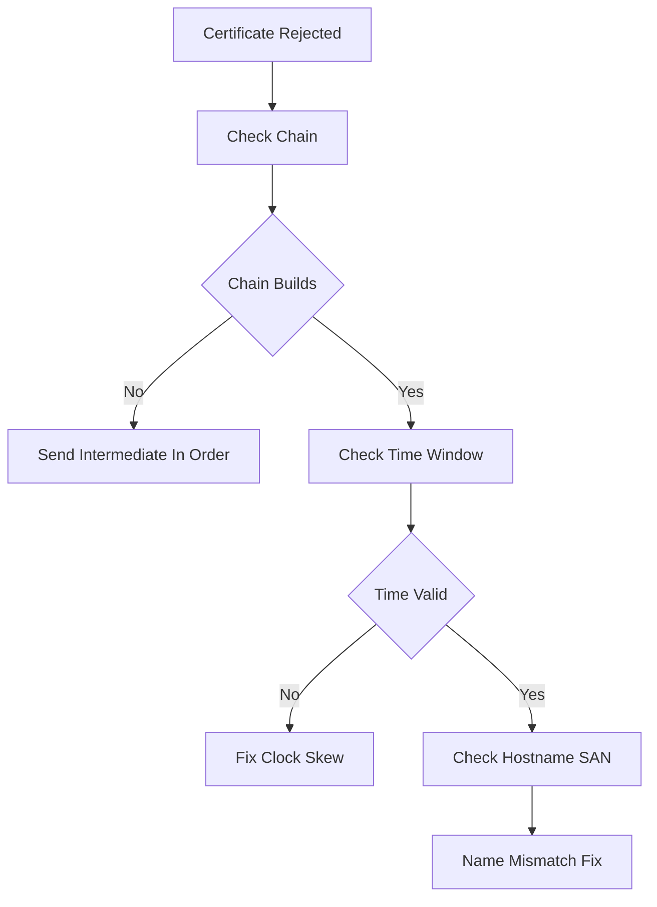

# Reading a Signature Failure: Separating 'Wrong Signature' From 'Wrong Everything Else'

## English

When a client rejects a certificate, the error message is often vague — 'certificate verify failed', 'unable to get local issuer certificate', 'certificate has expired' — and the temptation is to assume the signature is bad. In practice, a genuinely corrupt or forged signature is rare; most failures come from something adjacent. Learning to separate the categories saves enormous debugging time.

The first category is chain construction. The client must be able to build a path from the leaf to a trust anchor using the certificates it was given plus any it can find locally. If the server sends only the leaf and not the intermediate, the client may fail with 'unable to get local issuer certificate' even though every signature is mathematically fine. The fix is to send the intermediate alongside the leaf, in the correct order. A useful diagnostic is to inspect what the server actually presents, rather than what is in the file on disk.

The second category is time. A signature can be perfectly valid and still be rejected because the current time falls outside the certificate's NotBefore and NotAfter window. This is the clock-skew failure: a server whose clock is a few minutes fast, or a client whose clock is behind, can produce a rejection that looks like a signature problem but is really a time problem. Checking the validity window against the actual current time on both ends is a quick way to rule this out.

The third category is name mismatch. The signature verifies, the chain builds, the dates are fine, but the hostname the client asked for does not appear in the certificate's subject alternative names. This produces a distinct error, usually mentioning the hostname. It is worth remembering that the common name field is largely ignored by modern clients for this purpose; the SAN list is what counts.

The fourth category is policy. The certificate may be signed correctly but carry a key usage or extended key usage that does not permit the operation, or a name constraint that excludes the name, or a basic constraints setting that says it cannot act as a CA. These are failures of permission, not of cryptography, and they often surface with messages that mention usage or purpose.

Only after ruling out all of these should you suspect the signature itself. And even then, the practical test is simple: verify the signature independently with a tool that reports the result explicitly. If that verification succeeds while the client still rejects the certificate, the problem is almost certainly in one of the four categories above, not in the bytes.

## 中文

當用戶端拒絕一張憑證時，錯誤訊息往往很含糊——「certificate verify failed」、「unable to get local issuer certificate」、「certificate has expired」——而人很容易就假定是簽章壞了。實務上，真正損毀或被偽造的簽章很罕見；大多數失敗都來自旁邊的某個環節。學會分辨這些類別，能省下大量除錯時間。

第一類是憑證鏈的建構。用戶端必須能利用它拿到的憑證，加上它在本機能找到的任何憑證，從葉憑證建出一條通往信任錨點的路徑。如果伺服器只送葉憑證而不送中繼憑證，用戶端可能會以「unable to get local issuer certificate」失敗，即使每一個簽章在數學上都完好無缺。解法是把中繼憑證連同葉憑證一起送出，並依正確順序排列。一個有用的診斷方法，是檢視伺服器實際送出的內容，而不是磁碟上那個檔案的內容。

第二類是時間。一個簽章可以完全有效，卻因為目前時間落在憑證的 NotBefore 與 NotAfter 視窗之外而被拒絕。這就是時鐘偏移造成的失敗：伺服器的時鐘快了數分鐘，或用戶端的時鐘慢了，都可能產生一個看起來像簽章問題、實際上是時間問題的拒絕。把憑證的有效期視窗與兩端實際的目前時間對照一下，是快速排除這個可能的方法。

第三類是名稱不符。簽章通過驗證、鏈也建得起來、日期也沒問題，但用戶端所要求的主機名稱，並沒有出現在憑證的主體別名（SAN）裡。這會產生一個明顯不同的錯誤，通常會提到該主機名稱。值得記住的是，現代用戶端在這件事上大致已忽略一般名稱（common name）欄位；真正算數的是 SAN 清單。

第四類是政策。憑證可能被正確簽署，但帶有某個不允許該操作的金鑰用途或延伸金鑰用途，或帶有排除該名稱的名稱限制，或帶有表示它不能擔任 CA 的基本限制設定。這些是權限上的失敗，不是密碼學上的失敗，而且它們浮現時的訊息通常會提到用途或目的。

只有在排除以上全部之後，你才應該懷疑簽章本身。而即使到了那一步，實務上的測試也很簡單：用一個會明確報告結果的工具，獨立驗證那個簽章。如果那個驗證成功了，而用戶端仍然拒絕該憑證，那問題幾乎肯定出在上面四類之一，而不是在位元組裡。

## Key Takeaway

Most certificate rejections are chain, time, name, or policy problems rather than bad signatures — diagnose those four categories before suspecting the cryptography.

## Related Concepts
- Chain building
- Certificate validation errors

## Diagram

