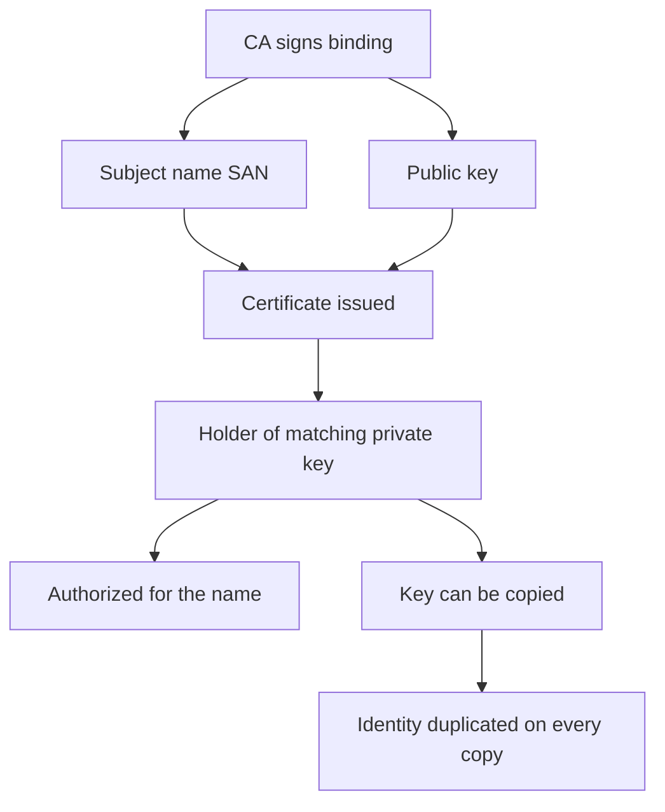

# What the CA Signs Is a Promise About a Name, Not a Machine

## English

It is tempting to imagine that a certificate is a statement about a server — that this particular box, at this particular IP, is who it says it is. It is not. The CA signs a binding between a subject name (usually a DNS hostname in the Subject Alternative Name extension) and a public key. That is the entire semantic content. The certificate says, in effect, 'the holder of the private key matching this public key is authorised to act for the name www.example.com until this date.' Nothing in the signed bytes mentions a CPU, a data centre, an IP address, or an operator. This is why a certificate can be copied to a different machine and still be valid — and why that is not a bug. The key is the identity, and the key travels with whoever holds it.

The practical consequence is that certificate security collapses to key custody. If the private key is exported from a server, backed up to a laptop, committed to a repository, or shared between load balancers in plaintext, then the identity is duplicated. Every copy is the same identity, and every copy can impersonate the name. The CA cannot tell the difference; it only ever saw the public half. This is why key rotation on compromise is not optional — revocation is a best-effort signal that many clients may never check, so replacing the key is the only fix you fully control.

A second consequence is that the name is the thing being protected, not the route to it. Hostname verification compares the name the client typed against the names in the certificate; it does not care which server answered. Two servers behind a load balancer can present different certificates for the same name, and both are valid, provided each holds a key the CA signed for that name. Conversely, a server with a perfectly good certificate for a different name is simply the wrong server, no matter how healthy it looks.

This also explains why wildcards and multi-name certificates are so powerful and so dangerous. A single signature can authorise a key to answer for many names at once. Compromise that one key and every name in the certificate is compromised simultaneously. The blast radius of a key is exactly the set of names the CA bound to it, no more and no less.

When you debug a certificate problem, keep this model in mind: ask 'which name is bound to which key, and who holds that key?' rather than 'is this the right machine?' The answer to the second question is not in the certificate at all.

## 中文

我們很容易想像憑證是對某部伺服器作出的聲明——這部機器、這個 IP，就是它自稱的身份。事實並非如此。CA 所簽署的，是主體名稱（通常是 Subject Alternative Name 擴展中的 DNS 主機名）與一對公開金鑰之間的綁定關係。這就是憑證語意上的全部內容。憑證實際上是在說：「持有與此公開金鑰配對之私鑰的一方，有權代表 www.example.com 這個名稱行事，直至某個日期為止。」被簽署的位元組之中，完全沒有提及 CPU、機房、IP 位址或操作人員。這正是為何憑證可以被複製到另一部機器而仍然有效——而這並不是缺陷。金鑰就是身份，金鑰隨著持有者而轉移。

實際後果是：憑證安全最終歸結為私鑰的保管。如果私鑰從伺服器被匯出、備份到筆記型電腦、被提交到程式碼倉庫，或在負載平衡器之間以明文共享，那麼身份就被複製了。每一份副本都是同一個身份，每一份副本都能冒充該名稱。CA 無法分辨差異；它從頭到尾只看過公開的那一半。這就是為何一旦洩漏，金鑰輪換並非選項——撤銷只是一種盡力而為的訊號，許多用戶端可能永遠不會檢查，所以更換金鑰是你完全掌控的唯一補救方法。

第二個後果是：被保護的是名稱，而非通往它的路徑。主機名驗證會把用戶端輸入的名稱與憑證中的名稱作比對；它並不在乎是哪部伺服器回應。負載平衡器後面的兩部伺服器可以為同一個名稱出示不同的憑證，而兩者都有效——只要各自持有一把 CA 為該名稱簽署過的私鑰。反過來說，一部持有另一個名稱之完好憑證的伺服器，純粹就是錯誤的伺服器，無論它看起來多麼健康。

這也解釋了為何萬用字元與多名稱憑證既強大又危險。單一簽章可以授權一把金鑰同時代表多個名稱回應。一旦該金鑰洩漏，憑證中的所有名稱便同時失守。一把金鑰的爆炸半徑，正好就是 CA 綁定到它身上的那組名稱，不多也不少。

當你排查憑證問題時，請記住這個模型：問「哪個名稱綁定了哪把金鑰，而誰持有那把金鑰？」而不是問「這是不是正確的機器？」第二個問題的答案，根本不在憑證裡面。

## Key Takeaway

A certificate binds a name to a key, not to a machine — so protecting the private key is the whole of protecting the identity.

## Related Concepts
- Public key custody
- Hostname verification

## Diagram

