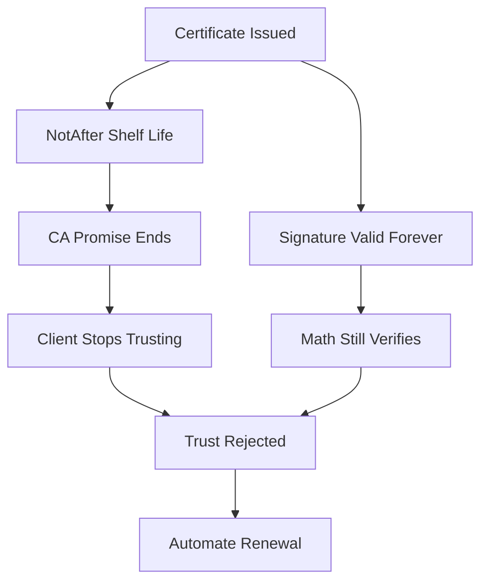

# The Signature Has a Shelf Life: Why 'Signed Correctly' Still Expires

## English

A signature is a mathematical fact; it does not decay. The bytes that the CA signed will verify identically in ten years, provided the same hash and signature algorithm are still computable. What expires is not the signature but the promise around it. The NotAfter field is a statement by the CA that it will stand behind this binding only until a certain moment. After that moment, clients must stop trusting it — not because the maths broke, but because the CA's assurance has a designed end. This is the difference between a cryptographic truth and a policy truth, and certificate validation is deliberately built on both.

There are good reasons for the shelf life. Keys can be stolen quietly; the longer a certificate lives, the longer a stolen key stays useful. Algorithms weaken over time as computing power grows, and a short lifetime limits how long an old algorithm must be supported. Names change hands — a domain can be sold, a company renamed — and a fresh certificate forces the new owner to prove control again. Browsers and the CA/Browser Forum have steadily shortened maximum lifetimes for exactly these reasons, and the trend has been one-way.

A subtlety worth internalising: the signature algorithm is itself a moving target. A certificate signed with an old hash or an old curve may verify fine today but be rejected by policy tomorrow. Clients maintain lists of acceptable algorithms and quietly drop the rest. So a certificate can be simultaneously 'correctly signed' and 'no longer acceptable', which is why an internal service using a long-lived certificate can suddenly fail after a client upgrade with no change on the server side at all.

The practical discipline is automation. Manual renewal is a countdown timer that eventually reaches zero at the worst possible moment. Renewing well before expiry, testing the renewal path, and monitoring expiry dates as a first-class alert all reduce the chance that a perfectly valid signature becomes a perfectly valid outage. The signature never fails; the calendar does.

Finally, remember that expiry is enforced by the client's clock, not the server's. A correct certificate on a server whose clock is wrong is still a certificate the client will judge against its own time. The signature is timeless; the trust in it is not.

## 中文

簽章是一個數學事實；它不會衰減。只要相同的雜湊與簽章演算法仍可計算，CA 所簽署的那些位元組十年後仍會驗證通過。真正到期的不是簽章，而是圍繞它的承諾。NotAfter 欄位是 CA 的聲明：它只會在某個時刻之前為這個綁定背書。過了那一刻，用戶端必須停止信任它——不是因為數學壞了，而是因為 CA 的保證有一個設計好的終點。這就是密碼學真相與政策真相之間的差別，而憑證驗證刻意同時建立在兩者之上。

有效期有充分的理由。金鑰可能被悄悄偷走；憑證活得越久，被盜金鑰就有越長的可用期。隨著運算能力增長，演算法會逐漸變弱，而較短的生命週期限制了舊演算法必須被支援的時間。名稱會易手——網域可以被出售、公司可以改名——而一張新的憑證會強迫新擁有者再次證明控制權。瀏覽器與 CA/Browser Forum 正因為這些理由而持續縮短最長有效期，而這個趨勢是單向的。

有一個值得內化的微妙之處：簽章演算法本身也是移動的目標。用舊雜湊或舊曲線簽署的憑證，今天可能驗證得好好的，明天卻被政策拒絕。用戶端會維護可接受演算法的清單，並悄悄丟棄其餘的。因此，一張憑證可以同時「簽署正確」而又「不再被接受」——這就是為何使用長效憑證的內部服務，可能在伺服器端毫無改動的情況下，於某次用戶端升級後突然失效。

實務上的紀律就是自動化。手動續期是一個倒數計時器，遲早會在最糟糕的時刻歸零。提早於到期前續期、測試續期路徑，並把到期日當作一等公民的告警來監控，都能降低「完全有效的簽章變成完全有效的故障」的機會。簽章永遠不會失效；失效的是日曆。

最後，請記住到期是由用戶端的時鐘強制執行，而非伺服器的。一部時鐘錯誤的伺服器上的正確憑證，仍然是一張用戶端會用自己的時間去判斷的憑證。簽章是無時間性的；對它的信任則不然。

## Key Takeaway

A signature never expires mathematically, but the trust placed in it does — so treat expiry as a policy clock you must automate against.

## Related Concepts
- NotAfter and validity windows
- Certificate lifecycle automation

## Diagram

