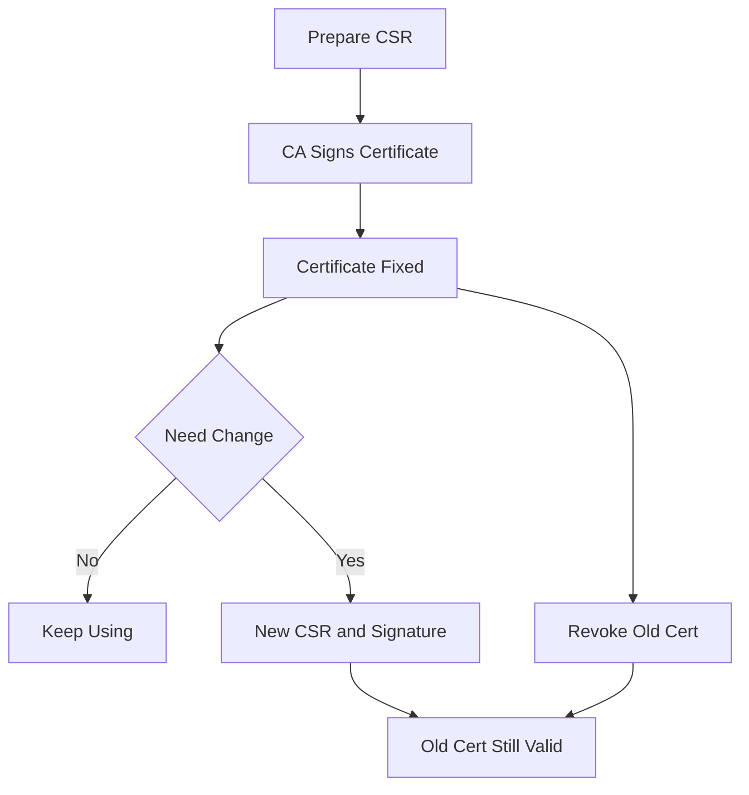

# Signing Is a One-Way Door: What You Can and Cannot Undo After the CA Signs

## English

Once a CA has signed a certificate, the artefact is fixed. You cannot edit a field, correct a typo in a hostname, or add a missing name without starting again from a new CSR. This is not laziness on the CA's part; it is the whole point of a signature. Any change to the signed bytes invalidates the signature, so a 'corrected' certificate is simply a different certificate that nobody has vouched for. Understanding this rigidity explains a lot of operational pain, and it shapes how you should prepare a request in the first place.

The most common mistake is treating the certificate like a configuration file. People issue one with three names, then discover a fourth is needed, and expect to append it. They cannot. The only path is a new CSR (or a new request referencing the same key, depending on the CA's workflow) and a new signature. If the key is reused, the new certificate is a fresh binding of the same key to a new set of names; the old certificate remains valid until it expires or is revoked, which is why sloppy reissuance can leave stale certificates floating around that still authenticate.

Revocation is the closest thing to an undo, and it is a weak one. A revocation entry tells clients 'stop trusting this', but clients only learn that if they check — via CRL, OCSP, or stapling — and many do not check reliably, especially for leaf certificates. So 'revoked' is a request, not a guarantee. The robust undo is to replace the key, not merely the certificate, because a new key cannot be used by an attacker who holds the old one.

This asymmetry has a design implication: put everything you might need into the request up front. Gather all the hostnames, decide on the key type and size, confirm the validity period the CA will grant, and check the Subject Alternative Name list twice. The cost of a mistake is a full reissue cycle, and if the mistake is discovered after deployment, it is a reissue plus a redeployment plus a revocation you cannot fully enforce.

Think of the signature as a wax seal on a letter. You can write a new letter, but you cannot unseal the old one and slip in a correction without the recipient noticing the seal is broken. Plan the letter before you seal it.

## 中文

一旦 CA 簽署了一張憑證，這件成品就固定了。你無法編輯欄位、修正主機名中的錯字，或補上漏掉的名稱，除非從新的 CSR 重新開始。這不是 CA 偷懶；這正是簽章的意義所在。對被簽署位元組的任何改動都會使簽章失效，所以一張「修正過」的憑證，只不過是一張沒有人背書過的不同憑證。理解這種剛性，可以解釋許多營運上的痛苦，也形塑了你一開始該如何準備請求。

最常見的錯誤，是把憑證當成設定檔來對待。人們簽發了一張包含三個名稱的憑證，後來發現需要第四個，就期望能附加上去。他們做不到。唯一的路徑是新的 CSR（或依 CA 工作流程，提交一份引用同一把金鑰的新請求）與新的簽章。如果重用金鑰，新憑證就是把同一把金鑰重新綁定到一組新名稱；舊憑證在到期或被撤銷之前仍然有效——這就是為何草率的重新簽發，會讓仍然能通過認證的過期憑證四處漂流。

撤銷是最接近「復原」的東西，而它很弱。撤銷條目告訴用戶端「停止信任這個」，但用戶端只有在檢查時才會得知——透過 CRL、OCSP 或 stapling——而許多用戶端並不可靠地檢查，尤其是對終端憑證。所以「已撤銷」是一個請求，而非保證。真正穩健的復原，是更換金鑰，而不只是更換憑證，因為新的金鑰無法被持有舊金鑰的攻擊者使用。

這種不對稱有一個設計上的含意：把你可能需要的所有東西，一開始就放進請求裡。蒐集所有主機名、決定金鑰類型與長度、確認 CA 會給予的有效期，並把 Subject Alternative Name 清單檢查兩次。犯錯的代價是一整個重新簽發週期；若錯誤在部署後才被發現，那就是重新簽發、加上重新部署、再加上一個你無法完全強制執行的撤銷。

把簽章想成信件上的火漆封印。你可以寫一封新信，但你無法拆開舊信、塞進更正，而不讓收件人注意到封印已破。在封印之前，先把信規劃好。

## Key Takeaway

A signed certificate is immutable, so the only real undo is a new key and a new request — plan the CSR as if you cannot edit it, because you cannot.

## Related Concepts
- Certificate reissuance
- Revocation limits

## Diagram

