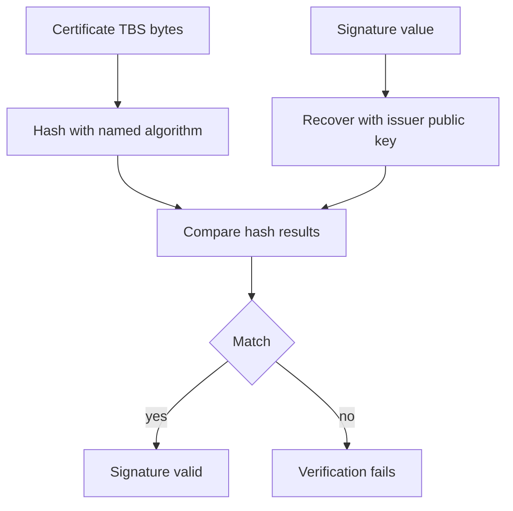

# Signature Verification in Practice: Reproducing the CA's Math With openssl

## English

When a client says a certificate is valid, it has not consulted a database of good certificates — it has done arithmetic. The verification step takes the certificate's TBS bytes (the 'to be signed' portion: everything except the signature itself), hashes them with the algorithm named in the signature algorithm field, then decrypts the signature value using the issuer's public key and compares the two results. If they match, the issuer's private key must have produced that signature over exactly those bytes. You can reproduce this yourself: `openssl x509 -in server.crt -noout -text` shows the signature algorithm and the raw signature in hex, and `openssl verify -CAfile chain.pem server.crt` walks the chain doing the check for you. To see it fail deliberately, flip one byte in the certificate with a hex editor and re-run verify — the signature check fails immediately, long before any name or date check.

The subtlety is that RSA and ECDSA verification look different under the hood. For RSA, the signature is a big integer that, when raised to the public exponent and reduced modulo the modulus, yields a padded structure containing the hash (PKCS#1 v1.5 or PSS padding). For ECDSA, the signature is a pair of integers (r, s) and verification is a curve equation check — there is no 'decrypt' step at all. Both end in the same place: a yes/no answer about whether the hash of the TBS matches what the signer committed to. This is why signature algorithm OIDs matter — the verifier must use the same hash and padding the signer used, or the comparison is meaningless.

A common beginner trap is verifying against the wrong key. If you run `openssl verify` with the server certificate itself as the CA file, you are asking 'did this certificate sign itself?' — which is only true for self-signed certs. For a properly issued certificate, you must supply the issuer's certificate (usually the intermediate) as the trust anchor, or supply the root and let OpenSSL build the chain. The error message 'unable to get local issuer certificate' almost always means the intermediate is missing from your `-CAfile` or `-untrusted` bundle, not that the signature is wrong.

Finally, remember that verification is layered: signature check, validity window check, name check, key usage check, and revocation check are separate gates. A certificate can pass the signature check perfectly and still be rejected because it expired yesterday or because its SAN does not list the hostname you asked for. When debugging, isolate the gates — run `openssl verify` first (signature and chain), then `openssl x509 -noout -dates` (window), then `openssl x509 -noout -ext subjectAltName` (names). Treating 'valid' as one thing hides which gate actually closed.

## 中文

當客戶端話一張憑證「有效」，佢並唔係查咗一個「好憑證資料庫」——佢係做咗一場算術。驗證步驟會攞憑證嘅 TBS bytes（to be signed 部分：即係除咗簽章本身之外嘅所有內容），用簽章演算法欄位指明嘅雜湊演算法計算雜湊，然後用簽發者嘅公鑰「解密」簽章值，再比較兩邊結果。如果吻合，就代表簽發者嘅私鑰確實對住呢啲 bytes 產生過簽章。你可以自己重現：`openssl x509 -in server.crt -noout -text` 會顯示簽章演算法同十六進位嘅原始簽章；`openssl verify -CAfile chain.pem server.crt` 就會幫你沿住憑證鏈做檢查。想刻意睇佢失敗，可以用十六進位編輯器改動憑證入面一個 byte，再跑 verify——簽章檢查會即刻失敗，遠早於任何名稱或日期檢查。

微妙之處在於 RSA 同 ECDSA 嘅驗證底層唔同。RSA 嘅簽章係一個大整數，將佢提升到公鑰指數次方再對模數取餘，就會得出一個包含雜湊值嘅填充結構（PKCS#1 v1.5 或 PSS padding）。ECDSA 嘅簽章係一對整數 (r, s)，驗證係一條曲線方程檢查——根本冇「解密」呢個步驟。但兩者最終都指向同一件事：TBS 嘅雜湊同簽署者所承諾嘅係咪一致。呢個就係簽章演算法 OID 咁重要嘅原因——驗證者必須用簽署者所用嘅同一雜湊同填充方式，否則比較毫無意義。

初學者常見嘅陷阱係用錯公鑰去驗證。如果你將伺服器憑證本身當成 CA 檔案去跑 `openssl verify`，你其實係問「呢張憑證有冇自己簽自己？」——只有自簽憑證先會係真。對於正常簽發嘅憑證，你必須提供簽發者嘅憑證（通常係中繼憑證）作為信任錨，或者提供根憑證並讓 OpenSSL 自行建鏈。錯誤訊息「unable to get local issuer certificate」幾乎總係代表你嘅 `-CAfile` 或 `-untrusted` bundle 缺少咗中繼憑證，而唔係簽章本身有問題。

最後要記住，驗證係分層嘅：簽章檢查、有效期限檢查、名稱檢查、金鑰用途檢查、撤銷檢查係各自獨立嘅閘門。一張憑證可以完美通過簽章檢查，但因為琴日過期、或者 SAN 冇列出你查詢嘅主機名而被拒。除錯時要逐個閘門隔離——先跑 `openssl verify`（簽章同鏈），再跑 `openssl x509 -noout -dates`（有效期限），然後 `openssl x509 -noout -ext subjectAltName`（名稱）。將「有效」當成單一概念，只會令你睇唔清邊個閘門真正關上。

## Key Takeaway

A valid certificate is the output of a reproducible arithmetic check, so debugging verification means isolating which gate — signature, chain, time, name, or usage — actually failed.

## Related Concepts
- TBS certificate bytes
- openssl verify

## Diagram

