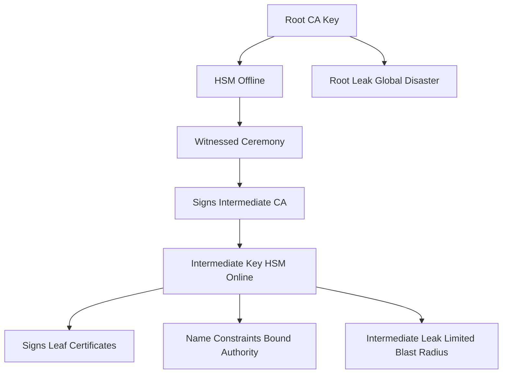

# Who Holds the Signing Key: HSM, Offline CA, and the Blast Radius of a Leak

## English

The security of an entire PKI collapses to one question: where does the CA's private signing key live, and who can make it sign? A root CA key is typically generated inside a hardware security module (HSM) — a tamper-resistant appliance that performs the signing operation internally and never exports the key material. The operator sends the TBS bytes to the HSM, the HSM computes the signature with its internal key, and the signature comes back. The private key is, in a literal sense, never in the same room as the network. This is why root CAs are often kept offline: the machine that holds the root can only be powered up during a ceremony, and ceremonies are witnessed and logged.

Intermediate CAs relax this because they must sign constantly. A typical public CA signs millions of leaf certificates per day, so its intermediate keys live in HSMs that are online, behind strict access control, with every signing request logged. The intermediate's authority is bounded by its own certificate — name constraints, path length constraints, and key usage — so a compromise of an intermediate does not automatically let the attacker sign for every name on the internet. That bounding is the whole point of the hierarchy: the root's signature on the intermediate is a delegation with limits, not a blank cheque.

The 'blast radius' concept is worth internalising. If an intermediate key leaks, every certificate it ever issued becomes suspect, and the fix is revocation plus a new intermediate — painful but survivable. If a root key leaks, the entire trust store entry for that root must be removed from every browser and OS on earth, which is a multi-year, coordinated disaster. This asymmetry is why root keys are treated with physical ceremony, split-knowledge (multiple people each hold part of the activation secret), and multi-person authorisation, whereas intermediate keys get operational discipline and monitoring.

For internal or test CAs the same reasoning applies at smaller scale. A test CA whose key sits in a plain file on a developer laptop is fine for a lab, but the moment that CA is added to a shared trust store, its key is as sensitive as a production one — because anyone who can read the file can sign a certificate for any internal hostname and every machine that trusts the CA will accept it. The practical rule: the moment a CA certificate enters a trust store, treat its private key as a production secret, move it off the laptop, and rotate it if it was ever copied around.

## 中文

成個 PKI 嘅安全性可以歸結為一個問題：CA 嘅私鑰簽署金鑰住喺邊，邊個可以叫佢簽署？根 CA 嘅金鑰通常喺硬體安全模組（HSM）內部生成——呢個係防篡改嘅裝置，簽署操作喺內部完成，金鑰材料永遠唔會匯出。操作員將 TBS bytes 送入 HSM，HSM 用內部金鑰計算簽章，再將簽章送返出嚟。可以話，私鑰喺字面意義上從未同網路身處同一間房。呢個就係根 CA 通常保持離線嘅原因：持有根金鑰嘅機器只喺儀式期間開機，而儀式有見證人同記錄。

中繼 CA 就放寬呢個要求，因為佢要不斷簽署。典型嘅公開 CA 每日簽發數百萬張葉憑證，所以佢嘅中繼金鑰住喺線上 HSM 入面，受到嚴格存取控制，每個簽署請求都有記錄。中繼憑證嘅許可權受自身憑證限制——名稱約束、路徑長度約束、金鑰用途——所以中繼被攻陷並唔代表攻擊者可以為網際網路上任何名稱簽署。呢種限制正正係階層架構嘅重點：根對中繼嘅簽章係一個有界限嘅授權，唔係一張空白支票。

「爆炸半徑」呢個概念值得內化。如果中繼金鑰洩漏，佢簽發過嘅每張憑證都會受懷疑，補救方法係撤銷加換新中繼——痛苦但可承受。如果根金鑰洩漏，就要從全球每部瀏覽器同作業系統嘅信任儲存移除該根，呢個係歷時多年、需要協調嘅災難。呢種不對稱性就係點解根金鑰要用實體儀式、分割知識（多人各持啟動秘密嘅一部分）、多人授權去處理，而中繼金鑰就靠營運紀律同監控。

對於內部或測試 CA，同樣道理只係規模縮細。一張測試 CA 嘅金鑰放喺開發者手提電腦嘅普通檔案度，實驗室用冇問題；但當呢個 CA 被加入共用信任儲存嗰一刻，佢嘅金鑰就同生產金鑰一樣敏感——因為任何讀到呢個檔案嘅人都可以為任何內部主機名簽憑證，而所有信任呢個 CA 嘅機器都會接受。實用守則：CA 憑證一入信任儲存，就當佢嘅私鑰係生產秘密，搬離手提電腦，如果曾經被複製過就要輪換。

## Key Takeaway

The security of a PKI reduces to where the signing key lives and who can invoke it, so the moment a CA enters a trust store its private key deserves production-grade protection.

## Related Concepts
- Hardware Security Module
- Root CA offline ceremony

## Diagram

