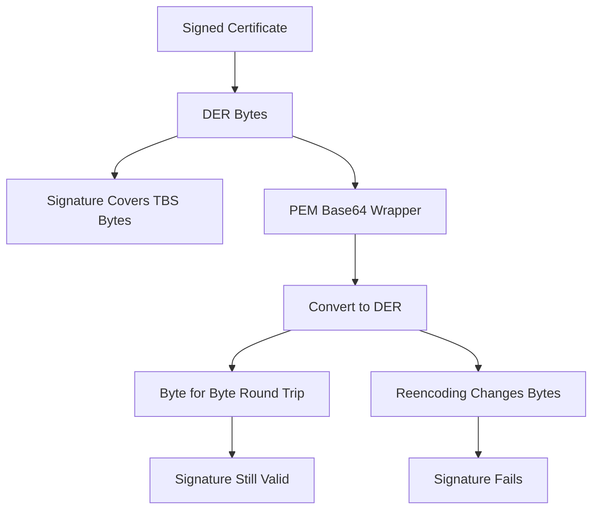

# The Signed Certificate as Data: Parsing Formats, Encodings, and What Survives the Round Trip

## English

A signed certificate is a DER-encoded ASN.1 structure — a strict, binary, tag-length-value format defined by X.690. DER has no flexibility: the same certificate always produces the same bytes, which is essential because the signature is computed over those exact bytes. PEM is just that DER wrapped in Base64 with `-----BEGIN CERTIFICATE-----` header and footer lines. Converting between them is lossless in principle: `openssl x509 -in cert.pem -outform DER -out cert.der` and `openssl x509 -inform DER -in cert.der -out cert.pem` should round-trip byte-for-byte on the DER side. If they do not, something in the pipeline is re-encoding, and that is a red flag.

Why does byte-exactness matter? Because the signature covers the TBS bytes, and any re-encoding that changes a length field, a string type, or the ordering of a SET OF element will change those bytes and invalidate the signature. A classic trap is a tool that 'normalises' a certificate by re-encoding it with a different ASN.1 library — the result may look identical in `openssl x509 -text` output but fail verification. This is also why you should never hand-edit a PEM file: even changing whitespace inside the Base64 is usually harmless (Base64 decoders ignore line breaks), but changing a single decoded byte is fatal.

Encoding confusion also affects how certificates are delivered. A `.cer` file can be either DER or PEM depending on the platform that produced it; Windows often defaults to DER, while Unix tooling defaults to PEM. A `.p7b` file is PKCS#7 — a signed container that can hold a whole chain but not a private key. A `.p12`/`.pfx` is PKCS#12 — an encrypted container that can hold a private key plus its certificate chain. Knowing which container you have tells you what you can do with it: a `.p7b` is for delivering chains, a `.p12` is for moving a key plus chain between systems, and a bare `.pem` might be either a single certificate or a concatenated chain depending on how many BEGIN/END blocks it contains.

When something breaks, the first diagnostic is usually 'what is actually in this file?' Run `openssl x509 -in file -noout -subject -issuer -dates` for a single certificate, `openssl crl2pkcs7 -nocrl -certfile chain.pem | openssl pkcs7 -print_certs -noout` to list what is inside a PKCS#7 bundle, or `openssl pkcs12 -in bundle.p12 -info -noout` to inspect a PKCS#12 without extracting the key. These commands tell you the truth about the bytes, which is frequently different from what the filename suggests.

## 中文

一張已簽署嘅憑證係一個 DER 編碼嘅 ASN.1 結構——由 X.690 定義嘅嚴格二進位 tag-length-value 格式。DER 冇任何彈性：同一張憑證永遠產生同一串 bytes，呢點至關重要，因為簽章就係對住呢啲確切 bytes 計算。PEM 只係將 DER 用 Base64 包起，加上 `-----BEGIN CERTIFICATE-----` 頭尾行。兩者之間轉換原則上無損：`openssl x509 -in cert.pem -outform DER -out cert.der` 同 `openssl x509 -inform DER -in cert.der -out cert.pem` 喺 DER 一側應該可以逐 byte 往返一致。如果唔係，即係流程中有嘢重新編碼，呢個係危險訊號。

點解 byte 精確咁重要？因為簽章覆蓋 TBS bytes，任何重新編碼只要改動長度欄位、字串型別、或者 SET OF 元素嘅排序，都會改變嗰啲 bytes 並令簽章失效。經典陷阱係有啲工具會用另一個 ASN.1 函式庫「正規化」憑證——結果喺 `openssl x509 -text` 輸出睇落一模一樣，但驗證會失敗。呢個亦係點解你永遠唔應該手動編輯 PEM 檔：改動 Base64 內部嘅空白通常無害（Base64 解碼器會忽略換行），但只要改動一個解碼後嘅 byte 就足以致命。

編碼混淆亦影響憑證嘅傳遞方式。`.cer` 檔可能係 DER 亦可能係 PEM，視乎產生佢嘅平臺——Windows 通常預設 DER，Unix 工具就預設 PEM。`.p7b` 係 PKCS#7——一個已簽署嘅容器，可以裝住整條鏈但唔可以裝私鑰。`.p12`／`.pfx` 係 PKCS#12——一個加密容器，可以裝私鑰連憑證鏈。知道你手上有邊種容器，就知你可以做啲乜：`.p7b` 用嚟交付憑證鏈，`.p12` 用嚟喺系統之間搬運金鑰連鏈，而一個普通 `.pem` 可能係單張憑證，亦可能係串接嘅鏈，取決於入面有幾多個 BEGIN/END 區塊。

出問題嗰陣，第一個診斷問題通常係「呢個檔案入面究竟係乜？」單張憑證用 `openssl x509 -in file -noout -subject -issuer -dates`；列出 PKCS#7 bundle 內容用 `openssl crl2pkcs7 -nocrl -certfile chain.pem | openssl pkcs7 -print_certs -noout`；檢查 PKCS#12 而唔匯出金鑰就用 `openssl pkcs12 -in bundle.p12 -info -noout`。呢啲指令會話你知 bytes 嘅真相，而真相往往同檔名嘅暗示唔同。

## Key Takeaway

A certificate is exact bytes, not a document, so understanding DER, PEM, PKCS#7, and PKCS#12 containers is the difference between debugging a real problem and chasing a re-encoding ghost.

## Related Concepts
- DER encoding
- PKCS#12 container

## Diagram

