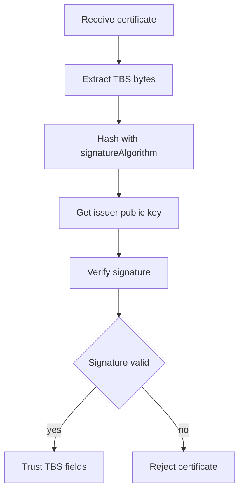

# The Signature Is Checked Before Anything Else Is Believed

## English

When a TLS client receives a certificate, the first thing it does is not read the hostname or the expiry date. It verifies the CA's signature over the TBS (to-be-signed) portion of the certificate. This ordering matters: every other field in the certificate — the subject name, the SANs, the validity window, the key usage bits — is just bytes until the signature proves they were not altered in transit or on disk. Think of a sealed envelope with a wax seal: you break the seal only after you confirm the seal is intact. If the signature check fails, the client should stop and reject; it should not "try anyway" with the name inside.

The mechanics: the client takes the certificate's TBS bytes exactly as they appear, hashes them with the algorithm named in the signatureAlgorithm field (typically SHA-256 today), and then runs the matching public-key operation using the public key from the issuer's certificate. For RSA this is a modular exponentiation; for ECDSA it is an elliptic-curve verification equation. The result is compared against the signature bits in the certificate. If they match, the TBS bytes are authentic; if not, either the certificate was tampered with or the wrong issuer key was used to check.

A common beginner mistake is to think of the signature as "encrypting" the certificate. It does not. The certificate is public data; anyone can read it. The signature only proves that whoever holds the issuer's private key produced exactly these TBS bytes. Confidentiality is not the goal — integrity and origin are.

Because the check is over the exact bytes, even a single byte difference in re-encoding breaks it. If you decode a PEM certificate, edit a field, and re-encode it, the signature will no longer verify. This is why tools like openssl re-emit the original DER rather than reconstructing it. It is also why you cannot "fix" a typo in a signed certificate — you have to get a new one issued.

Practical consequence: when debugging a TLS failure, run the signature check first. If it fails, nothing else about the certificate is worth reading yet. If it succeeds, then move on to hostname, expiry, key usage, and chain building. The order of checks is not arbitrary; it is the order in which trust is established.

## 中文

當 TLS 用戶端收到一張憑證時，它第一件做的事並不是讀取主機名稱或到期日，而是驗證 CA 對憑證中 TBS（to-be-signed，待簽署部分）所做的簽章。這個次序很重要：憑證裡其他所有欄位——主體名稱、SAN、有效期間、key usage 位元——在簽章證明它們沒有在傳輸途中或磁碟上被改動之前，都只是一堆位元組。可以想像一個蓋了火漆印的信封：你要先確認火漆印完整，才會拆開信封。若簽章檢查失敗，用戶端應該停下來並拒絕，而不是「照樣試試看」裡面寫的名字。

機制是這樣的：用戶端取出憑證的 TBS 位元組（完全按照它們原本的樣子），用 signatureAlgorithm 欄位指定的演算法（今天通常是 SHA-256）計算雜湊，然後用簽發者憑證裡的公鑰執行對應的公鑰運算。對 RSA 而言這是模冪運算；對 ECDSA 而言是橢圓曲線驗證方程式。結果會與憑證裡的簽章位元比對。若相符，TBS 位元組就是真實的；若不符，要麼憑證被篡改，要麼用了錯誤的簽發者金鑰來檢查。

初學者常犯的錯誤，是以為簽章是在「加密」整張憑證。其實不是。憑證是公開資料，任何人都可以讀。簽章只證明一件事：持有簽發者私鑰的人，確實產生了這串 TBS 位元組。機密性不是目標——完整性與來源才是。

正因為檢查是針對確切的位元組，重新編碼時即使只差一個位元，簽章也會失效。如果你把 PEM 憑證解碼、改一個欄位、再重新編碼，簽章就不再通過驗證。這就是為什麼 openssl 這類工具會直接輸出原本的 DER，而不是重新建構它。這也是為什麼你不能「修正」一張已簽署憑證裡的錯字——你必須重新申請一張。

實務上的後果是：除錯 TLS 失敗時，先做簽章檢查。若失敗，憑證的其他部分都還不值得讀。若成功，才繼續看主機名稱、到期日、key usage 與鏈建立。檢查的次序不是隨意的，而是信任建立的次序。

## Key Takeaway

The CA's signature over the TBS bytes is the gatekeeper: verify it first, and only then trust any other field in the certificate.

## Related Concepts
- TBS bytes
- signature verification

## Diagram

