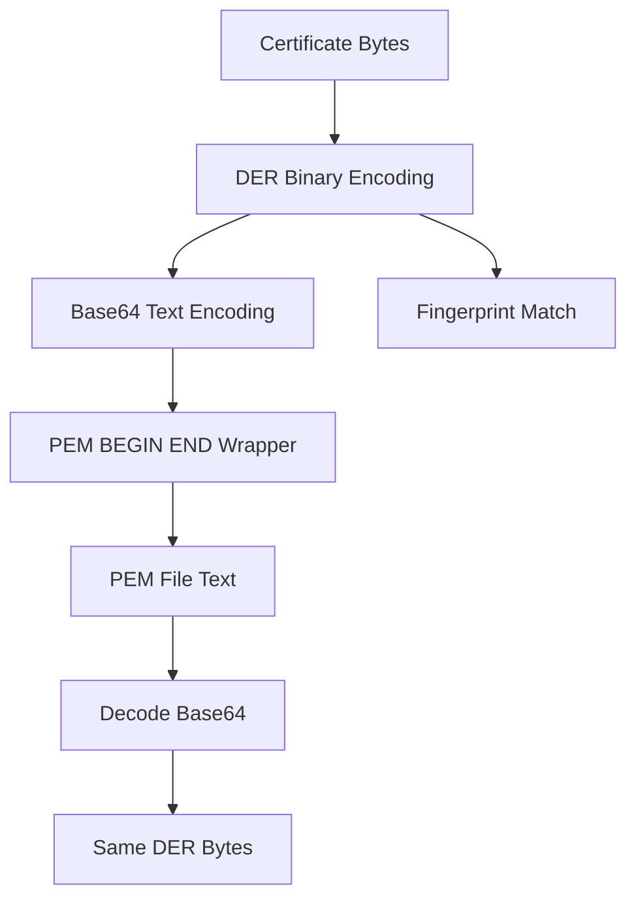

# Why the Same Certificate Looks Different in PEM, DER, and Base64

## English

A signed certificate is a single DER-encoded byte string. DER (Distinguished Encoding Rules) is a binary, canonical encoding — every value has exactly one valid byte representation, which is why signatures over DER bytes are stable. But you almost never see raw DER in the wild. You see PEM, which is the same DER bytes wrapped in Base64 text between `-----BEGIN CERTIFICATE-----` and `-----END CERTIFICATE-----` lines. The Base64 text is not a different certificate; it is the same bytes, just made safe for email, config files, and copy-paste.

The conversion is lossless in both directions. `openssl x509 -in cert.pem -outform DER -out cert.der` decodes the Base64 and writes the raw bytes; `openssl x509 -in cert.der -inform DER -out cert.pem` re-encodes them. If you run `openssl x509 -in cert.pem -noout -fingerprint -sha256` and then do the same on the DER file, the fingerprints must match. If they do not, something in the conversion was wrong — usually line endings, stray whitespace, or a tool that "helpfully" reformatted the file.

A frequent trap is that PEM files can contain multiple certificates concatenated together, each with its own BEGIN/END block. This is exactly how a chain is shipped: leaf first, then intermediates. A tool that only reads the first block will silently ignore the rest, which is a classic cause of "why does my server only send one certificate?" The fix is not to change the encoding but to make sure the server software is configured to read the whole file, or to split it into separate files.

Another trap is text-mode transfer. If a PEM file is copied through a system that converts LF to CRLF (or back), the Base64 payload is unchanged but the surrounding lines may not be. Most parsers tolerate this, but some strict ones do not. DER files, being binary, are far more fragile: a single byte changed by a text-mode FTP transfer corrupts them completely. This is why PEM is preferred for anything that travels through humans or text channels.

Finally, Base64 is not encryption and not compression. It increases size by about 33% and provides zero security. Its only job is to turn arbitrary bytes into printable ASCII so that tools which expect text do not choke. Understanding this makes the PEM/DER distinction feel trivial — because it is — and lets you stop worrying about "format" and start worrying about what the bytes actually contain.

## 中文

一張已簽署的憑證，本質上就是一串 DER 編碼的位元組。DER（Distinguished Encoding Rules，可辨識編碼規則）是一種二進位、正規化的編碼——每個值只有唯一一種合法位元組表示法，這正是為何對 DER 位元組所做的簽章能夠穩定。但你在真實世界幾乎看不到原始 DER。你看到的是 PEM，也就是同一串 DER 位元組，用 Base64 文字包在 `-----BEGIN CERTIFICATE-----` 與 `-----END CERTIFICATE-----` 兩行之間。Base64 文字不是另一張憑證；它是同一串位元組，只是變得可以安全地放進電郵、設定檔與複製貼上。

兩個方向的轉換都是無損的。`openssl x509 -in cert.pem -outform DER -out cert.der` 會解開 Base64 並寫出原始位元組；`openssl x509 -in cert.der -inform DER -out cert.pem` 則重新編碼。如果你對 PEM 執行 `openssl x509 -in cert.pem -noout -fingerprint -sha256`，再對 DER 檔做同樣的事，兩個指紋必須相同。若不相同，轉換過程中有東西出錯了——通常是換行符號、多餘空白，或某個工具「好心」重新排版了檔案。

常見的陷阱是：PEM 檔可以包含多張串接在一起的憑證，每張都有自己的 BEGIN/END 區塊。憑證鏈正是這樣傳遞的：leaf 在前，中繼憑證在後。只讀第一個區塊的工具會默默忽略其餘部分，這正是「為什麼我的伺服器只送出一張憑證？」的經典成因。解法不是改編碼，而是確認伺服器軟體有設定讀取整個檔案，或把它拆成多個檔案。

另一個陷阱是文字模式傳輸。若 PEM 檔經過會把 LF 轉成 CRLF（或反向）的系統，Base64 內容不變，但周邊的行可能變了。多數解析器能容忍，但某些嚴格的不行。DER 檔因為是二進位，脆弱得多：文字模式的 FTP 傳輸只要改動一個位元，就會徹底損壞。這就是為何只要檔案會經過人或文字通道，就偏好用 PEM。

最後，Base64 不是加密，也不是壓縮。它會讓大小增加約 33%，而且提供零安全性。它唯一的任務，是把任意位元組轉成可列印的 ASCII，讓期待文字的工具有東西可讀。理解這點，PEM 與 DER 的差別就顯得微不足道——因為它確實如此——你就能停止擔心「格式」，開始關心位元組裡到底裝了什麼。

## Key Takeaway

PEM and DER are the same bytes in two costumes; the fingerprint is the ground truth, and multi-block PEM files are how chains actually travel.

## Related Concepts
- Base64 encoding
- DER encoding

## Diagram

