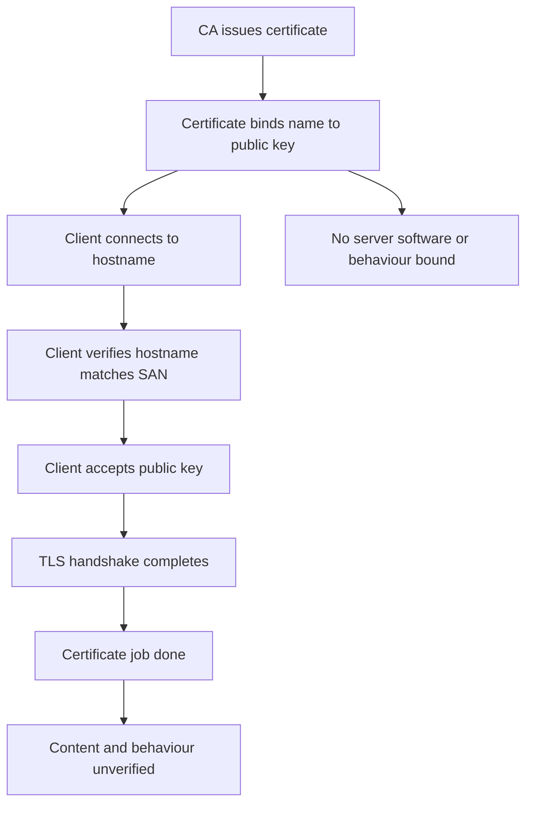

# What a Certificate Cannot Sign For You: Binding Names, Not Behaviour

## English

A signed certificate binds a name (or set of names) to a public key. That is the entire promise. It does not bind the key to a particular server, a particular IP address, a particular piece of software, or a particular behaviour. When a client accepts a certificate for `www.example.com`, it has learned only one thing: the CA vouches that the holder of the corresponding private key was authorised to use that name at the moment of issuance. Everything else — that the server is patched, that it serves the right content, that it is not a phishing page, that it is the machine you intended to reach — is outside the certificate's scope.

This is why a valid certificate on a phishing site is not a bug in PKI; it is a misunderstanding of what PKI promises. If an attacker can obtain a certificate for `paypal-login-secure.example` (a domain they control), the certificate is genuinely valid for that name. The browser will show a padlock. The defence is not the certificate but hostname verification: the client checks that the name it intended to reach matches a SAN in the certificate. If the user typed the wrong name, no certificate can save them.

Similarly, a certificate does not say anything about the server's identity in a physical sense. The same certificate and key can be copied to another machine and will verify there just as well. This is why key theft is so damaging: the attacker does not need to break cryptography, only to obtain the private key. The certificate will keep verifying until it expires or is revoked, and revocation checking is famously unreliable in practice.

The certificate also does not cover the content of the connection. Once the TLS handshake completes, the certificate's job is done. What is sent over the encrypted channel — whether it is the real bank or a compromised server relaying to one — is governed by application-layer authentication (passwords, tokens, mutual TLS, signed API requests), not by the server certificate alone.

Understanding this boundary is what separates "the padlock means secure" from "the padlock means this specific name is bound to this specific key by a trusted CA." The first is marketing; the second is the actual cryptographic statement. Building systems on the second requires adding the checks the certificate deliberately does not perform: hostname matching, revocation, certificate pinning where appropriate, and application-level identity.

## 中文

一張已簽署的憑證，把一個名稱（或一組名稱）繫結到一把公鑰。這就是全部的承諾。它不把金鑰繫結到某臺伺服器、某個 IP 位址、某套軟體，或某種行為。當使用者端接受一張給 `www.example.com` 的憑證時，它只學到一件事：CA 擔保在簽發那一刻，持有對應私鑰的人有權使用這個名稱。其他一切——伺服器有無修補、是否提供正確內容、是否為釣魚頁面、是否是你想連上的那臺機器——都不在憑證的範圍內。

這就是為何釣魚網站上出現有效憑證，並不是 PKI 的漏洞，而是對 PKI 承諾的誤解。若攻擊者能為 `paypal-login-secure.example`（他們控制的網域）取得憑證，那張憑證對該名稱確實有效。瀏覽器會顯示鎖頭。防禦不是憑證本身，而是主機名稱驗證：使用者端檢查它想連上的名稱，是否與憑證裡某個 SAN 相符。若使用者打錯名稱，沒有任何憑證救得了他。

同樣地，憑證對伺服器的實體身分不置一詞。同一張憑證與金鑰可以被複製到另一臺機器，在那裡照樣驗證透過。這就是金鑰被竊如此致命的原因：攻擊者不需要破解密碼學，只要取得私鑰。憑證會持續驗證成功，直到到期或被撤銷，而撤銷檢查在實務上出了名地不可靠。

憑證也不涵蓋連線的內容。TLS 握手一完成，憑證的任務就結束了。加密通道上送的是什麼——是真銀行，還是被入侵並轉發到別處的伺服器——由應用層認證（密碼、權杖、雙向 TLS、簽署的 API 請求）決定，而不是單靠伺服器憑證。

理解這條界線，就能把「鎖頭代表安全」與「鎖頭代表這個特定名稱被受信任的 CA 繫結到這把特定金鑰」區分開來。前者是行銷話術；後者才是真正的密碼學陳述。要在第二種理解上建系統，就必須補上憑證刻意不做的檢查：主機名稱比對、撤銷檢查、在適當場合做憑證釘選，以及應用層的身分識別。

## Key Takeaway

A certificate binds a name to a key and nothing more; every other security property must be supplied by the client and the application.

## Related Concepts
- hostname verification
- application-layer authentication

## Diagram

