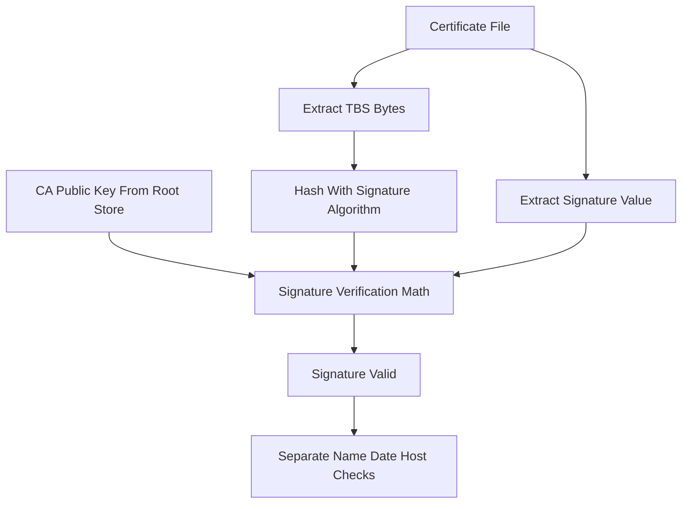

# Reading a Certificate's Signature Without the CA's Help: Offline Verification

## English

Verification is often imagined as a phone call to the CA, but in practice it is almost entirely local arithmetic. When a TLS client checks a certificate, it does not contact the issuing CA to ask 'did you really sign this?'. Instead it takes the CA's public key — which it already has, sitting in a root store on disk — and runs one signature-verification operation against the signed bytes. That is why HTTPS still works on an air-gapped network and why a certificate issued yesterday verifies instantly with no network round trip. The network is only needed for revocation checks and OCSP stapling, which are a separate question from 'is this signature mathematically valid?'.

The mechanics are worth spelling out because they explain a lot of confusing error messages. The verifier takes the certificate's TBS (to-be-signed) portion — the DER-encoded blob that excludes the signature field itself — hashes it with the algorithm named in the signatureAlgorithm field, and then feeds that hash plus the signature value plus the CA's public key into the signature scheme (for example ECDSA with SHA-256, or RSA-PSS). If the math checks out, the signature is valid. Nothing in this step involves the subject's name, the validity dates, or the hostname you typed into the browser. Those are separate checks performed afterwards.

This separation is why you can verify a certificate offline with a single command. Given a certificate file and the CA certificate, `openssl verify -CAfile ca.crt server.crt` will do the chain walk and signature checks locally, with no network access. If you want to see the raw verification step, `openssl x509 -in server.crt -noout -text` shows you the signature algorithm and the signature bytes, and `openssl dgst` combined with the extracted public key can reproduce the check by hand. The point is that you, not the CA, hold the power to confirm the signature.

The practical consequence is that a CA cannot 'un-sign' a certificate. Once issued, the signature remains mathematically valid forever, even after the certificate expires or is revoked. Expiry and revocation are policy decisions layered on top of a signature that never changes. This is why revocation lists and OCSP exist at all: the math has no concept of 'this is no longer trusted', so the ecosystem has to bolt that meaning on with extra protocols and extra data. Understanding the offline nature of verification makes that design choice feel inevitable rather than arbitrary.

Finally, offline verification is a debugging superpower. When a browser complains about a certificate, you can usually reproduce the entire decision locally: run `openssl verify` against the chain you think you are serving, and see whether the failure is a signature problem, a chain problem, an expiry problem, or a hostname problem. Because verification is local and deterministic, the browser's answer and your answer should match — and when they do not, the difference is almost always in which trust store or which chain file each side is actually using.

## 中文

很多人以為驗證憑證就等於打電話問 CA，但實際上它幾乎完全是本機的數學運算。當 TLS 客戶端檢查一張憑證時，它並不會聯絡簽發的 CA 去問「你真的簽過這張嗎？」。相反地，它拿出 CA 的公鑰——這把公鑰早就躺在磁碟上的根憑證庫裡——然後對被簽署的位元組做一次簽章驗證運算。這就是為什麼在氣隙網路（air-gapped network）上 HTTPS 依然可用，也是為什麼昨天才簽發的憑證可以瞬間驗證、完全不需要網路往返。網路只在撤銷檢查和 OCSP stapling 時才派上用場，而那跟「這個簽章在數學上是否有效」是兩個不同的問題。

背後的機制值得講清楚，因為它能解釋很多令人困惑的錯誤訊息。驗證者會取出憑證的 TBS（to-be-signed，待簽署）部分——也就是排除簽章欄位本身之後的 DER 編碼區塊——用 signatureAlgorithm 欄位指定的演算法對它做雜湊，然後把這個雜湊值、簽章值、以及 CA 的公鑰一起餵進簽章方案（例如 ECDSA 配 SHA-256，或 RSA-PSS）。如果數學對得上，簽章就有效。這一步完全不涉及主體名稱、有效日期，也不涉及你在瀏覽器輸入的主機名。那些都是之後才做的獨立檢查。

這種分離正是為什麼你可以用單一指令離線驗證憑證。給定一張憑證檔案和 CA 憑證，`openssl verify -CAfile ca.crt server.crt` 會在本機完成鏈的走訪與簽章檢查，完全不需要網路。若你想看原始的驗證步驟，`openssl x509 -in server.crt -noout -text` 會顯示簽章演算法與簽章位元組，而 `openssl dgst` 搭配抽出的公鑰，可以讓你手工重現這個檢查。重點是：握有確認簽章之權力的是你，不是 CA。

實務上的後果是：CA 無法「取消簽署」一張憑證。一旦簽發，即使憑證過期或被撤銷，這個簽章在數學上永遠有效。到期與撤銷是疊加在一個永不改變的簽章之上的政策決定。這正是為什麼會有撤銷清單和 OCSP：數學本身沒有「這已不再受信任」的概念，所以整個生態系必須用額外的協定和額外的資料，把這層意義硬加上去。理解了驗證的離線本質，就會覺得這個設計選擇是無可避免的，而非任意為之。

最後，離線驗證是除錯的利器。當瀏覽器抱怨憑證有問題時，你通常可以完全在本機重現整個判斷過程：對你認為正在提供的鏈跑一次 `openssl verify`，看看失敗究竟是簽章問題、鏈問題、到期問題，還是主機名問題。因為驗證是本機且確定性的，瀏覽器的答案和你的答案理應一致——而不一致時，差異幾乎總是出在雙方各自實際使用的是哪個信任庫、哪個鏈檔案。

## Key Takeaway

Signature verification is local arithmetic against a public key you already hold, which is why certificates verify offline and why a CA can never un-sign one.

## Related Concepts
- Trust store
- Chain building

## Diagram

