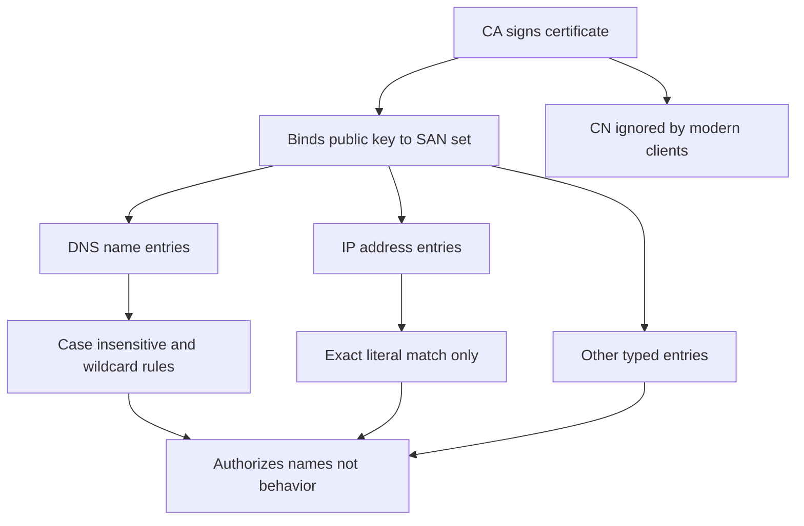

# What the Subject Alternative Name Extension Actually Binds, and What It Leaves Open

## English

A common mental model is that a certificate 'belongs to' a server or a company. The certificate says no such thing. What the CA signs is a binding between a public key and a set of names, expressed in the Subject Alternative Name (SAN) extension. The subject's Common Name field, historically the place people looked for the domain, is now largely decorative for hostname matching — modern clients such as browsers and most TLS libraries match against SAN entries and ignore CN entirely. If you put your domain only in CN and leave SAN empty, modern clients will reject the certificate even though older tooling accepted it.

A SAN entry is a typed name, not just a string. It can be a DNS name (`www.example.com`), an IP address (`203.0.113.10`), an email address, a URI, or a directory name. Each type has its own matching rules. DNS names are matched case-insensitively and, importantly, wildcard matching is defined with specific constraints: a wildcard like `*.example.com` matches `a.example.com` but not `a.b.example.com`, and it does not match the bare `example.com`. IP SANs must match the literal address the client connected to — there is no wildcard for IP addresses, and a DNS name that happens to resolve to the same IP is not a substitute.

What the SAN does not say is anything about behaviour. A certificate covering `www.example.com` does not promise that the server is honest, that it runs a particular application, or that the same organisation controls every name in the SAN. It is a statement of the form 'this key is authorised to speak for these names', nothing more. That is why a certificate with fifty SAN entries is not inherently stronger than one with a single entry: it is simply wider. The breadth is a liability as well as a convenience, because anyone who obtains that key can impersonate all fifty names.

The CA's job at signing time is to decide which names it is willing to vouch for and how much evidence it requires. For DNS names, that usually means a domain-control challenge — proving you can publish a token at a particular DNS record or HTTP path. For IP addresses, the challenge is analogous but the evidence is thinner. For internal names or names in a private namespace, a public CA generally will not sign at all, which is why internal PKI exists. The signed SAN is therefore a record of what the CA was willing to assert, not an objective fact about the world.

When debugging, read the SAN list as the authoritative answer to 'what is this certificate allowed to be used for by name'. `openssl x509 -in cert.pem -noout -ext subjectAltName` prints it directly. If a client rejects a certificate for a hostname you believe is covered, the usual suspects are: the name is only in CN, the wildcard depth is wrong, the client connected to an IP but only a DNS SAN exists, or the name has a trailing dot or IDN encoding difference that the client treats as a different string. Each of these is a mismatch between the literal bytes the client compared and the literal bytes in the SAN.

## 中文

一個常見的心智模型是：憑證「屬於」某臺伺服器或某間公司。憑證其實沒有這樣說。CA 所簽署的，是公鑰與一組名稱之間的繫結，並以主體別名（Subject Alternative Name，SAN）擴充套件來表達。主體的 Common Name 欄位——歷史上大家尋找網域的地方——如今在主機名比對上大致只是裝飾；現代客戶端（例如瀏覽器和多數 TLS 函式庫）是拿 SAN 專案來比對，完全忽略 CN。如果你只把網域放進 CN 而讓 SAN 留空，現代客戶端會拒絕這張憑證，即使較舊的工具曾經接受。

一個 SAN 專案是帶型別的名稱，不只是字串。它可以是 DNS 名稱（`www.example.com`）、IP 位址（`203.0.113.10`）、電郵地址、URI，或目錄名稱。每種型別有各自的比對規則。DNS 名稱以不分大小寫方式比對，而且重要的是，萬用字元比對有明確的限制：像 `*.example.com` 這樣的萬用字元可匹配 `a.example.com`，但不匹配 `a.b.example.com`，也不匹配裸的 `example.com`。IP SAN 必須符合客戶端實際連線的位址——IP 位址沒有萬用字元，而一個剛好解析到同一 IP 的 DNS 名稱也不能代替。

SAN 沒有說的是任何關於行為的事。一張涵蓋 `www.example.com` 的憑證，並不承諾伺服器誠實、不承諾它跑特定應用程式、也不承諾同一組織掌控 SAN 裡的每一個名稱。它只是一句「這把公鑰有權代表這些名稱發言」的陳述，僅此而已。這就是為什麼一張有五十個 SAN 專案的憑證，本質上並不比只有一個專案的更強：它只是更寬。這種寬度既是便利也是負擔，因為任何取得那把金鑰的人，都能冒充全部五十個名稱。

CA 在簽署時的職責，是決定它願意為哪些名稱背書，以及需要多少證據。對 DNS 名稱而言，這通常意味著網域控制權挑戰——證明你能在某個 DNS 記錄或 HTTP 路徑上發布一個權杖。對 IP 位址而言，挑戰類似，但證據較薄。對內部名稱或私有名稱空間中的名稱，公開 CA 通常根本不會簽，這正是內部 PKI 存在的原因。因此，被簽署的 SAN 是一份「CA 願意主張什麼」的記錄，而不是關於世界的客觀事實。

除錯時，請把 SAN 清單當作「這張憑證按名稱來說被允許用於什麼」的權威答案。`openssl x509 -in cert.pem -noout -ext subjectAltName` 會直接印出它。如果客戶端以一個你相信已被涵蓋的主機名拒絕憑證，常見的嫌疑是：名稱只放在 CN、萬用字元深度不對、客戶端連的是 IP 但只有 DNS SAN、或名稱有尾點或 IDN 編碼差異，而客戶端把它們當成不同字串。這些全都是客戶端所比對的字面位元組與 SAN 中的字面位元組之間的不一致。

## Key Takeaway

A certificate binds a key to a typed list of names in the SAN, and hostname matching is a literal comparison against that list — nothing about the server's behaviour is signed.

## Related Concepts
- Hostname verification
- Wildcard certificates

## Diagram

