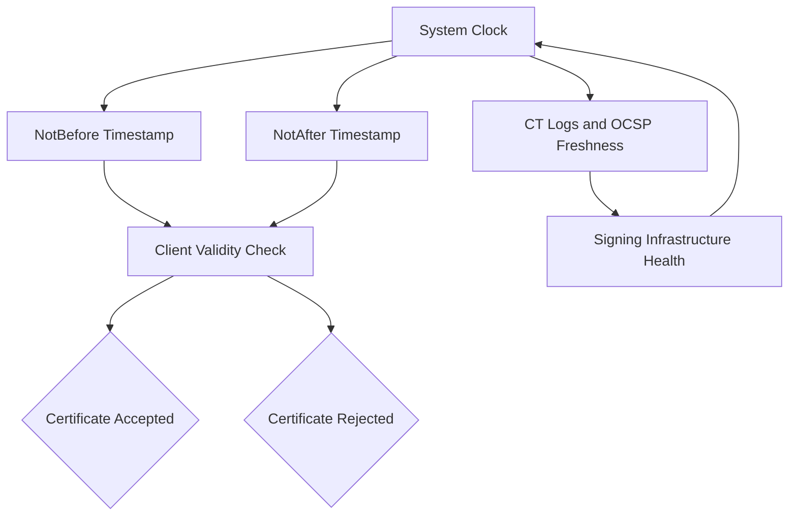

# Clock Discipline as Part of Signing: Why NTP Is a Certificate Infrastructure Dependency

## English

Certificate validity is expressed as two timestamps, NotBefore and NotAfter, and every conforming client compares the current time against that window. This makes the system's clock a security-relevant input. If a server's clock is wrong by a few hours, a freshly issued certificate may appear 'not yet valid' to clients; if it is wrong in the other direction, an expired certificate may appear valid. There is no cryptographic fix for this — the signature is correct, the chain is correct, and the client still rejects the certificate because the wall clock says so. Time is the one external input that signing cannot control.

Signing infrastructure itself depends on accurate time in several places. Certificate Transparency logs use timestamps to order submissions, CAs record issuance times in audit trails, and OCSP responses carry thisUpdate and nextUpdate fields that clients use to decide whether a response is fresh enough. If a CA's signing service has drifted, it can emit certificates with NotBefore dates slightly in the future, which will fail on clients whose clocks are also slightly behind. The practical fix is not a code change but a monitoring one: watch clock offset as a first-class health signal for any host that issues, serves, or verifies certificates.

Different clients tolerate different amounts of skew. Browsers and operating systems often permit a small grace period — minutes, not hours — to accommodate minor drift, but they do not advertise the exact threshold and it can change between versions. Servers behind load balancers or in containers can drift independently, so a fleet where one node is five minutes off can produce intermittent failures that are maddening to diagnose: most requests succeed, a few fail, and the error looks like a certificate problem but is really a time problem. Checking `chronyc tracking` or `timedatectl` on the failing node usually settles it in seconds.

The safest design is to make time a monitored dependency rather than an implicit assumption. Run a time daemon that is configured to fail loudly if it cannot reach its sources, alert on offset exceeding a small threshold, and include the current time in any certificate-related log line so that a future investigator can see whether a failure coincided with a clock event. For systems that must operate without reliable time — embedded devices, for example — consider certificates with long validity and explicit handling of the 'time unknown' case, rather than pretending the clock is trustworthy.

A useful mental model: a certificate is a signed statement that includes a validity window, and the client's clock is the judge of whether that window is currently open. The signature is timeless, but the decision to accept is not. When you are debugging an 'expired' or 'not yet valid' error, before you touch anything cryptographic, check the clock on both ends — the server that presents the certificate and the client that evaluates it. More often than people expect, the certificate is fine and the clock is the thing that is broken.

## 中文

憑證的有效性以兩個時間戳表達：NotBefore 與 NotAfter，而每一個符合規範的客戶端都會拿目前時間與這個區間比較。這使得系統時鐘成為一個與安全相關的輸入。如果伺服器的時鐘偏差了幾小時，剛簽發的憑證在客戶端眼中可能顯示「尚未生效」；若偏差方向相反，已過期的憑證則可能看起來仍然有效。這沒有密碼學上的解法——簽章正確、鏈正確，客戶端仍會因為牆上時鐘這麼說而拒絕憑證。時間是簽署無法控制的唯一外部輸入。

簽署基礎設施本身在好幾個地方依賴準確時間。憑證透明度（Certificate Transparency）日誌用時間戳來排序提交；CA 在稽核軌跡中記錄簽發時間；OCSP 回應帶有 thisUpdate 與 nextUpdate 欄位，客戶端用它們判斷回應是否夠新。如果 CA 的簽署服務發生漂移，它可能發出 NotBefore 日期略在未來的憑證，而這會在時鐘也略慢的客戶端上失敗。實務上的解法不是改程式碼，而是改監控：把時鐘偏移當作任何簽發、提供、或驗證憑證之主機的一級健康指標來觀察。

不同客戶端容忍的偏移量不同。瀏覽器和作業系統通常允許一小段寬限期——是幾分鐘，不是幾小時——以容納輕微漂移，但它們不會公布確切門檻，而且版本之間可能改變。位於負載平衡器後方或容器中的伺服器可能各自獨立漂移，因此一個叢集中只要有一個節點差了五分鐘，就可能產生令人抓狂的間歇性失敗：大多數請求成功，少數失敗，而錯誤看起來像憑證問題，實際上卻是時間問題。在出問題的節點上檢查 `chronyc tracking` 或 `timedatectl`，通常幾秒鐘就能定案。

最安全的設計，是把時間當成受監控的依賴，而不是隱含的假設。執行一個時間守護程式，設定成在無法連上來源時大聲報錯；當偏移超過小門檻時發出告警；並在任何與憑證相關的日誌行中包含目前時間，好讓未來的調查者能看出失敗是否與時鐘事件同時發生。對於必須在不可靠時間下運作的系統——例如嵌入式裝置——應考慮採用長有效期的憑證，並明確處理「時間未知」的情況，而不是假裝時鐘值得信賴。

一個有用的心智模型是：憑證是一份附帶有效區間的簽署聲明，而客戶端的時鐘是判斷該區間此刻是否敞開的裁判。簽章本身沒有時間性，但接受的決定有。當你在除錯「已過期」或「尚未生效」的錯誤時，在碰任何密碼學的東西之前，先檢查兩端的時鐘——呈現憑證的伺服器，以及評估憑證的客戶端。比人們預期的更常發生的情況是：憑證沒問題，壞掉的是時鐘。

## Key Takeaway

Validity windows make the wall clock part of certificate verification, so accurate, monitored time is a genuine dependency of any PKI, not an afterthought.

## Related Concepts
- Validity windows
- OCSP freshness

## Diagram

