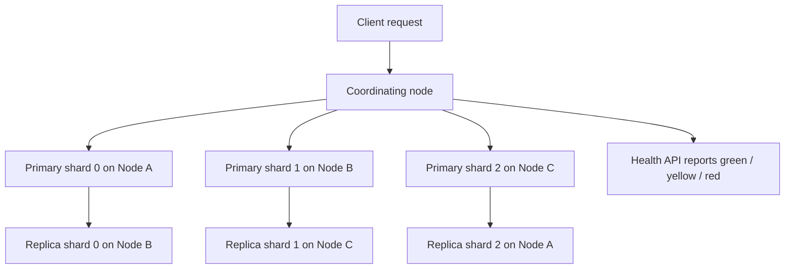

# Shards, Replicas and Cluster Health in Elasticsearch

### English

Elasticsearch stores data in **indices**, but it never keeps an index on a single machine. Each index is split into **shards** — independent chunks of data that each live on one node (a server in the cluster). If you create an index with 3 primary shards, the data is divided three ways, so three nodes can hold and serve parts of it in parallel. Think of a library that splits a catalogue into three separate card indexes so three librarians can look things up at the same time.

A **replica** is a full copy of a primary shard. If you configure 1 replica, every primary shard gets a backup copy placed on a *different* node, so if a server dies, the data survives and the cluster promotes the replica to primary with no data loss. Replication also doubles the read capacity, because searches can be spread across primary and replica copies.

Because everything is distributed, the cluster constantly reports its own condition through an API that returns colours. **Green** means every primary shard and every replica is assigned and active. **Yellow** means all primaries are fine but at least one replica is unassigned — common with a single-node cluster, since a replica cannot be placed on the node that already holds its primary. **Red** means at least one primary shard is missing, so part of your data is unavailable.

Node allocation is governed by **shard allocation awareness**: shards can be told to avoid sharing a rack or a host, and the cluster will refuse to reallocate a replica next to its primary.

### 中文

Elasticsearch 將資料放在 **index** 入面，但永遠唔會將整個 index 放喺單一機器。每個 index 會拆成多個 **shard**（分片）—— 係互相獨立嘅資料塊，每個分片存在 cluster 入面其中一個 node（節點）上面。如果你建立一個有 3 個 primary shard 嘅 index，資料就會分成三份，畀三個 node 同時儲存同查詢。可以想像圖書館將書目目錄拆成三本獨立的卡片索引，等三位館員可以同時幫人搵書。

**Replica**（副本）係 primary shard 嘅完整複製本。如果你設定 1 個 replica，每個 primary shard 都會有一份備份放喺**另一個** node 度，所以當有機器死機，資料唔會遺失，cluster 會即時提升副本做 primary。就算冇死機，副本都可以將讀取流量分擔，令搜尋速度更快。

正因為所有嘢都係分散式，cluster 會不停自我監察狀態，並且用顏色報告畀你知：**Green** 代表所有 primary shard 同 replica 都已分配而且運作正常；**Yellow** 代表 primary 全部正常，但至少有一個 replica 未分配到（單節點 cluster 好常見，因為副本唔可以同 primary 放喺同一個 node）；**Red** 代表有 primary shard 遺失，部分資料暫時無法讀取。

Shard 分配仲受 **shard allocation awareness** 控制：你可以要求 shard 唔好放喺同一個機架或同一部主機上面，cluster 會拒絕將副本分配到 primary 隔籬。

## Key Takeaway
Elasticsearch splits every index into shards for parallelism and duplicates them as replicas for durability, so cluster health colours tell you at a glance whether any shard of your data is missing or unprotected.

## Related Concepts
- Shard allocation awareness
- Cluster state and routing table
- Document-level operations (index, update, delete)
- Resharding and split APIs

## Diagram

