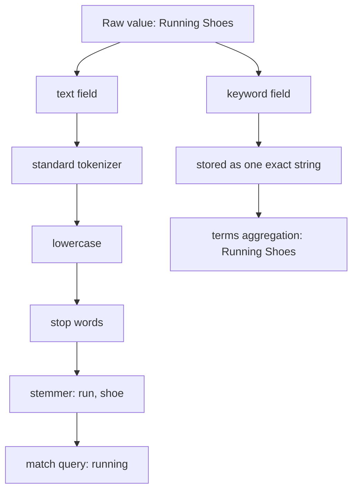

# Mappings, `text` vs `keyword`, and Custom Analyzers

### English

Every index has a **mapping**, which is the schema Elasticsearch uses to interpret each field. The mapping decides the field's data type and, for text fields, how the field is analysed. If you index a document without a mapping, Elasticsearch tries to guess from the first document it sees — and that guess can be wrong forever, since the field's type cannot simply be changed afterwards.

The most important decision is choosing between `text` and `keyword`. A `keyword` field is stored as one whole string, unanalysed: exactly as written, including case and punctuation. It is meant for exact matches, sorting, and aggregations. A `text` field is broken down by an **analyser** into searchable tokens. The default analyser splits on word boundaries and lowercases, so "Running Shoes" becomes the tokens `running` and `shoes`, which is why a `match` query for "running" finds a document containing "Running Shoes".

The classic mistake is putting everything in `text` and then trying to aggregate on it. A `terms` aggregation on an analysed field counts every token separately, so you get "running: 5, shoes: 12" instead of "Running Shoes: 5". The fix is the **multi-field** pattern: map the same raw value twice — once as `text` for full-text search, once as `keyword` for exact filtering and aggregation — and use the `.keyword` sub-field.

A **custom analyser** lets you control the tokenisation pipeline. You compose it from a tokenizer (e.g. `standard`, `whitespace`, or `ngram`), optional character filters that rewrite the text first (e.g. `lowercase`, `ascii_folding` to strip accents), and optional token filters applied afterwards (e.g. `stop`, `stemmer`, `synonym`). A common English setup is `standard` tokenizer + `lowercase` + `stop` + `snowball` stemming, so "running", "runs", and "ran" all collapse to the stem `run` and share one document in the index. A `synonym` token filter lets you treat "phone" and "mobile" as equivalent.

### 中文

每個 index 都有 **mapping**（映射），就係 Elasticsearch 用嚟理解每個欄位嘅結構。Mapping 會決定欄位嘅資料類型，同埋文字欄位應該點樣被「分析」。如果你唔寫 mapping 就直接寫入 document，Elasticsearch 會根據第一份 document 猜測欄位類型 —— 而呢個猜測可能永遠錯落去，因為欄位類型之後唔可以隨意更改。

最關鍵嘅決定係 `text` 同 `keyword` 之間點揀。`keyword` 欄位會原封不動儲存成一個完整字串，唔會被分析：大小寫同標點全部保留，適合做精確比對、排序同 aggregation。`text` 欄位則會被 **analyzer**（分析器）拆成一個個 token。預設分析器會按字詞邊界切開並轉為小寫，所以 "Running Shoes" 會變成 `running` 同 `shoes` 兩個 token —— 呢個就係點解 `match` 查詢 "running" 搵到含有 "Running Shoes" 嘅 document。

最經典嘅錯誤係乜嘢都放入 `text`，然後想喺上面做 aggregation。喺一個已被分析嘅欄位行 `terms` aggregation，係會逐個 token 分開計數，你會見到「running: 5、shoes: 12」而唔係「Running Shoes: 5」。修正方法係 **multi-field** 模式：同一份原始值映射兩次 —— 一次做 `text` 供全文搜尋，一次做 `keyword` 供精確過濾同 aggregation，然後用 `.keyword` 子欄位。

**Custom analyzer**（自訂分析器）就係話你可以自己控制整條 tokenisation 流程：由 tokenizer（例如 `standard`、`whitespace`、`ngram`）、可選嘅 character filter（先改寫文字，例如 `lowercase`、`ascii_folding` 去走重音符號），同埋可選嘅 token filter（之後再處理，例如 `stop`、`stemmer`、`synonym`）組成。一個常見嘅英文設定係 `standard` tokenizer + `lowercase` + `stop` + `snowball` stemming，令 "running"、"runs"、"ran" 全部收斂成 `run` 呢個字根，喺 index 入面共用同一份計錄；而 `synonym` token filter 就更可以令 "phone" 同 "mobile" 當成同一件事。

## Key Takeaway
`text` fields exist to be analysed and searched, `keyword` fields exist to be matched exactly and aggregated, and mapping both from the same raw value with a multi-field is the safe default.

## Related Concepts
- Inverted index and postings list
- Doc values
- Stemming and token filters
- Index templates and dynamic mapping

## Diagram

