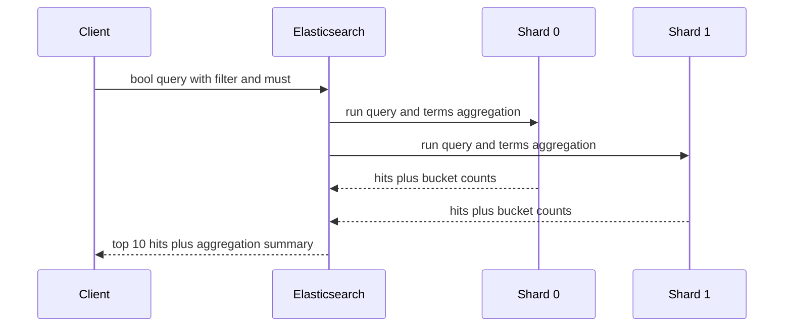

# Query DSL and Aggregations: Searching and Summarising Data

### English

Elasticsearch queries are sent as JSON documents describing what you want, using the **Query DSL** (Domain Specific Language). The body always lives under a `query` key, and the shape of the JSON tells Elasticsearch which query type to run.

Two query types cover most real needs. **Leaf queries** inspect a single field: `match` searches an analysed text field (it analyses your search phrase the same way the field was analysed, so it matches loosely), `term` searches a `keyword` field for the exact stored value (it does *not* analyse), `range` covers numeric or date bounds, and `exists` finds documents where a field is present. **Compound queries** combine leaf queries using `bool`, which has four sub-clauses: `must` (must match, contributes to the score), `should` (matches if possible, also contributes to the score), `filter` (must match, but does not affect the score) and `must_not` (must not match). Keeping filters in `filter` rather than `must` matters for performance because Elasticsearch can cache filter results and skip scoring — the classic example is a `bool` with a `filter` for `status: published` plus a `must` for the user's search terms.

**Aggregations** answer "what patterns are in this data" instead of "give me matching documents". A `terms` aggregation buckets documents by a field and returns counts per bucket, which is how you build a faceted sidebar. A `date_histogram` aggregation buckets by time interval, which powers trend charts. A `histogram` aggregation buckets by numeric ranges. Each aggregation can contain **sub-aggregations**, so you can compute an average price per category, or per month per category.

A useful distinction is the **metrics versus buckets** split: metrics such as `avg`, `sum`, `min`, `max`, and `cardinality` compute one number per bucket, while buckets divide the documents into groups. You can also combine them with a `filter` aggregation to compute a metric over a subset — for example, the average order value for customers who have bought more than three times.

Finally, `size` controls how many *hits* come back while aggregations always aggregate over the entire matching set, no matter how many documents you are shown. This is why you can see "10 results" but a histogram covering millions of documents.

### 中文

Elasticsearch 嘅查詢係用 JSON 文件表達你想要咩，語言叫 **Query DSL**（Domain Specific Language）。request body 永遠放喺 `query` key 底下，而 JSON 嘅結構本身就話畀 Elasticsearch 應該行邊一種 query。

兩大類 query 覆蓋咗大部分實際需要。**Leaf query**（葉節點查詢）只檢查單一欄位：`match` 查一個已經被分析嘅 `text` 欄位（佢會用同欄位一樣嘅分析方法處理你嘅搜尋字詞，所以匹配比較鬆散）；`term` 查 `keyword` 欄位嘅完全一樣值（佢**唔會**做分析）；`range` 處理數值或日期範圍；`exists` 搵出某欄位存在嘅 document。**Compound query**（複合查詢）用 `bool` 組合葉節點查詢，佢有四個子句：`must`（一定要匹配，同時影響評分）、`should`（最好匹配，一樣影響評分）、`filter`（一定要匹配，但**唔影響**評分）、`must_not`（一定唔可以匹配）。將條件放喺 `filter` 而唔係 `must` 好重要，因為 Elasticsearch 可以快取 filter 結果並跳過評分 —— 典型例子就係一個 `bool`，入面 `filter` 咗 `status: published`，`must` 咗用戶嘅搜尋字詞。

**Aggregation**（聚合）答嘅唔係「畀我啲符合條件嘅 document」，而係「呢批資料有咩規律」。`terms` aggregation 會按欄位將 document 分桶並回傳每個桶嘅數量，正係你砌出分面側邊欄嘅方法。`date_histogram` aggregation 按時間間隔分桶，用嚟畫趨勢圖；`histogram` aggregation 就按數值範圍分桶。每個 aggregation 內部仲可以再包含 **sub-aggregation**，例如計每個分類嘅平均價，甚至每月每個分類嘅平均價。

另一個好用嘅分別係 **metrics 同 buckets** 嘅分工：metrics（例如 `avg`、`sum`、`min`、`max`、`cardinality`）每個桶計一個數字，而 buckets 負責將 document 分組。你亦可以用 `filter` aggregation 喺子集上計 metric —— 例如計出買過多過三次嘅客戶嘅平均訂單金額。

最後，`size` 控制回傳幾多 **hits**，但 aggregation 永遠係對**全部**符合條件嘅 document 計算，唔受 `size` 影響。所以你會見到「10 筆結果」，但下面嘅 histogram 覆蓋咗幾百萬筆 document。

## Key Takeaway
The Query DSL separates cheap, cacheable filtering from scoring full-text matching, while aggregations summarise the whole matching result set so you can present trends and facets rather than raw documents.

## Related Concepts
- Inverted index and scoring (BM25)
- Composite aggregations and pagination
- Search profiles and relevance tuning
- Point-in-time (PIT) search

## Diagram

