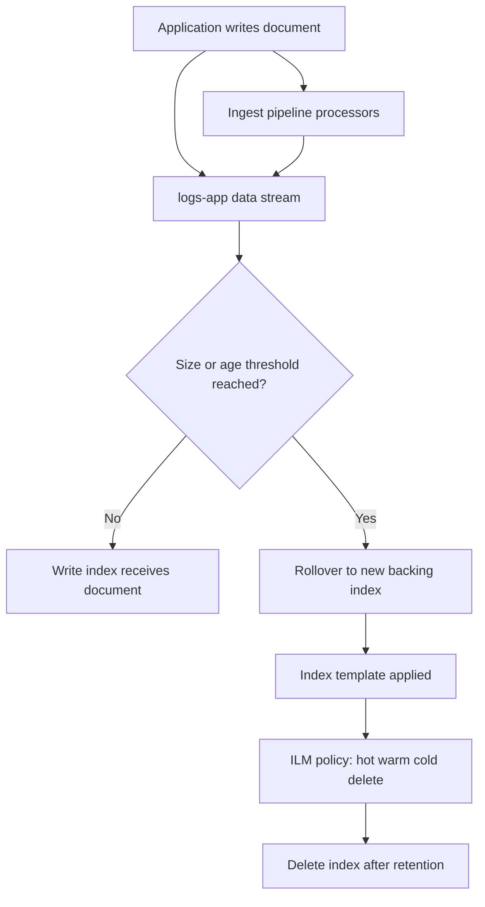

# Data Streams, ILM and Ingest Pipelines: Managing Time-Based Data

### English

A regular index is a **box** of documents. You write into it, you delete from it, and over time you get deletions, merges and fragmented segment counts that degrade performance. When your data is *append-only and time-ordered* — application logs, click events, metrics, audit trails — Elasticsearch offers a better abstraction: the **data stream**.

A data stream is a logical name that sits on top of one or more **backing indices**, which are hidden from you and created automatically. You index into the stream name (`POST logs-app/_doc`), and Elasticsearch routes the write to the current *write index*. When that index crosses a threshold, the stream **rolls over** to a fresh backing index. To the application, nothing changes: the stream name is still the same. This is a huge operational win because rollover no longer requires downtime, alias swaps, or applications that know about index naming conventions.

Data streams have one hard requirement: every document must contain a `@timestamp` field mapped as `date` or `date_nanos`. That timestamp is what makes the stream "time series" and what lets Elasticsearch route and later query by time. The mapping and settings for new backing indices come from a matching **index template** with `data_stream` enabled — the template is what defines the fields, the shards, and the lifecycle policy for every index the stream will ever create.

Because backing indices accumulate, you need something to retire the old ones. That is **ILM** (Index Lifecycle Management). An ILM policy is a sequence of phases — `hot`, `warm`, `cold`, `frozen`, `delete` — and each phase can hold actions. A common policy: in `hot`, roll over at 30 GB or 7 days; in `warm`, shrink the index and force-merge it to 1 segment (fewer, larger segments means faster searching and less RAM); in `delete`, remove the index after 90 days. From 8.14 onwards, Elasticsearch also ships a simpler **data stream lifecycle** that is configured directly on the stream and handles rollover, force-merge, retention and downsampling with sensible defaults — you describe *business* retention ("keep 30 days") instead of Elasticsearch-internal phases. If both ILM and data stream lifecycle apply to the same backing index, ILM wins by default, but you can flip that with the index setting `index.lifecycle.prefer_ilm: false`.

The last piece is the **ingest pipeline**, a chain of processors that transforms and enriches a document *before* it is indexed. It is the right place to normalise data: add a field, rename one, drop a sensitive one, convert a string to a number, look up an enrichment table, or geocode an address. Writing to a stream can point at a pipeline by default:

```json
PUT _index_template/logs-template
{
  "index_patterns": ["logs-app*"],
  "data_stream": {},
  "template": {
    "settings": { "index.lifecycle.name": "logs-policy" },
    "mappings": {
      "properties": {
        "@timestamp": { "type": "date" },
        "message":   { "type": "text" },
        "service":   { "type": "keyword" }
      }
    }
  }
}
```

A pipeline that stamps a receipt time and hides an internal field looks like this:

```json
PUT _ingest/pipeline/logs-pipeline
{
  "processors": [
    { "set": { "field": "ingest_time", "value": "{{{_ingest.timestamp}}}" } },
    { "remove": { "field": "internal_session_id" } }
  ]
}
```

Why does this matter? Because the ingest pipeline is the one place where you can guarantee a rule holds for *every* document, no matter which client or service wrote it. A rule implemented in application code will eventually be skipped by a new producer; a rule in the pipeline cannot be.

### 中文

普通 index 係一個「盒」，你塞嘢入去、拎嘢出嚟，日子耐咗就會出現一堆 deleted document、merge 同埋 fragment 咗嘅 segment，搜尋效能逐步跌落去。但如果你的資料係**只增不改、又帶時間順序** —— 例如應用程式 log、click event、metric、audit trail —— Elasticsearch 提供咗一個更好嘅抽象層：**data stream**。

Data stream 係一個虛擬名稱，架喺一個或者多個** backing index**（隱藏嘅實際 index）之上。你只係寫入 stream 名（例如 `POST logs-app/_doc`），Elasticsearch 就會自動將寫入導去目前嘅 *write index*。當呢個 index 大細或者時間去到門檻，stream 就會 **roll over**，開一個全新嘅 backing index。對應用程式嚟講乜都冇變，個名一樣。呢個運維上嘅好處好大 —— rollover 唔使停機、唔使換 alias、應用程式亦完全唔使知道 index 命名規則。

Data stream 有一個硬性要求：每一份 document 都必須帶 `@timestamp` 欄位，而且要 map 做 `date` 或者 `date_nanos`。呢個 timestamp 就係令佢成為「time series」嘅關鍵，亦係之後可以按時間做 routing 同查詢嘅依據。新 backing index 嘅 mapping 同 settings 由一份開咗 `data_stream` 嘅 **index template** 決定 —— template 定義咗欄位、shard 數量同 lifecycle policy，日後 stream 開出嚟嘅每個 index 都會套用同一份設定。

因為 backing index 會不斷累積，所以需要有人幫你「退場」，呢個就係 **ILM**（Index Lifecycle Management）。一條 ILM policy 係由幾個 phase 串埋一齊 —— `hot`、`warm`、`cold`、`frozen`、`delete` —— 每個 phase 可以擺唔同 action。一條常見嘅 policy 係咁：喺 `hot` phase，30 GB 或者 7 日就 roll over；喺 `warm` phase 做 shrink 再 force-merge 成 1 個 segment（segment 又大又少，搜尋快啲、佔用 RAM 少啲）；喺 `delete` phase 過咗 90 日就刪走。由 8.14 開始，Elasticsearch 仲有個更簡單嘅 **data stream lifecycle**，直接掛喺 stream 上面，內置 rollover、force-merge、retention 同 downsampling 嘅預設值 —— 你只需要描述「業務上要保留 30 日」，而唔使再諗 Elasticsearch 內部嗰啲 phase。如果同一個 backing index 同時受 ILM 同 data stream lifecycle 管，預設係 ILM 贏，但你可以用 index setting `index.lifecycle.prefer_ilm: false` 改返。

最後一塊係 **ingest pipeline**，即係一條 processor 鏈，喺 document 真正寫入 index **之前** 幫你轉換同豐富資料。適合做嘅嘢包括：補一個欄位、改名、刪走敏感欄位、字串轉數字、查 enrichment table、甚至將地址做 geo coding。寫入 stream 嘅時候可以預設指定一條 pipeline：

```json
PUT _index_template/logs-template
{
  "index_patterns": ["logs-app*"],
  "data_stream": {},
  "template": {
    "settings": { "index.lifecycle.name": "logs-policy" },
    "mappings": {
      "properties": {
        "@timestamp": { "type": "date" },
        "message":   { "type": "text" },
        "service":   { "type": "keyword" }
      }
    }
  }
}
```

一條幫你蓋上收取時間、又隱藏內部欄位嘅 pipeline 係咁寫：

```json
PUT _ingest/pipeline/logs-pipeline
{
  "processors": [
    { "set": { "field": "ingest_time", "value": "{{{_ingest.timestamp}}}" } },
    { "remove": { "field": "internal_session_id" } }
  ]
}
```

點解咁重要？因為 ingest pipeline 係唯一一個位置，可以保證某條規則對**每一份** document 都成立，無論係邊個 client 或者邊個服務寫入嘅。規則如果只寫喺應用程式入面，遲早會有新嘅 data producer 唔跟；放喺 pipeline 就冇呢個問題。

## Key Takeaway
Data streams plus lifecycle policies and ingest pipelines turn time-series indexing into a self-managing system where rollover, retention and data cleanup are declarative rules rather than cron jobs and index-name conventions.

## Related Concepts
- Index Lifecycle Management (ILM) phases and actions
- Ingest processors and enrich pipelines
- Index templates and composable templates
- Bulk indexing and back-pressure

## Diagram

