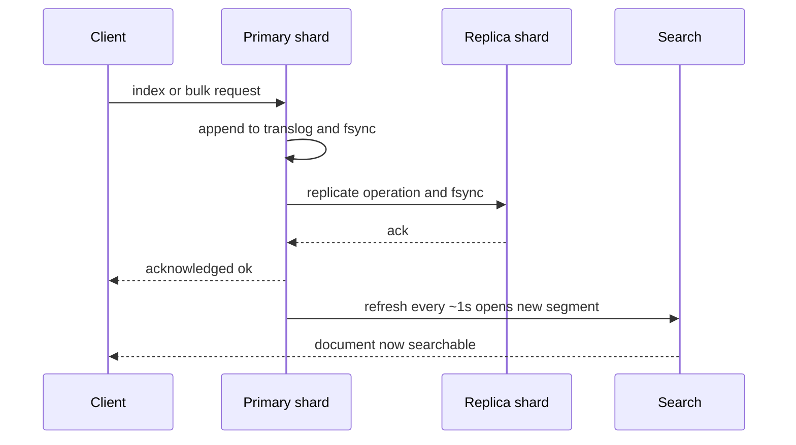

# The Write Path: Refresh, Translog, Bulk and Snapshots

### English

Understanding Elasticsearch's write path explains a lot of confusing behaviour: why a document you just indexed is not searchable yet, why a bulk request of 10,000 rows takes seconds but 10,000 separate requests take hours, and what "durability" actually costs you.

The first concept is **near-real-time search**. When you index a document, Elasticsearch does not push it into the searchable index immediately. It appends the operation to a **transaction log** (the *translog*) and marks the shard as needing a refresh. A **refresh** is the action of opening the current Lucene segment(s), making them visible to search, and starting a new one. By default a refresh happens about every second (`index.refresh_interval`), which is why a search issued immediately after an index call may miss the document. If you need read-your-write consistency in a test, use `?refresh=wait_for` (wait until the next refresh) or `?refresh=true` (force a refresh immediately, at a cost). In production you normally leave the default alone — turning it down increases the risk of data loss, turning it up wastes I/O.

The second concept is the **translog**, which is what makes an acknowledged write durable. Every index, update, delete and bulk request is written to the translog on the primary *and* on every allocated replica before the client is told "ok". The per-index setting `index.translog.durability` controls this: the default `request` means fsync and commit the translog for every request, so an acknowledged write survives a hardware failure; `async` only fsyncs every `index.translog.sync_interval` (5 seconds by default) and is much faster but can lose the last few seconds of acknowledged writes. The translog also holds operations that are not yet part of a Lucene commit point; when a shard is recovered after a crash, Elasticsearch replays it. `index.translog.flush_threshold_size` (10 GB by default) triggers a flush so recovery does not take forever.

The third concept is the **bulk API**, and it is the single biggest performance lever in Elasticsearch. Instead of one HTTP round trip per document, you send many operations in one request, each on its own line terminated by a newline:

```bash
curl -X POST "localhost:9200/_bulk" -H 'Content-Type: application/x-ndjson' -d '
{"index":{"_index":"products"}}
{"sku":"A-1","name":"Desk lamp","price":29.9}
{"index":{"_index":"products"}}
{"sku":"A-2","name":"Office chair","price":149.0}
'
```

The response contains a per-item status, so you must check `errors: true` and inspect each item — a bulk request can partially succeed. A good rule of thumb is to keep batches in the range of 1,000–10,000 documents or a few megabytes per request, and to check the `429 Too Many Requests` status: that is Elasticsearch applying **back-pressure**, and the correct response is to slow down and retry, not to hammer harder.

The fourth concept is **snapshots**, which are incremental, cluster-consistent backups stored in a **snapshot repository** (a shared filesystem, an S3-compatible bucket, or an object store plugin). A snapshot records the state of every shard at a point in time; subsequent snapshots only store what changed, which is why they are cheap. Restoring a snapshot recreates the indices, and it is the mechanism used for disaster recovery, for cloning production data into a staging environment, and for cross-cluster replication. Snapshot and restore is *not* a backup of the translog — it is a backup of committed Lucene segments — so you should still understand your durability settings if you need zero-data-loss recovery.

### 中文

理解 Elasticsearch 嘅寫入路徑，可以解釋好多令人困惑嘅行為：點解你啱啱寫入咗份 document 立即去搜就搜唔到、點解一條一萬行嘅 bulk request 只需幾秒但一萬條獨立 request 要花幾個鐘、同埋「durability」實際上要你付出幾多代價。

第一個概念係 **near-real-time search**（近即時搜尋）。當你 index 一份 document，Elasticsearch 唔會即刻將佢推入可搜尋嘅 index。佢會先將呢個 operation 附加落 **transaction log**（即係 *translog*），並標記該 shard 需要 refresh。**Refresh** 嘅動作係：將目前嘅 Lucene segment 開啟、令佢哋對搜尋可見、再開一個新嘅。而家預設大約每一秒做一次 refresh（`index.refresh_interval`），所以寫入完即刻發出嘅搜尋有可能搵唔到嗰份 document。如果測試時需要「寫完即刻讀到」嘅一致性，可以用 `?refresh=wait_for`（等下一次 refresh）或者 `?refresh=true`（即刻強制 refresh，但有代價）。生產環境通常唔好郁預設值 —— 調細咗會增加資料遺失風險，調大咗就浪費 I/O。

第二個概念係 **translog**，佢就係令「已確認寫入」真正耐得住嘅嘢。每一次 index、update、delete 同 bulk request，都會先寫入 primary 同每一個已分配 replica 嘅 translog，之後先回覆 client 話「搞掂」。per-index 設定 `index.translog.durability` 控制呢件事：預設 `request` 意思係每個 request 都 fsync 同 commit translog，所以已確認嘅寫入就算硬件故障都仲喺度；`async` 就只係每 `index.translog.sync_interval`（預設 5 秒）先 fsync，快好多，但可能會失去最後幾秒已確認嘅寫入。translog 亦會保存未成為 Lucene commit point 嘅 operation；當 shard 崩潰後恢復，Elasticsearch 會重播佢哋。`index.translog.flush_threshold_size`（預設 10 GB）會觸發 flush，避免恢復時間拖得太耐。

第三個概念係 **bulk API**，呢個係 Elasticsearch 最多性能提升嘅單一槓桿。唔使每份 document 行一次 HTTP round trip，而係一次過用 newline 分隔咁多個 operation 送去：

```bash
curl -X POST "localhost:9200/_bulk" -H 'Content-Type: application/x-ndjson' -d '
{"index":{"_index":"products"}}
{"sku":"A-1","name":"Desk lamp","price":29.9}
{"index":{"_index":"products"}}
{"sku":"A-2","name":"Office chair","price":149.0}
'
```

回應會逐項附上狀態，所以你要檢查 `errors: true` 並逐項睇 —— bulk request 係可以部分成功嘅。一個實用經驗係：每批維持喺 1,000 至 10,000 份 document，或者幾 MB 左右一個 request；同時要留意 `429 Too Many Requests` 狀態，咁代表 Elasticsearch 正在施加 **back-pressure**（背壓），正確做法係慢落嚟重試，而唔係更加用力拍門。

第四個概念係 **snapshot**，即係增量、而且叢集一致性嘅備份，儲存在 **snapshot repository**（共享檔案系統、S3 相容 bucket，或者 object store plugin）。一次 snapshot 記錄咗某個時間點所有 shard 嘅狀態；之後嘅 snapshot 只會儲存變更咗嘅部分，所以成本好低。還原 snapshot 會重建啲 index，亦係災難復原、將生產資料複製去 staging 環境、以及跨叢集複製嘅機制。Snapshot 同 restore **唔係** translog 嘅備份 —— 佢備份嘅係已 commit 嘅 Lucene segment —— 所以如果你需要零資料遺失嘅復原，就仲要搞清楚自己嘅 durability 設定。

## Key Takeaway
Every acknowledged write goes through the translog before becoming searchable at the next refresh, which means durability, freshness and throughput are three separate dials you tune independently.

## Related Concepts
- Near-real-time search and the refresh interval
- Bulk API, back-pressure and batching strategy
- Snapshot repositories and disaster recovery
- Segment merging and force-merge

## Diagram

