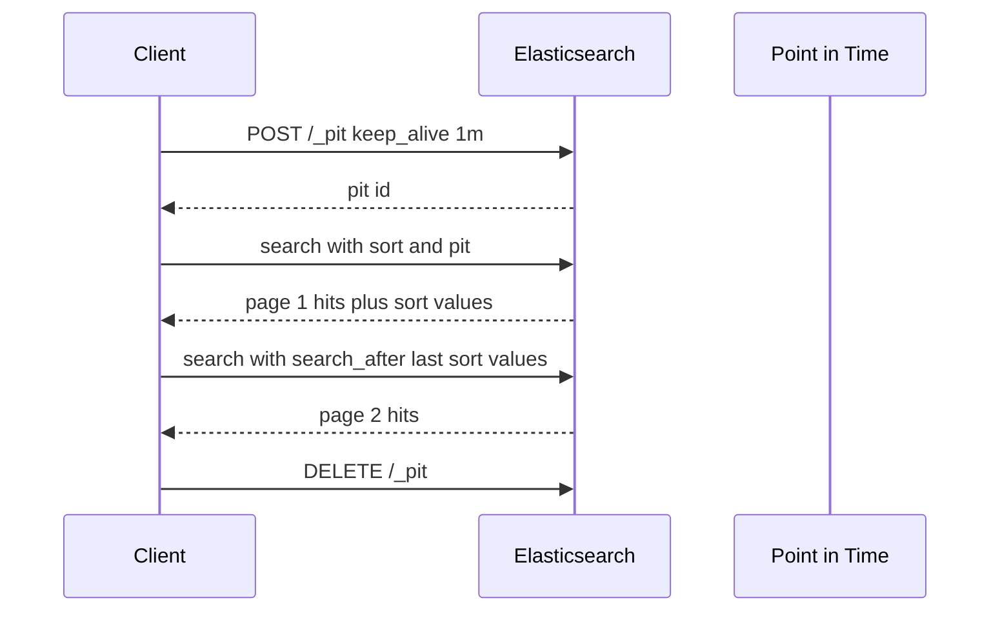

# Relevance Tuning and Deep Pagination: Fuzzy Matching, Highlighting, PIT and `search_after`

### English

Getting the right documents back is only half of search. Two practical problems show up in almost every production Elasticsearch project: users type things slightly wrong, and users want to page through more than 10,000 results. Elasticsearch has first-class answers for both.

**Fuzzy matching** tolerates small spelling mistakes. The `match` query accepts a `fuzziness` parameter expressed as an **edit distance** — the number of single-character changes (insert, delete, substitute) needed to turn one term into another. `fuzziness: 1` matches "lamp" against "lmap"; `fuzziness: 2` also matches "lmap" against "lmpa". The value `AUTO` is the common choice: it uses `1` for terms of 3–5 characters, `2` for terms longer than 5, and `0` for terms of 1–2 characters, which stops very short queries from matching everything. Two companion parameters keep the cost down: `prefix_length` (default 0) requires the first N characters to match exactly, and `max_expansions` (default 50) caps how many fuzzy variants are tried. Fuzzy matching is more expensive than an exact match because the query expands into many term lookups, so use it on user-facing search boxes, not on internal filters.

To search several fields at once, use `multi_match`, and use **boosting** to express "this field matters more":

```json
{
  "query": {
    "multi_match": {
      "query": "wireless headphones",
      "fields": ["title^3", "description^1", "brand^2"],
      "type": "best_fields",
      "fuzziness": "AUTO"
    }
  }
}
```

The `^3` suffix multiplies that field's contribution to the final BM25 score. `type` matters too: `best_fields` treats the fields as alternatives and takes the highest score (good for a title-or-description search), while `cross_fields` blends scores across fields (good when a phrase is split across columns, like "wireless" in one column and "headphones" in another). `most_fields` is in between.

**Highlighting** marks the matching fragments so your UI can show "…the *wireless headphones* bundle…". Elasticsearch offers four highlighters. `unified` is the default for `text` and `keyword` fields: it splits the text into sentences using a language-aware sentence breaker, scores each passage with BM25, and returns the best `number_of_fragments` passages with `<em>` tags around the matches. `plain` is the classic Lucene highlighter, fast for simple single-field matches. `fvh` (fast vector highlighter) requires the field to be indexed with `term_vector: with_positions_offsets`, which increases index size but makes it very fast and good for large volumes of highlighting. `semantic` is for `semantic_text` fields. Control the output with `fragment_size` (how many characters per fragment), `number_of_fragments` (how many fragments to return), and `pre_tags`/`post_tags` if the default `<em>` tags do not fit your markup.

For **pagination**, the `from`/`size` parameters are limited by `index.max_result_window`, which defaults to 10,000 — you cannot ask for page 5,000 of 100,000 hits. The reason is that `from` makes each shard materialise and discard up to `from + size` results, so the cost grows with depth. The modern solution is **`search_after`** combined with a **point in time** (PIT). Instead of an offset, you pass the sort values of the last document of the previous page, and Elasticsearch returns the next documents after those values:

```json
POST /_search
{
  "pit": { "id": "46ToAw...", "keep_alive": "1m" },
  "query": { "match": { "title": "headphones" } },
  "sort": [ { "price": "asc" }, { "_id": "asc" } ],
  "search_after": [ 29.99, "prod-1042" ]
}
```

Two details are essential. First, the `query` and `sort` must stay identical across pages. Second, you should add a unique tie-breaker field (here `_id`) to the sort, because documents with equal sort values otherwise have no defined order and you may see duplicates or gaps. A PIT pins the search to a fixed snapshot of the index state, so a refresh between page requests cannot shuffle the results underneath you; each request extends the PIT's `keep_alive`, and you should delete the PIT when you are done. Elastic no longer recommends the old **scroll API** for deep pagination, because a scroll holds server-side resources for the whole traversal.

### 中文

搜尋得啱 document 只係一半嘅工作。喺幾乎所有生產環境嘅 Elasticsearch 項目入面，會出現兩個好實際嘅問題：使用者打錯少少字，同埋使用者想翻過一萬筆之後嘅結果。Elasticsearch 對兩者都有第一級嘅答案。

**Fuzzy matching**（模糊匹配）可以容忍少量拼寫錯誤。`match` query 有一個 `fuzziness` 參數，用 **edit distance**（編輯距離）表示 —— 即係要將一個詞變成另一個詞，最少需要幾次單字元嘅改動（插入、刪除、替換）。`fuzziness: 1` 會令 "lamp" 配到 "lmap"；`fuzziness: 2` 更加連 "lmap" 都配到 "lmpa"。`AUTO` 係最常用嘅選擇：3 至 5 個字元嘅詞用 `1`，超過 5 個字用 `2`，1 至 2 個字嘅詞用 `0`，避免太短嘅查詢匹配到幾乎所有嘢。另有兩個參數幫你控制成本：`prefix_length`（預設 0）要求頭 N 個字元必須完全一致；`max_expansions`（預設 50）限制最多試幾多個模糊變體。模糊匹配比精確匹配貴，因為 query 會展開成好多次 term 查詢，所以應該用喺面向使用者嘅搜尋框，而唔係內部 filter。

要一次過搜多個欄位，就用 `multi_match`，再用 **boosting** 表達「呢個欄位重要啲」：

```json
{
  "query": {
    "multi_match": {
      "query": "wireless headphones",
      "fields": ["title^3", "description^1", "brand^2"],
      "type": "best_fields",
      "fuzziness": "AUTO"
    }
  }
}
```

`^3` 會將該欄位對最終 BM25 分數嘅貢獻乘以三。`type` 都好重要：`best_fields` 當欄位係互選關係，取最高分（適合 title 或者 description 嘅搜索）；`cross_fields` 會將多個欄位嘅分數混合埋（適合一個詞組被拆開落不同欄位，例如 "wireless" 喺一欄、"headphones" 喺另一欄）；`most_fields` 介乎兩者之間。

**Highlighting**（高亮）會標示匹配嘅片段，等你個 UI 可以顯示「…*wireless headphones* 套裝…」。Elasticsearch 有四種 highlighter。`unified` 係 `text` 同 `keyword` 欄位嘅預設：用語言感知嘅句子分割器將文字切成句子，用 BM25 為每段評分，然後回傳最好嗰啲 `number_of_fragments` 段，匹配位置用 `<em>` 包住。`plain` 係傳統 Lucene highlighter，處理簡單嘅單欄匹配好快。`fvh`（fast vector highlighter）要求欄位索引入時用 `term_vector: with_positions_offsets`，會令 index 大啲，但高亮量大時非常快。`semantic` 則係畀 `semantic_text` 欄位用。你可以透過 `fragment_size`（每段幾多字元）、`number_of_fragments`（回傳幾多段）同埋 `pre_tags`/`post_tags`（預設 `<em>` 唔啱你 markup 就改佢）嚟控制輸出。

講到**分頁**，`from`/`size` 受 `index.max_result_window` 限制，預設係 10,000 —— 你唔可以要求「十萬筆入面嘅第 5,000 頁」。原因係 `from` 令每個 shard 都要先產生再丟棄最多 `from + size` 筆結果，所以越翻越深，成本就越高。現代做法係用 **`search_after`** 配合 **point in time**（PIT）。你唔再傳 offset，而係傳上一頁最後一份 document 嘅 sort 值，Elasticsearch 就會回傳排序上喺呢啲值之後嘅下一批：

```json
POST /_search
{
  "pit": { "id": "46ToAw...", "keep_alive": "1m" },
  "query": { "match": { "title": "headphones" } },
  "sort": [ { "price": "asc" }, { "_id": "asc" } ],
  "search_after": [ 29.99, "prod-1042" ]
}
```

有兩個細節係必須嘅。第一，跨頁嘅 `query` 同 `sort` 必須完全一致。第二，你要喺 sort 加一個唯一嘅 tie-breaker 欄位（呢度係 `_id`），因為 sort 值相同嘅 document 本身冇定義次序，否則你會見到重複或者漏咗嘅結果。PIT 會將搜尋鎖定喺 index 狀態嘅一個固定快照，所以兩頁之間就算發生 refresh，結果次序都唔會被打亂；每次 request 都會延長 PIT 嘅 `keep_alive`，用完記得刪走 PIT。Elastic 而家唔再建議用舊嘅 **scroll API** 做深分頁，因為 scroll 會喺成個遍歷過程佔住 server 端資源。

## Key Takeaway
Relevance is a tunable surface (fuzziness, field boosts, highlighters) and deep pagination is a different mechanism entirely (search_after plus a point in time), so good search design treats ranking and traversal as two separate problems.

## Related Concepts
- BM25 scoring and query-time analysis
- Inverted index and postings lists
- Index sorting for stable pagination
- Cross-cluster replication and snapshots

## Diagram

