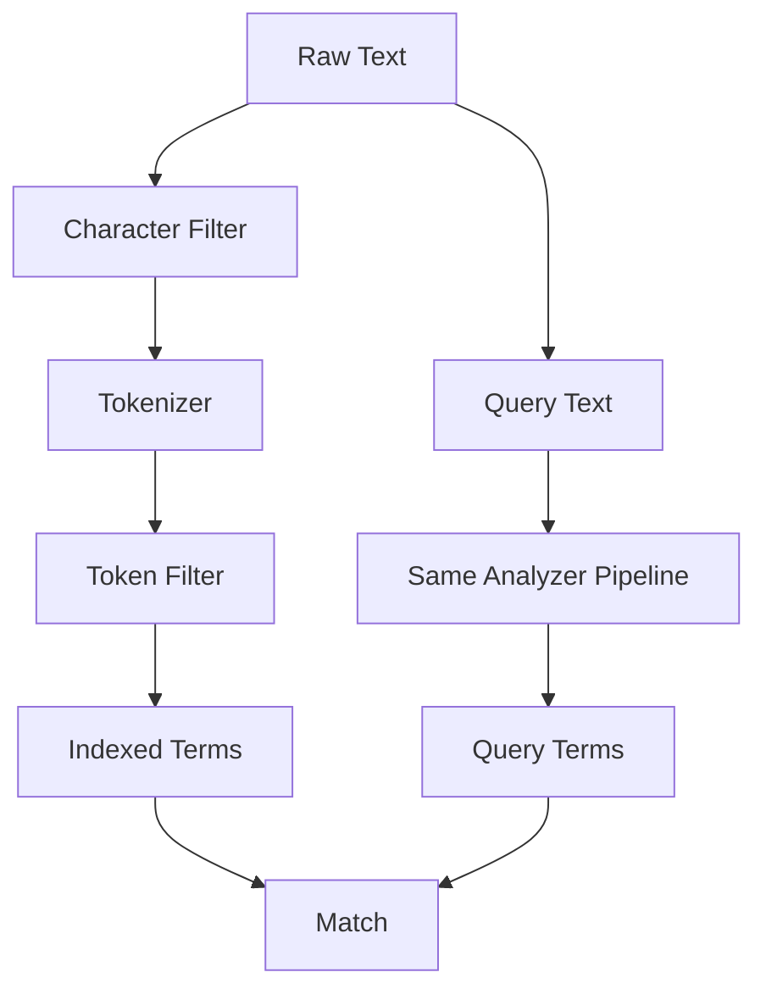

# Analyzer Pipeline: How Text Becomes Searchable Tokens

## English

When you index a document, Elasticsearch does not store the raw string — it runs the field's analyzer over it, a three-stage pipeline that turns prose into a list of normalized terms. The first stage, the character filter, cleans raw characters before tokenization: an HTML strip filter can remove `<b>` tags, a mapping filter can replace `&` with `and`. The second stage, the tokenizer, splits the string into tokens; the standard tokenizer splits on word boundaries and handles punctuation, while a whitespace tokenizer just cuts at spaces. The third stage, the token filter, rewrites those tokens: lowercase converts `Elasticsearch` to `elasticsearch`, stemming reduces `running` to `run`, and stop-word filters drop words like `the` and `is`. The exact same analyzer runs at query time on the search text, which is why `Running` finds `run` — both sides get stemmed identically.

The critical rule is that the analyzer used at index time and at search time must match, or your terms will never align. If you index with a stemming analyzer and search with a keyword analyzer, the stored term is `run` but your query term is `running`, and you get zero hits. This is a classic debugging trap: a field that seems to contain data but never matches. The `_analyze` API lets you test this without indexing anything — send a string and an analyzer name and it shows you the token stream, so you can see exactly what terms will be stored.

Analyzers are configured per field in the mapping. A `text` field can carry its own `analyzer` parameter, and you can also set `search_analyzer` separately if you want different behaviour at query time — for example, indexing with an aggressive stemmer but searching with a gentler one to avoid over-matching. A `keyword` field, by contrast, is not tokenized at all: the whole value becomes a single term, which is why it is right for IDs, tags, and exact-match filters but wrong for full-text relevance.

Multi-fields let one input feed two representations. You can map a `title` field as `text` for relevance scoring and also as a `title.keyword` sub-field for sorting and aggregations, both derived from the same source value. This is the standard pattern for "search this text but sort by it exactly." Without it, you would have to duplicate the data or accept that a tokenized field cannot be sorted meaningfully.

Language matters too. Elasticsearch ships with language-specific analyzers that know about plural forms and stop words for dozens of languages. Choosing the wrong one — say, the English analyzer on Chinese text — produces poor tokenization because it assumes space-delimited words. Getting the analyzer right is often the single biggest lever on search quality, more so than tuning relevance scores after the fact.

## 中文

當你索引一份文件時，Elasticsearch 並不會直接儲存原始字串，而是用該欄位的分析器（analyzer）處理它。分析器是一條三階段的管道，把文章變成一份正規化詞項（term）清單。第一階段是字元過濾器（character filter），在分詞之前清理原始字元：HTML strip 過濾器可以移除 `<b>` 標籤，mapping 過濾器可以把 `&` 換成 `and`。第二階段是分詞器（tokenizer），把字串切成詞元（token）；standard 分詞器按詞界切分並處理標點，whitespace 分詞器則只按空格切。第三階段是詞項過濾器（token filter），改寫這些詞元：lowercase 把 `Elasticsearch` 變成 `elasticsearch`，stemming 把 `running` 還原成 `run`，stop 過濾器則丟掉 `the`、`is` 這類字。查詢時，同一條分析器會套用在搜尋文字上，所以 `Running` 找得到 `run`——兩邊都被同樣地還原了。

關鍵規則是：索引時與搜尋時所用的分析器必須一致，否則詞項永遠對不上。如果你用 stemming 分析器索引，卻用 keyword 分析器搜尋，儲存的詞項是 `run`，但你的查詢詞是 `running`，結果就是零筆命中。這是經典的除錯陷阱：欄位明明有資料，卻永遠配不上。`_analyze` API 讓你毋須索引任何東西就能測試——送出一個字串與分析器名稱，它會顯示詞元串流，你便能確切看到會儲存哪些詞項。

分析器在 mapping 中按欄位設定。`text` 欄位可以帶自己的 `analyzer` 參數，你也可以另外設定 `search_analyzer`，讓查詢時有不同行為——例如索引時用較激進的 stemmer，搜尋時用較溫和的，以免過度匹配。相反，`keyword` 欄位完全不分詞：整個值成為單一詞項，所以它適合 ID、標籤與精確匹配過濾，卻不適合全文相關性。

多欄位（multi-field）讓同一份輸入餵養兩種表示。你可以把 `title` 欄位映射成 `text` 以供相關性評分，同時映射成 `title.keyword` 子欄位以供排序與聚合，兩者都源自同一個值。這是「搜尋這段文字但按原文精確排序」的標準做法。沒有它，你要麼複製資料，要麼接受已分詞欄位無法有意義地排序。

語言也很重要。Elasticsearch 內建多種語言專屬分析器，認識數十種語言的複數形與停用詞。選錯語言——例如把英文分析器套在中文上——分詞效果會很差，因為它假設詞語以空格分隔。把分析器設對，往往是搜尋品質最大的槓桿，比事後調校相關性分數更有效。

## Key Takeaway

The analyzer pipeline (character filter, tokenizer, token filter) must be consistent between index time and search time, and testing it with the _analyze API prevents the classic 'data exists but never matches' bug.

## Related Concepts
- Tokenization and stemming
- Multi-field mappings

## Diagram

