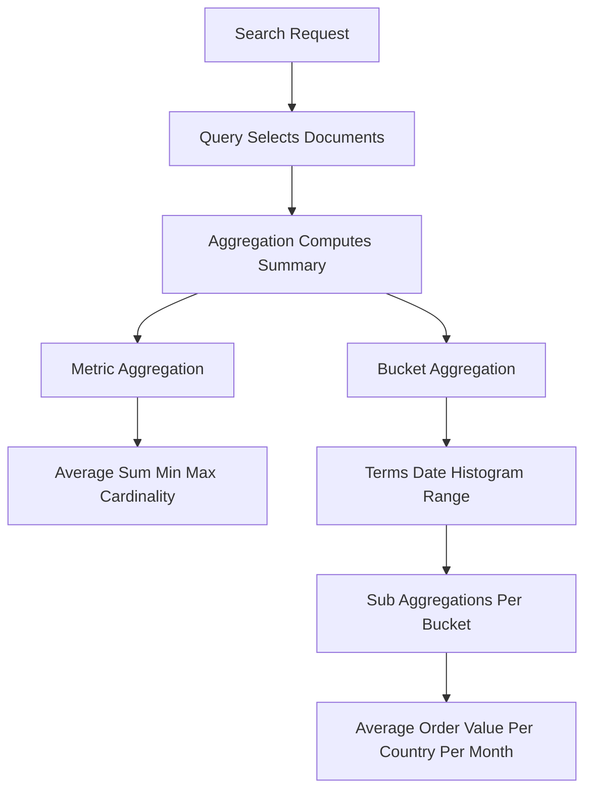

# Aggregations: Turning Search Hits into Analytics

## English

Search returns documents; aggregations return summaries. An aggregation is a computation over a set of documents that produces metrics or buckets rather than hits. The two families are metric aggregations, which compute a number (average price, sum of revenue, min and max timestamps, cardinality of unique visitors), and bucket aggregations, which group documents into categories (terms buckets by country, date histogram buckets by day, range buckets by price band). Bucket aggregations can contain sub-aggregations, so you can ask for "average order value per country per month" in one request — the outer date histogram creates month buckets, each containing a terms bucket per country, each containing an avg metric.

This is where Elasticsearch competes with dedicated analytics databases. A single aggregation request can compute dashboards' worth of numbers without pulling documents to the client. The `terms` aggregation is the workhorse: it counts documents per distinct value of a field, which is why that field usually needs to be a `keyword` — you cannot meaningfully bucket on a tokenized `text` field. The `date_histogram` aggregation with a `calendar_interval` of `day`, `week`, or `month` builds time series, and `composite` aggregations let you paginate through many buckets when a terms aggregation would hit its size limit.

One subtlety is `doc_count` versus metric accuracy. `terms` aggregations return approximate counts when the number of distinct values is large, because they use a bounded data structure and report `doc_count_error_upper_bound`. For exact counts on high-cardinality fields you either raise the `size` parameter (costly) or restructure. Similarly, the `cardinality` metric is approximate by default, using a HyperLogLog++ sketch; it is fast and memory-bounded but can be off by a small percentage, which is fine for dashboards and wrong for billing.

Aggregations run on the same distributed machinery as search: each shard computes partial results locally, then the coordinating node merges them. This is why shard count affects aggregation cost — more shards means more partial results to merge. A `terms` aggregation across ten shards asks each shard for its top N terms, then combines, which is why the global top N can occasionally differ slightly from a single-machine count. Understanding this merge step explains why some aggregations are cheap and others expensive.

A practical pattern is to combine search and aggregation in one request: filter to a subset with a `query`, then aggregate only over matching documents. This is how faceted search works — the query narrows results, and a `terms` aggregation on a category field produces the facet counts shown in a sidebar. The same request that returns the top ten hits can return the category breakdown, price histogram, and average rating, all in one round trip.

## 中文

搜尋回傳文件；聚合（aggregation）回傳摘要。聚合是對一組文件做運算，產出指標或桶（bucket），而非命中結果。兩大類分別是：指標聚合（metric aggregation），計算一個數字（平均價格、營收總和、時間戳的最小最大值、獨立訪客的基數）；以及桶聚合（bucket aggregation），把文件分組（按國家做 terms 桶、按日做 date histogram 桶、按價格區間做 range 桶）。桶聚合可以包含子聚合，所以你可以在一個請求裡問「每國每月平均訂單金額」——外層 date histogram 建立月份桶，每桶內含按國家的 terms 桶，每桶再含一個 avg 指標。

這正是 Elasticsearch 與專門分析資料庫競爭之處。單一聚合請求就能算出整個儀表板所需的數字，毋須把文件拉到客戶端。`terms` 聚合是主力：它計算某欄位每個相異值下的文件數，所以該欄位通常是 `keyword`——你無法在已分詞的 `text` 欄位上有意義地分桶。`date_histogram` 聚合配合 `calendar_interval` 設為 `day`、`week` 或 `month` 可建立時間序列，而 `composite` 聚合讓你能在 terms 聚合觸及 size 上限時，分頁走遍大量桶。

一個微妙之處是 `doc_count` 與指標準確度。當相異值很多時，`terms` 聚合回傳的是近似計數，因為它使用有界的資料結構，並回報 `doc_count_error_upper_bound`。要在高基數欄位上取得精確計數，你要麼提高 `size` 參數（代價高），要麼重構。同樣地，`cardinality` 指標預設是近似的，使用 HyperLogLog++ 草圖；它快速且記憶體有界，但可能有小百分比誤差，用於儀表板可以，用於帳單則不行。

聚合與搜尋跑在同一套分散式機制上：每個分片在本地算出部分結果，協調節點再合併。這就是分片數影響聚合成本的原因——分片越多，要合併的部分結果越多。跨十個分片的 `terms` 聚合會向每個分片要前 N 個詞項再合併，所以全域前 N 偶爾會與單機計數略有出入。理解這個合併步驟，就能解釋為何有些聚合便宜、有些昂貴。

實用模式是在一個請求裡結合搜尋與聚合：先用 `query` 過濾出子集，再只對符合的文件聚合。這就是分面搜尋（faceted search）的運作方式——查詢縮小結果，而對分類欄位的 `terms` 聚合產生側邊欄顯示的分面計數。同一個回傳前十筆命中的請求，可以一併回傳分類分佈、價格直方圖與平均評分，全部一次往返完成。

## Key Takeaway

Aggregations compute summaries — metrics for numbers and buckets for grouping — and run distributed like search, so terms and cardinality results are approximate by design and should be treated accordingly.

## Related Concepts
- Faceted search
- HyperLogLog cardinality estimation

## Diagram

