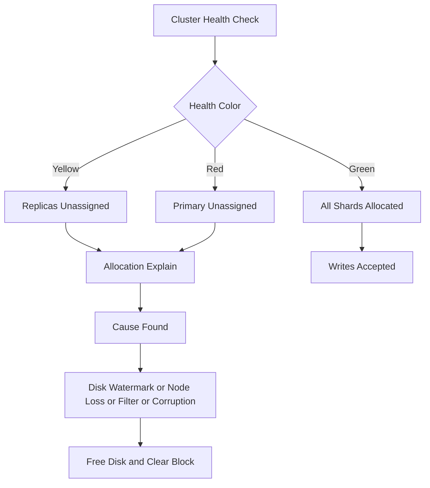

# Cluster Operations: Health, Allocation, and Failure Modes

## English

Running Elasticsearch in production means watching cluster health, which comes in three colours. Green means all primary and replica shards are allocated. Yellow means all primaries are allocated but some replicas are not — search still works, but you have no redundancy. Red means at least one primary shard is unassigned, so some data is unavailable and searches on it will fail or return partial results. Yellow is common on a single-node cluster by design, since replicas cannot live on the same node as their primary, and it is a warning rather than an outage.

The `_cluster/health` API reports these colours plus counts of unassigned shards. When shards are unassigned, `_cluster/allocation/explain` tells you why: not enough disk space, a node left the cluster, an allocation filter excluded every node, or a shard's data is corrupt. This diagnostic is the first thing to check in an incident. Allocation is governed by the allocator, which balances shards by disk usage and respects awareness attributes so that primaries and replicas land on different racks or zones.

Disk watermarks are a frequent cause of trouble. Elasticsearch marks nodes read-only at the flood-stage watermark (default 95% disk used), which throws a `cluster_block_exception` on writes. The low and high watermarks (defaults around 85% and 90%) stop allocating new shards to a node. These defaults are configurable, but the lesson is that disk monitoring must happen before the flood stage, because recovery from a read-only block requires freeing space and clearing the block explicitly with the cluster settings API.

Split-brain is the classic distributed failure this architecture guards against. If a network partition splits the cluster, two halves might each elect a master and accept writes, diverging. Elasticsearch avoids this with a quorum-based master election: a master is only elected if it has votes from a majority of master-eligible nodes, configured through `discovery.seed_hosts` and `cluster.initial_master_nodes` at bootstrap. This is why an even number of master-eligible nodes is not better than an odd number — three nodes tolerate one failure, and adding a fourth does not increase fault tolerance but does increase the majority threshold.

Operationally, the practical advice is to treat shard count as a budget. Each shard carries overhead in cluster state, memory, and recovery time; thousands of tiny shards degrade a cluster more than a few large ones. Index lifecycle management (ILM) helps by rolling indices over and shrinking or deleting old ones, keeping the shard count bounded over time. Combined with monitoring health, allocation explanations, and disk watermarks, these are the levers that keep a cluster stable rather than merely running.

## 中文

在生產環境運行 Elasticsearch，意味著要監察叢集健康（cluster health），它有三種顏色。綠色代表所有主分片與副本分片都已分配。黃色代表所有主分片已分配，但部分副本未分配——搜尋仍可運作，但你沒有冗餘。紅色代表至少有一個主分片未分配，部分資料不可用，對它的搜尋會失敗或回傳部分結果。黃色在單節點叢集上是設計使然，因為副本不能與其主分片同處一個節點，所以它是警告而非故障。

`_cluster/health` API 回報這些顏色以及未分配分片的數量。當分片未分配時，`_cluster/allocation/explain` 會告訴你原因：磁碟空間不足、某節點離開了叢集、分配過濾器排除了所有節點，或某分片的資料損壞。這個診斷是事故中首先要檢查的。分配由分配器（allocator）管轄，它按磁碟使用量平衡分片，並尊重感知屬性（awareness attributes），讓主分片與副本落在不同的機架或區域。

磁碟水位（watermark）是常見的麻煩來源。Elasticsearch 在洪水階段水位（預設磁碟使用 95%）會把節點標記為唯讀，寫入時拋出 `cluster_block_exception`。低與高水位（預設約 85% 與 90%）則停止把新分片分配到該節點。這些預設值可配置，但教訓是磁碟監控必須在洪水階段之前進行，因為從唯讀封鎖中恢復需要釋放空間，並用叢集設定 API 明確清除封鎖。

腦裂（split-brain）是這套架構防範的經典分散式故障。若網路分割把叢集切成兩半，兩邊可能各自選出主節點並接受寫入，造成分歧。Elasticsearch 以基於法定人數的主節點選舉避免此問題：主節點只有在取得過半數具主節點資格節點的票數時才會當選，這在啟動時透過 `discovery.seed_hosts` 與 `cluster.initial_master_nodes` 配置。這就是為何偶數個具主節點資格的節點並不比奇數好——三個節點可容忍一個故障，加第四個不會增加容錯，卻會提高過半數門檻。

在運維上，實用建議是把分片數視為預算。每個分片在叢集狀態、記憶體與恢復時間上都有開銷；數千個小分片比少數大分片更能拖垮叢集。索引生命週期管理（ILM）有幫助，它透過滾動索引、縮減或刪除舊索引，讓分片數隨時間保持有界。配合健康監察、分配解釋與磁碟水位，這些就是讓叢集穩定而非僅僅運行的槓桿。

## Key Takeaway

Cluster health colours, allocation explanations, disk watermarks, and quorum-based master election are the core operational signals that keep a distributed Elasticsearch cluster stable.

## Related Concepts
- Split-brain and quorum
- Disk watermarks

## Diagram

