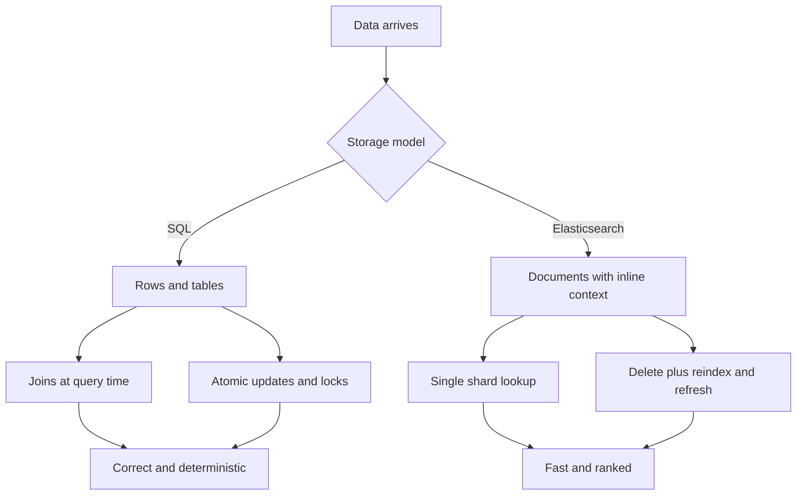

# Elasticsearch vs SQL: Two Different Ways of Thinking About Data

## English

The single biggest mental shift when learning Elasticsearch is that it does not store rows and columns, it stores documents and inverted indexes. A relational database is built around normalisation: you split data into tables, join them at query time, and the engine guarantees that a price column is always a number. Elasticsearch is built around denormalisation: each document is a self-contained JSON object that repeats whatever context it needs, because joins are expensive in a distributed system and the engine wants every query answered by a single shard lookup. This is why a product document in Elasticsearch often contains its category name, brand name, and tag list inline, rather than just foreign keys.

SQL is optimised for transactions and correctness. When you run an UPDATE, the database locks, rewrites the row, and commits atomically. Elasticsearch is optimised for throughput and searchability: an update is really a delete-plus-reindex, and the change only becomes visible after a refresh (typically every second). This is the famous near-real-time behaviour. It means you should never treat Elasticsearch as the source of truth for money, inventory counts, or anything where two readers must see the same value at the same instant.

Querying also feels different. SQL asks a question with a fixed shape: SELECT ... WHERE ... GROUP BY. Elasticsearch asks a question with a scoring model: which documents match, and how relevant are they? A SQL WHERE clause is binary (matches or does not), while an Elasticsearch query produces a _score per hit. That score is what lets a search box rank a page titled 'Python tutorial' above a page that merely mentions Python once in a footnote. You get ranking for free, but you lose the crisp determinism and join semantics of SQL.

A practical rule of thumb: use a relational database (or a transactional store) as the system of record, and stream changes into Elasticsearch using something like Logstash, Beats, or a custom consumer. Elasticsearch then serves as a read-optimised projection: fast search, fast aggregations, but always rebuildable from the source. If Elasticsearch is ever wiped, you should be able to reindex everything from the primary database without losing data.

Finally, think about what each system is bad at. SQL struggles with fuzzy text, relevance ranking, and multi-field free-text search across millions of documents. Elasticsearch struggles with multi-document ACID transactions, unique constraints, and complex relational joins. Choosing the right tool is not about which is 'better' but about which shape of question you are asking most often.

## 中文

學習 Elasticsearch 時最大的一個心態轉變，就是它並不以「列與行」儲存資料，而是以「檔案」與「倒排索引」儲存。關聯式資料庫圍繞著正規化（normalisation）而建：你把資料拆成多張表，查詢時才 JOIN 起來，而引擎會保證 price 欄位永遠是數字。Elasticsearch 則圍繞著反正規化（denormalisation）而建：每份檔案都是自成一體的 JSON 物件，重複攜帶它需要的上下文，因為在分散式系統中 JOIN 代價高昂，而引擎希望每個查詢都能由單一分片一次查完。這就是為何 Elasticsearch 中的商品檔案，往往直接內嵌分類名稱、品牌名稱與標籤清單，而不是隻存外來鍵。

SQL 為交易與正確性而最佳化。當你執行 UPDATE，資料庫會鎖定、改寫該行，然後原子性地提交。Elasticsearch 則為吞吐量與可搜尋性而最佳化：一次更新其實是「刪除再重新索引」，而且改動要等到 refresh（通常每秒一次）之後才看得見。這就是所謂的「準實時」（near-real-time）行為。意思是：金錢、庫存數量，或任何要求兩位讀者在同一瞬間看到相同數值的東西，都不應以 Elasticsearch 作為真實來源（source of truth）。

查詢的感覺也不同。SQL 用固定形狀問問題：SELECT ... WHERE ... GROUP BY。Elasticsearch 則用評分模型問問題：哪些檔案符合，以及它們有多相關？SQL 的 WHERE 是二元的（符合或不符合），而 Elasticsearch 查詢會為每筆命中產生一個 _score。這個分數正是搜尋框能把標題為「Python 教學」的頁面，排在只在腳註提過一次 Python 的頁面之上的原因。你免費得到排名能力，但失去了 SQL 那種清晰的確定性與 JOIN 語意。

一條實用原則：用關聯式資料庫（或交易式儲存）作為系統的記錄來源，再透過 Logstash、Beats 或自寫的消費者把變更串流進 Elasticsearch。Elasticsearch 於是成為一個「為讀取而最佳化的投影」：快速搜尋、快速聚合，但永遠可以從來源重建。若 Elasticsearch 有一天被清空，你應該能從主資料庫重新索引全部資料而不失任何東西。

最後，想想每個系統不擅長什麼。SQL 面對模糊文字、相關性排名、以及跨數百萬檔案的多欄位全文搜尋時會吃力。Elasticsearch 面對多檔案 ACID 交易、唯一性約束、以及複雜的關聯式 JOIN 時會吃力。選對工具不在於哪個「更好」，而在於你最常問的是哪一種形狀的問題。

## Key Takeaway

Relational databases are the system of record built for transactions and correctness, while Elasticsearch is a rebuildable, read-optimised projection built for relevance-ranked search and analytics.

## Related Concepts
- Near-real-time refresh and _score relevance
- Denormalisation and the system of record

## Diagram

