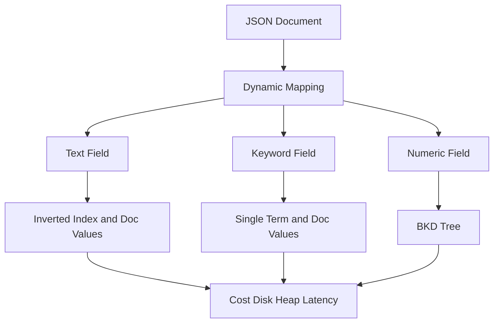

# The Cost of a Field: Why Mapping Choices Shape Performance

## English

Every field you define in a mapping has a price, and understanding that price is what separates a cluster that hums from one that melts under load. When a text field is indexed, Elasticsearch runs it through an analyzer and writes each token into the inverted index, plus stores doc values (a columnar on-disk structure) so that sorting and aggregations stay fast. A keyword field, by contrast, is indexed as one whole term and also gets doc values, but no tokenisation. A numeric field gets BKD tree structures for range queries. None of this is free: more indexed fields means bigger disk footprint, slower indexing, and more memory pressure on the JVM heap.

A classic trap is dynamic mapping. If you just POST JSON without a mapping, Elasticsearch guesses types: strings become text plus a keyword sub-field, numbers become long or float, and dates are detected by pattern. This is convenient for prototyping but dangerous in production. A field that is sometimes a number and sometimes a string will trigger a mapping conflict, and once a field's type is set, changing it requires reindexing into a new index. Many production incidents trace back to a single dynamic field that silently exploded the index size.

Think about which fields you actually query. If a field is only ever used for exact filtering (status codes, user IDs, country codes), map it as keyword, not text. If it is only ever used for full-text search, map it as text and consider disabling doc values if you never sort or aggregate on it. If it is used for both, use a multi-field: text for searching, keyword for filtering and aggregations. Also consider index: false for fields you store but never search, and doc_values: false for fields you only search and never sort or aggregate.

The _source field is another common cost. By default Elasticsearch stores the original JSON document in _source so it can return it in search results and reindex it later. That is usually what you want, but for very large documents (say, a document with a megabyte of HTML body), storing _source doubles the disk cost. Some teams use synthetic _source (available in recent versions) or exclude large fields from _source to save space, at the cost of not being able to return them directly.

Finally, beware the temptation to index everything 'just in case'. Each extra indexed field increases the size of the inverted index, slows down merges, and can push you toward more shards or bigger nodes. A disciplined mapping is one of the highest-leverage performance decisions you can make, and it is much cheaper to decide before you have a terabyte of data than after.

## 中文

你在 mapping 中定義的每一個欄位都有代價，而理解這個代價，正是叢集能順暢運作、還是會在負載下熔掉的分水嶺。當一個 text 欄位被索引時，Elasticsearch 會把它送進分析器（analyzer），把每個 token 寫進倒排索引，另外再存 doc values（一種欄式磁碟結構），令排序與聚合保持快速。相對地，keyword 欄位會以整個詞語作為單一 term 索引，同樣有 doc values，但不做分詞。數值欄位則獲得 BKD tree 結構以支援範圍查詢。這些全都不是免費的：索引欄位越多，磁碟佔用越大、索引速度越慢、JVM 堆積記憶體的壓力也越大。

一個經典陷阱是動態 mapping（dynamic mapping）。若你直接 POST JSON 而不給 mapping，Elasticsearch 會猜測型別：字串會變成 text 加一個 keyword 子欄位，數字會變成 long 或 float，日期則靠模式偵測。這對原型開發很方便，但在生產環境很危險。一個欄位時而數字、時而字串，就會觸發 mapping 衝突；而欄位型別一旦設定，要改變就得重新索引到新索引。許多生產事故都追溯到某個動態欄位悄悄把索引體積撐爆。

想一想你真正會查詢哪些欄位。若某欄位只用於精確過濾（狀態碼、使用者 ID、國家代碼），就把它 map 成 keyword，而不是 text。若只用於全文搜尋，就 map 成 text，並可考慮停用 doc values（若你從不對它排序或聚合）。若兩者都要，就用 multi-field：text 負責搜尋，keyword 負責過濾與聚合。另外，對於只儲存、從不搜尋的欄位可考慮 index: false；對於只搜尋、從不排序或聚合的欄位可考慮 doc_values: false。

_source 欄位是另一個常見成本。預設情況下 Elasticsearch 會把原始 JSON 文件存進 _source，以便在搜尋結果中回傳，日後也可重新索引。這通常正是你要的，但對於非常大的文件（例如內含一 MB HTML 內文的文件），儲存 _source 會令磁碟成本翻倍。有些團隊會使用 synthetic _source（較新版本提供），或把大型欄位排除於 _source 之外以節省空間，代價是無法直接回傳它們。

最後，要提防「以防萬一就全部索引」的誘惑。每個額外被索引的欄位都會增大倒排索引、拖慢 merge，並可能迫使你增加分片或加大節點。嚴謹的 mapping 是你所能做的最高槓桿效能決策之一，而在你擁有 TB 級資料之前決定，遠比之後才決定便宜得多。

## Key Takeaway

Mapping is a performance contract: every indexed field costs disk, memory, and indexing throughput, so map fields to the exact queries you actually run.

## Related Concepts
- Dynamic mapping and mapping conflicts
- doc_values and _source storage trade-offs

## Diagram

