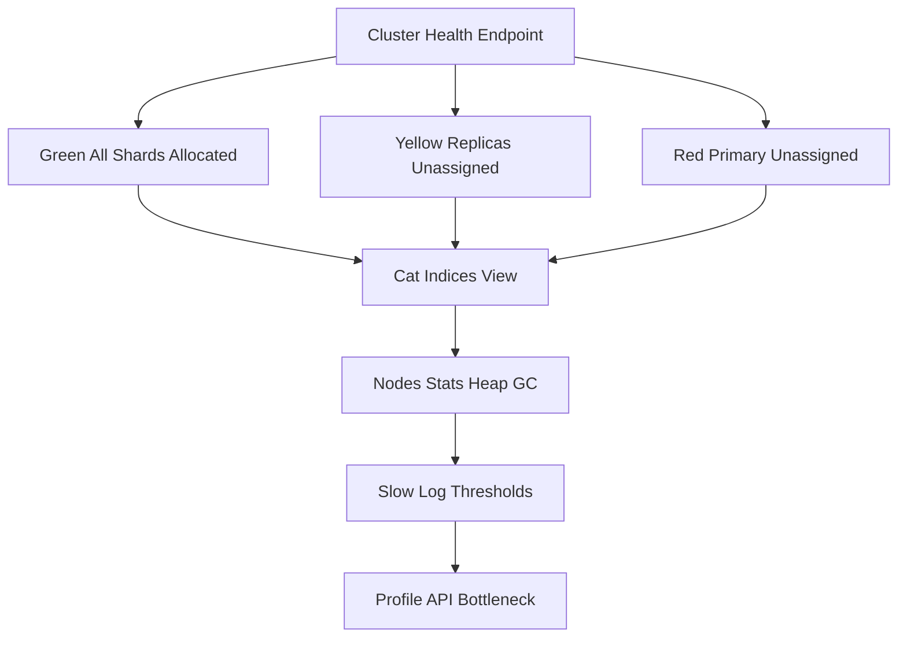

# Reading the Cluster: Interpreting Health, Stats, and Slow Logs

## English

Elasticsearch exposes a rich set of diagnostic endpoints, and learning to read them is the difference between guessing and knowing what is wrong. The most famous is GET _cluster/health, which returns a status of green, yellow, or red. Green means all primary and replica shards are allocated. Yellow means all primaries are allocated but some replicas are not, which is common on a single-node cluster because replicas cannot live on the same node as their primary. Red means at least one primary shard is unassigned, so some data is unavailable for search. Yellow is not automatically a problem, but red always is.

Beyond health, GET _cat/indices?v gives a per-index view: document count, size on disk, and shard counts. This is where you spot runaway indices. A common pattern is an index whose doc count looks normal but whose store size is enormous, which usually points to oversized _source, too many indexed fields, or a field being mapped as text when it should be keyword. GET _nodes/stats reveals JVM heap usage, garbage collection times, and thread pool queues. If heap usage stays above roughly 75 percent and GC time climbs, you are heading toward the dreaded circuit breaker or out-of-memory errors.

The slow log is one of the most underused tools. You can configure index.search.slowlog.threshold.query.warn and index.search.slowlog.threshold.fetch.warn (and the indexing equivalents) so that any query or fetch slower than a threshold is written to a log file. This turns vague complaints of 'search feels slow' into concrete evidence: which query, which index, which shard, and how long. Combined with the profile API, which breaks a single query into its component costs, you can pinpoint whether the bottleneck is a wildcard query, a deeply nested aggregation, or a huge fetch phase.

GET _tasks lets you see long-running operations currently in flight, such as a reindex, a force merge, or a snapshot. If a cluster suddenly feels sluggish, checking _tasks is often the fastest way to find that someone kicked off a heavy operation. Similarly, GET _cat/thread_pool?v shows queue depths; a growing search or write queue means the cluster is saturated and you need more capacity or a query rewrite.

Reading these signals together is the real skill. A yellow cluster with rising heap and a full search queue tells a different story from a green cluster with a single slow aggregation. The habit to build is: when something feels wrong, check health, then indices, then nodes stats, then tasks, then slow logs, in that order. Each layer narrows the search space until the culprit is obvious.

## 中文

Elasticsearch 提供大量診斷端點，學會讀懂它們，就是「靠猜」與「確知問題所在」之間的分別。最著名的是 GET _cluster/health，它回傳 green、yellow 或 red 狀態。Green 代表所有主分片與副本分片都已分配。Yellow 代表所有主分片已分配，但部分副本未分配，這在單節點叢集很常見，因為副本不能與其主分片放在同一節點。Red 代表至少有一個主分片未分配，即部分資料無法被搜尋。Yellow 不一定有問題，但 Red 一定有問題。

除了健康狀態，GET _cat/indices?v 提供逐個索引的檢視：檔案數、磁碟大小、分片數。這裡正是你發現失控索引的地方。常見模式是某索引檔案數看似正常，但儲存體積驚人，通常指向過大的 _source、過多被索引的欄位，或某欄位本應是 keyword 卻被 map 成 text。GET _nodes/stats 揭示 JVM 堆積使用率、垃圾回收時間與執行緒池佇列。若堆積使用率長期高於約 75%，而 GC 時間持續攀升，你正走向可怕的斷路器（circuit breaker）或記憶體不足錯誤。

慢查詢日誌（slow log）是最被低估的工具之一。你可以設定 index.search.slowlog.threshold.query.warn 與 index.search.slowlog.threshold.fetch.warn（以及索引方面的對應設定），令任何慢於門檻的查詢或抓取被寫進日誌檔。這把「搜尋好像很慢」這種模糊抱怨，變成具體證據：哪個查詢、哪個索引、哪個分片、耗時多久。再配合 profile API——它把單一查詢拆解成各組成部分的成本——你就能 pinpoint 瓶頸是 wildcard 查詢、深層巢狀聚合，還是龐大的 fetch 階段。

GET _tasks 讓你看到目前正在進行的長時間操作，例如 reindex、force merge 或快照。若叢集突然變慢，檢視 _tasks 往往是找出「有人啟動了重型操作」的最快方法。同樣地，GET _cat/thread_pool?v 顯示佇列深度；搜尋或寫入佇列持續增長，代表叢集已飽和，你需要更多容量或改寫查詢。

把這些訊號合起來讀，才是真正的功夫。一個 yellow 叢集加上堆積上升與搜尋佇列爆滿，與一個 green 叢集只有一個慢聚合，講的是完全不同的故事。要養成的習慣是：當感覺不對勁，依序檢查 health、indices、nodes stats、tasks、slow logs。每一層都收窄搜尋範圍，直到元兇顯而易見。

## Key Takeaway

Cluster health, _cat endpoints, node stats, _tasks, and slow logs form a diagnostic ladder that turns vague slowness into a specific culprit.

## Related Concepts
- Cluster health colours (green/yellow/red)
- Slow logs and the profile API

## Diagram

