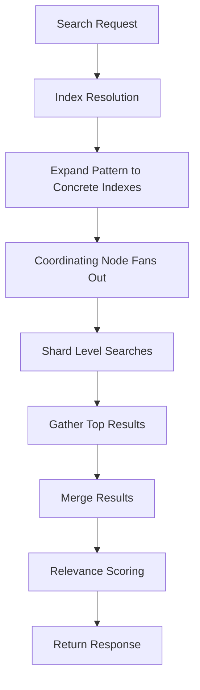

# Multi-Field Search: How One Query Spans Many Indexes

## English

A single search request in Elasticsearch does not have to hit one index. You can name several indexes, use wildcards like logs-* or my-index-2024.*, or search everything with * (the older _all spelling still works too). This is how teams split data by tenant, by day, or by domain while still offering one search box. Internally the coordinating node fans the query out to every shard of every matched index, gathers the top results from each, and merges them. That fan-out is where the real cost lives: searching ten indexes with five shards each means fifty shard-level searches, each with its own overhead. Wildcards are convenient but dangerous because a pattern like * can explode into hundreds of shards and slow the whole cluster.

A crucial concept is index resolution. Before any query runs, Elasticsearch expands your index expression into a concrete list of indexes using cluster state, and it applies settings like ignore_unavailable and allow_no_indices to decide what happens when a pattern matches nothing. The two govern different cases and have different defaults. allow_no_indices defaults to true: if a wildcard expression such as logs-* matches no index at all, the request succeeds with an empty result set. ignore_unavailable defaults to false, and it applies to a concrete (non-wildcarded) index, alias or data stream that is missing or closed — that case is an error unless you set ignore_unavailable=true. Getting these two the wrong way round is a classic source of confusion.

When results come back, relevance scores across indexes are only loosely comparable. Each index has its own statistics: document frequency, average field length, and term counts. A term that is rare in index A but common in index B will score differently in each. Elasticsearch mitigates this with the search_type=dfs_query_then_fetch option, which does a preliminary pass to gather global term statistics before scoring, at the cost of an extra round trip. For most log-style searches where you sort by timestamp rather than relevance, this does not matter, but for cross-index relevance ranking it does.

A practical pattern is alias-based routing. Instead of hardcoding index names in application code, you create an alias such as products-current that points to one or more concrete indexes. When you reindex or roll over, you atomically repoint the alias. Applications keep searching products-current and never notice. This decouples query logic from physical index layout and is the mechanism behind zero-downtime reindexing.

Finally, cross-cluster search (CCS) extends the same idea across clusters. You register a remote cluster and query it as remote_cluster:index-name. The coordinating node forwards the request, the remote cluster runs it locally, and results merge back. This lets you keep regional data where it lives while offering a global search view, but latency and failure handling become part of your design.

## 中文

在 Elasticsearch 中，單一次搜尋請求不一定只打一個索引。你可以指名多個索引、使用萬用字元如 logs-* 或 my-index-2024.*，或用 * 搜尋全部（舊版的 _all 已被取代）。團隊就是這樣按租戶、按日期、按業務領域切分資料，同時仍提供單一搜尋框。內部運作上，協調節點會把查詢分發到每個符合索引的每個分片，收集各分片的頂部結果再合併。真正的成本就在這個分發：搜尋十個索引、每個五個分片，等於五十次分片層級搜尋，每次都有自身開銷。萬用字元方便但危險，因為像 * 這樣的模式可膨脹成數百個分片，拖慢整個叢集。

一個關鍵概念是索引解析（index resolution）。查詢執行前，Elasticsearch 會用叢集狀態把你的索引表達式展開成具體的索引清單，並套用 ignore_unavailable 與 allow_no_indices 等設定，決定模式匹配不到任何東西時怎麼辦。若你搜尋 logs-* 而該索引不存在，預設行為是報錯，除非你設 ignore_unavailable=true。這常讓初學者以為會得到空結果集。

結果返回時，跨索引的相關性分數只是鬆散可比。每個索引有自己的統計：文件頻率、平均欄位長度、詞項計數。某詞在索引 A 罕見、在索引 B 常見，兩邊分數就不同。Elasticsearch 用 search_type=dfs_query_then_fetch 緩解：先做一趟預備查詢收集全域詞項統計再評分，代價是多一次往返。對按時間戳排序而非按相關性排序的日誌搜尋，這無關緊要；但對跨索引相關性排名就有影響。

一個實用模式是以別名（alias）做路由。不要在應用程式碼硬編碼索引名，而是建立如 products-current 的別名指向一個或多個具體索引。重新索引或滾動更新時，你原子性地重指別名。應用程式照樣搜 products-current，完全無感。這把查詢邏輯與實體索引佈局解耦，也是零停機重新索引背後的機制。

最後，跨叢集搜尋（CCS）把同一概念延伸到叢集之間。你註冊遠端叢集，然後以 remote_cluster:index-name 查詢。協調節點轉發請求，遠端叢集本地執行，結果合併回來。這讓你把區域資料留在原地，同時提供全域搜尋視圖，但延遲與故障處理也成為設計的一部分。

## Key Takeaway

Searching across many indexes is easy to write but costly to run, so control fan-out with aliases, explicit index lists, and awareness of per-index scoring statistics.

## Related Concepts
- Index aliases and reindexing
- Cross-cluster search

## Diagram

