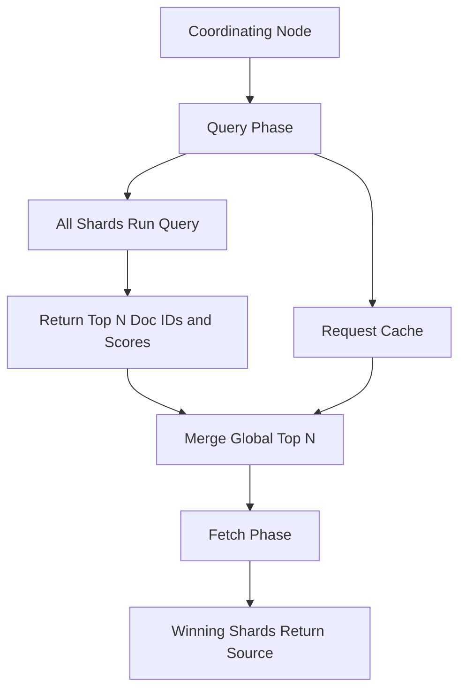

# The Cost of a Query: Understanding Search Phases and the Request Cache

## English

Every search in Elasticsearch passes through two phases: query then fetch. In the query phase, the coordinating node sends the query to every relevant shard. Each shard runs the query against its local Lucene segments, produces a list of matching document IDs with scores, and returns only the top N (where N is from+size) to the coordinator. The coordinator merges these sorted lists into a global top N. In the fetch phase, it then asks only the shards that own those winning documents to return the actual _source. This two-phase design keeps network traffic small: you never ship every matching document across the cluster, only the winners. Understanding this explains why deep pagination is expensive: from=10000 forces each shard to return 10000+size results, and the coordinator must merge enormous lists just to discard most of them.

Query cost is dominated by how many documents and segments must be examined. A term query on a keyword field can jump straight to a posting list. A wildcard or regexp query may have to scan terms in the dictionary. A script query runs code per document and is the most expensive of all. Filters, which do not score, are cheaper than scoring queries and their results are cacheable. This is why the common advice is to put exact-match constraints in filter context and only use must (scoring) for the parts that actually need relevance ranking.

The request cache stores the result of a search request (not the documents, but the shard-level result including doc IDs and scores), keyed by a hash of the whole request body. By default it only caches requests with size=0, because scoring results depend on statistics that change as documents are indexed; a request with size greater than 0 is not cached even if the cache is enabled for the index, unless you force it with the request_cache query parameter. The cache is shard-level — each shard caches its own local results and the coordinating node combines them — and because the key is a hash of the entire JSON body, the key ordering in the serialized request matters too. If you run the same dashboard query repeatedly, the request cache can serve it without re-executing. The query cache, by contrast, caches filter results at the segment level and is invalidated whenever a segment changes (on refresh or merge). Knowing which cache applies to which query shape helps you design dashboards that stay fast.

Profiling is how you find the expensive part. The profile API returns a tree showing how long each query component took, how many documents it advanced over, and how many it matched. A query that advances over millions of documents but matches ten is a sign your filter is not selective enough or your mapping lacks the right field type. Slow logs, configured per index, record queries exceeding a threshold so you can find them after the fact rather than guessing.

Putting it together: fast search is a design problem, not a tuning trick. Choose field types that allow direct lookup, push exact constraints into filter context, avoid scripts and leading wildcards, keep pagination shallow or use search_after, and let the caches do their job by keeping query shapes stable and cache-friendly.

## 中文

Elasticsearch 中每次搜尋都經過兩個階段：query 然後 fetch。在 query 階段，協調節點把查詢送到每個相關分片。每個分片對本地 Lucene 段執行查詢，產生符合文件的 ID 與分數清單，只回傳前 N 名（N 為 from+size）給協調者。協調者把這些已排序清單合併成全域前 N。在 fetch 階段，它只向擁有那些勝出文件的分片要求回傳實際的 _source。這個兩階段設計讓網路流量保持精簡：你從不把每份符合文件都送過叢集，只送勝出者。理解這點就解釋了為何深分頁昂貴：from=10000 迫使每個分片回傳 10000+size 筆結果，協調者必須合併龐大清單卻只為丟掉大部分。

查詢成本主要取決於要檢查多少文件與段。keyword 欄位上的 term 查詢可直接跳到倒排列表。wildcard 或 regexp 查詢可能得掃描詞典中的詞項。script 查詢對每份文件執行程式碼，是當中最貴的。filter 不評分，比評分查詢便宜，且結果可快取。這就是為何常見建議是把精確匹配條件放進 filter context，只在真正需要相關性排名的地方用 must（評分）。

請求快取（request cache）以請求內容與索引為鍵，儲存搜尋請求的完整結果（不是文件本身，而是分片層級結果，含文件 ID 與分數）。它只適用於 size=0 或只用 filter context 的請求，因為評分結果依賴隨索引變化而變的統計。若你反覆執行同一個儀表板查詢，請求快取可不必重跑就供應。相對地，查詢快取（query cache）在段層級快取 filter 結果，段一變（refresh 或 merge）就失效。知道哪種快取適用哪種查詢形狀，有助你設計持續快速的儀表板。

剖析（profiling）是找出昂貴環節的方法。profile API 回傳一棵樹，顯示每個查詢元件耗時、前進過多少文件、匹配多少。一個前進過數百萬文件卻只匹配十筆的查詢，顯示你的 filter 選擇性不足或 mapping 缺了正確欄位型別。可依索引設定的慢日誌（slow logs）會記錄超過門檻的查詢，讓你事後找出而非猜測。

綜合起來：快速搜尋是設計問題，不是調校伎倆。選擇允許直接查找的欄位型別，把精確條件推入 filter context，避免 script 與前置萬用字元，分頁保持淺或改用 search_after，並讓快取發揮作用——保持查詢形狀穩定且快取友善。

## Key Takeaway

Search speed is decided by query shape and mapping choices long before any tuning: understand the query/fetch phases and cache behaviour to design fast queries.

## Related Concepts
- Filter vs query context
- Profile API and slow logs

## Diagram

