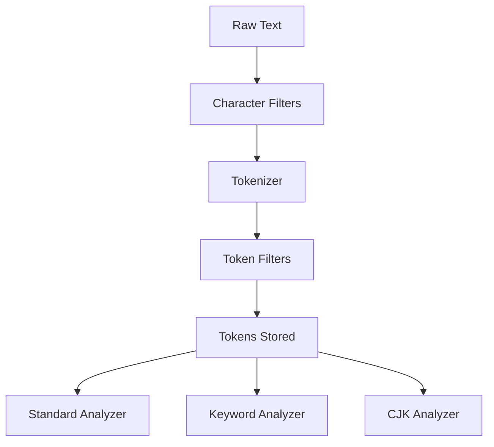

# Text Analysis in Practice: Choosing the Right Analyzer for Real Data

## English

Analysis is the process that turns raw text into the tokens stored in the inverted index, and it is where most search quality is won or lost. An analyzer is a chain of three stages: character filters (which preprocess the raw string, e.g. stripping HTML), a tokenizer (which splits the string into tokens), and token filters (which modify tokens: lowercasing, removing stop words, stemming, adding synonyms). Elasticsearch ships with a built-in standard analyzer that splits on word boundaries and lowercases, which is a sensible default for English. But real data is rarely plain English.

Consider a product catalogue with SKUs like AB-1234-X. The standard analyzer splits on the hyphen, producing ab, 1234, x. A search for AB-1234-X would match, but so would a search for x, which is useless. A keyword analyzer (no splitting) treats the whole string as one token, so exact matching works but partial matching does not. The right answer is often a multi-field: index the same source field twice, once as text with a standard analyzer for fuzzy human search, and once as keyword for exact filtering and sorting. This is why mappings commonly show a field with a text sub-field and a keyword sub-field.

Language matters enormously. The standard analyzer does not segment Chinese, Japanese, or Korean text, because those languages do not separate words with spaces. For Chinese you need an analyzer that performs word segmentation, such as the built-in CJK analyzer (which splits into bigrams) or a plugin-based approach with a dictionary. Bigram splitting produces overlapping two-character tokens, which is robust but inflates the index and can produce noisy matches. A dictionary-based segmenter produces cleaner tokens but depends on the dictionary quality and needs maintenance as language evolves.

Stemming and synonyms are powerful but double-edged. Stemming reduces running, runs, and ran to a common root, improving recall, but aggressive stemmers can conflate unrelated words. Synonyms let you map mobile phone, cellphone, and smartphone to one token, which is essential for e-commerce, but synonym lists must be maintained and every change requires reindexing the affected documents (or using a search-time synonym filter, which is slower).

Testing analysis is not optional. The _analyze API lets you send a string and see exactly which tokens an analyzer produces, which is the fastest way to debug why a search does not match. A workflow of define analyzer, test with _analyze, index sample documents, test queries, then iterate is far more reliable than guessing. Analysis decisions are baked into the index at write time, so a wrong analyzer means reindexing everything to fix it.

## 中文

分析（analysis）是把原始文字轉成存進倒排索引的詞項的過程，也是搜尋品質勝負所在。分析器是一條三階段鏈：字元過濾器（預處理原始字串，例如剝除 HTML）、分詞器（把字串切成詞項）、詞項過濾器（修改詞項：轉小寫、移除停用詞、詞幹化、加同義詞）。Elasticsearch 內建 standard 分析器，按詞邊界切分並轉小寫，對英文是合理預設。但真實資料很少是純英文。

設想一個產品目錄，SKU 如 AB-1234-X。standard 分析器按連字號切分，產生 ab、1234、x。搜尋 AB-1234-X 會匹配，但搜尋 x 也會匹配，毫無用處。keyword 分析器（不切分）把整串當一個詞項，精確匹配可行但部分匹配不行。正解往往是 multi-field：同一來源欄位索引兩次，一次為 text 用 standard 分析器供人類模糊搜尋，一次為 keyword 供精確過濾與排序。這就是為何 mapping 常見某欄位帶 text 子欄位與 keyword 子欄位。

語言至關重要。standard 分析器不切分中文、日文、韓文，因為這些語言不用空格分詞。中文需要能做詞分割的分析器，例如內建 CJK 分析器（切成二元組）或基於詞典的外掛方案。二元組切分產生重疊的兩字詞項，穩健但膨脹索引且可能產生雜訊匹配。基於詞典的分詞器產生更乾淨的詞項，但依賴詞典品質，且隨語言演變需維護。

詞幹化與同義詞強大但雙面。詞幹化把 running、runs、ran 化為共同詞根，提升召回，但激進的詞幹化可能把無關詞混為一談。同義詞讓你把手機、行動電話、智能手機映射到一個詞項，對電商不可或缺，但同義詞清單需維護，每次變更都需重新索引受影響文件（或使用搜尋時同義詞過濾器，較慢）。

測試分析不是可選項。_analyze API 讓你送一字串並確切看到分析器產生哪些詞項，是除錯搜尋不匹配的最快方法。定義分析器、用 _analyze 測試、索引樣本文件、測試查詢、再迭代，這流程遠比猜測可靠。分析決策在寫入時就烙進索引，所以錯的分析器意味著要重新索引一切才能修正。

## Key Takeaway

Analyzer choices are permanent at index time, so test with _analyze and use multi-fields to serve both fuzzy text search and exact keyword filtering.

## Related Concepts
- Multi-fields (text vs keyword)
- The _analyze API

## Diagram

