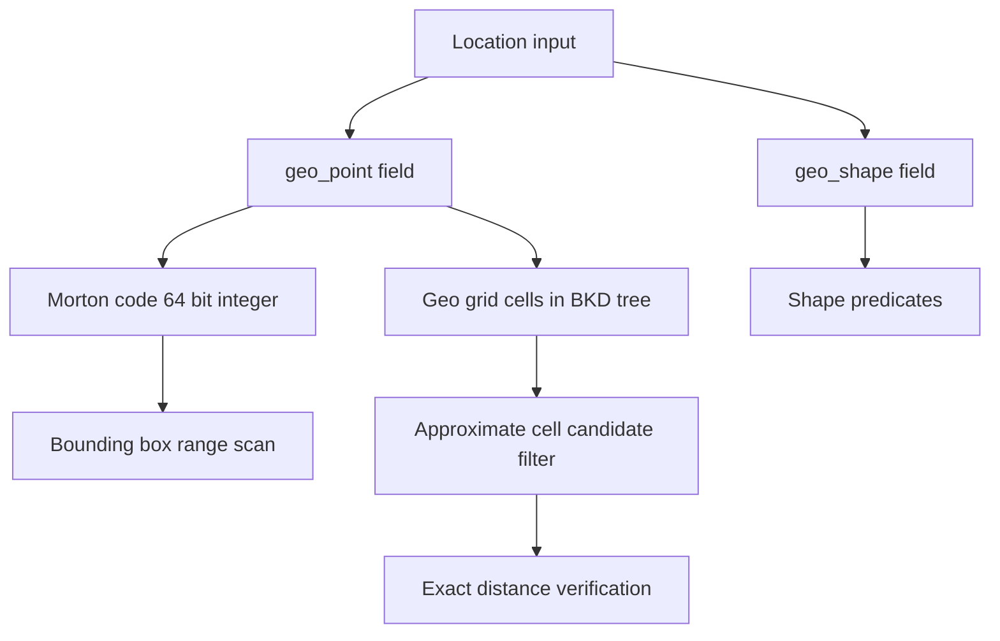

# Geo Search: Storing and Querying Location Data

## English

Elasticsearch has a dedicated field family for geography, and it is worth understanding how locations are physically stored, because that storage choice decides which queries are fast. The two main types are `geo_point` (a single latitude/longitude pair) and `geo_shape` (arbitrary polygons, lines, or points). A `geo_point` is not stored as two plain floating-point numbers. Instead it is encoded into a single sortable 64-bit integer using a space-filling curve called a Morton code (a Z-order curve): you interleave the bits of the latitude and longitude so that points physically close on the map tend to land close in the integer ordering. That trick is what lets Elasticsearch answer bounding-box queries with a numeric range scan instead of comparing every coordinate.

For distance queries, Elasticsearch builds a second structure: a geo grid of cells at multiple resolutions, stored in a BKD tree (a block k-d tree, the same family of structure that powers numeric range queries). When you ask for "all restaurants within 2 km of this point," the engine first converts the circle into a set of grid cells that cover it, finds the documents in those cells, and then does an exact distance check on that much smaller candidate set. This two-stage approach — cheap approximate filter, then exact verification — is a recurring theme in spatial databases.

A practical example: index a `location` field as `geo_point` and you can write a `geo_distance` query with a centre point and a radius, or a `geo_bounding_box` query with top-left and bottom-right corners. For sorting by proximity, `_geo_distance` sort returns documents ordered by computed distance. For shapes, `geo_shape` supports predicates like `intersects`, `disjoint`, `within`, and `contains`, plus a `shape` query for point-in-polygon tests. Note that `geo_shape` queries are heavier because they work with actual geometry rather than grid cells.

Two gotchas deserve attention. First, coordinate order: Elasticsearch accepts several formats (object with `lat`/`lon`, array of `[lon, lat]`, or a WKT-style string), but the array form is longitude-first, which trips up people used to "lat, lon". Second, precision: geo points are stored with finite precision (roughly centimetre-level by default), so exact-equality comparisons on coordinates are unreliable — always query with a radius or box, never with an exact match.

Finally, geo queries are usually combined with other filters. Because a `geo_distance` filter is constant-scoring and cacheable in the filter context, putting it inside a `bool.filter` (rather than `must`) lets the query cache reuse the result set across identical requests, which matters enormously for "find nearby" features that fire on every page load.

## 中文

Elasticsearch 有一整族專為地理資料而設的欄位類型，而值得理解的是位置資料實際上如何儲存，因為這個儲存選擇直接決定哪些查詢會快。兩大類型是 `geo_point`（單一經緯度對）與 `geo_shape`（任意多邊形、線或點）。`geo_point` 並非以兩個普通浮點數儲存，而是用一條稱為 Morton code（Z-order 曲線）的空間填充曲線，把緯度與經度的位元交錯編碼成單一個可排序的 64 位元整數，令地圖上彼此接近的點，在整數排序上也傾向接近。這個技巧正是 Elasticsearch 能用數值範圍掃描回答邊界框查詢、而不必逐個比較座標的原因。

至於距離查詢，Elasticsearch 會建立第二個結構：一個多解析度的地理網格，儲存在 BKD 樹（block k-d tree，與數值範圍查詢所用的結構同屬一族）。當你查詢「距離此點 2 公里內的所有餐廳」，引擎會先把圓形轉換成一組覆蓋它的網格單元，找出落在這些單元內的文件，再對這個已大幅縮小的候選集做精確距離檢查。這種「先便宜地粗略過濾、再精確驗證」的兩階段做法，是空間資料庫反覆出現的主題。

實際例子：把 `location` 欄位索引為 `geo_point`，你就能寫 `geo_distance` 查詢（中心點加半徑），或 `geo_bounding_box` 查詢（左上與右下角）。若要按距離排序，`_geo_distance` 排序會回傳依計算距離排列的文件。至於形狀，`geo_shape` 支援 `intersects`、`disjoint`、`within`、`contains` 等謂詞，另有 `shape` 查詢做點在多邊形內的判斷。要注意 `geo_shape` 查詢較重，因為它處理的是真實幾何而非網格單元。

兩個陷阱值得留意。第一是座標順序：Elasticsearch 接受多種格式（含 `lat`／`lon` 的物件、`[lon, lat]` 陣列，或 WKT 風格字串），但陣列形式是經度在前，這常令習慣「緯度、經度」的人出錯。第二是精度：地理點以有限精度儲存（預設約厘米級），所以對座標做完全相等比較並不可靠——永遠用半徑或方框查詢，不要用完全匹配。

最後，地理查詢通常會與其他過濾條件組合。由於 `geo_distance` 過濾屬於 constant-scoring 且可在 filter context 中快取，把它放進 `bool.filter`（而非 `must`）可讓查詢快取在多個相同請求之間重用結果集，這對於每次頁面載入都觸發的「尋找附近」功能影響極大。

## Key Takeaway

Geo points are encoded as sortable integers via a space-filling curve and answered with a two-stage grid-then-verify strategy, so put geo filters in filter context to benefit from caching.

## Related Concepts
- BKD tree
- Query cache and filter context

## Diagram

