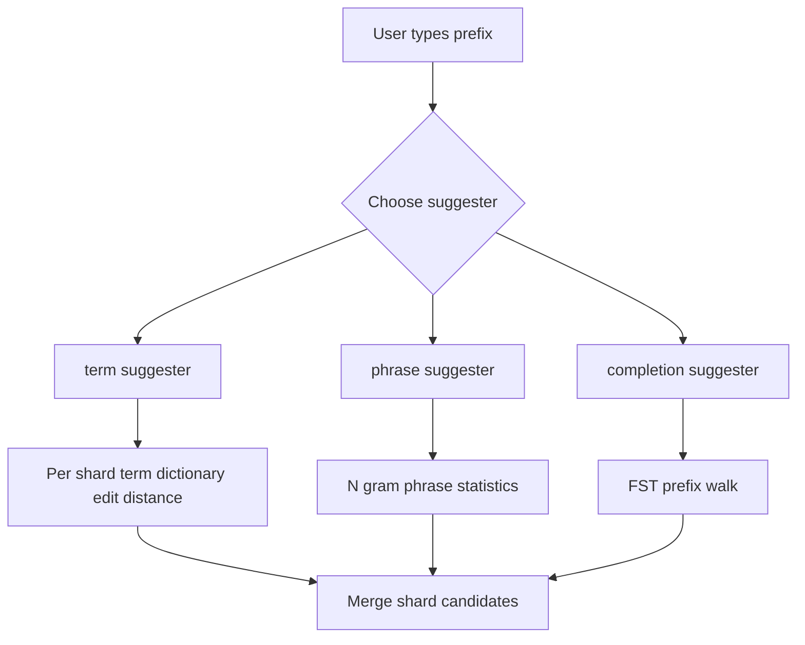

# Suggesters: Autocomplete, Spell Correction, and the Structures Behind Them

## English

Search boxes need to guess what you mean before you finish typing, and Elasticsearch offers three suggester types that solve different problems with different data structures. Understanding which structure backs each one explains their behaviour and their cost. The three are `term`, `phrase`, and `completion`.

The `term` suggester is the classic spell-corrector. It works on a per-shard basis: each shard looks at its own term dictionary, finds terms within a given edit distance (Levenshtein distance — the number of single-character insertions, deletions, or substitutions needed to turn one word into another) of the input, and returns candidates. Because it only sees its own shard, results are approximate and must be merged; that is why term suggestions can occasionally miss a correction that exists elsewhere in the index. `phrase` is a smarter variant that considers the whole phrase and can propose corrections for multiple words at once, using n-gram-based statistics to decide which corrections are plausible together.

Both `term` and `phrase` suggesters are relatively expensive because they consult the term dictionary at query time. The `completion` suggester is different: it is built for speed and uses a finite state transducer (FST) — a compact automaton that encodes all the indexed strings as paths through a graph, sharing common prefixes. Because prefixes are shared, a prefix lookup is essentially a walk down the automaton, which is extremely fast. This is why `completion` is the right choice for type-ahead: you define a `completion` field, index the phrases you want suggested, and query with a prefix. It also supports weights (to rank popular suggestions higher) and optional contexts (so you can restrict suggestions to, say, a category or a language).

A concrete example: an e-commerce site might index product names into a `completion` field with a `weight` equal to monthly sales, so that typing "wire" suggests "wireless headphones" before "wireless charger" if headphones sell more. Meanwhile, a "did you mean" link under zero-result searches is a job for the `term` or `phrase` suggester, because there you genuinely want edit-distance-based correction of a possibly misspelled query.

One caveat: the `completion` suggester is designed for prefix matching, not fuzzy matching. It does not do edit-distance correction, and its FST is built at index time, so changes to the suggestion set require reindexing (or at least re-indexing those documents). Also, `completion` fields are stored in memory as part of the FST, so very large suggestion vocabularies consume heap — a real operational constraint worth planning for.

## 中文

搜尋框需要在你打完字之前猜出你想找甚麼，而 Elasticsearch 提供三種 suggester 類型，各自用不同資料結構解決不同問題。理解每種背後的結構，就能解釋它們的行為與成本。三者分別是 `term`、`phrase` 與 `completion`。

`term` suggester 是經典的拼字修正器。它按分片運作：每個分片查看自己的詞典，找出與輸入在給定編輯距離（Levenshtein distance——把一個詞變成另一個詞所需的單字元插入、刪除或替換次數）之內的詞，然後回傳候選。因為它只看到自己的分片，結果是近似的，必須合併；這正是 term 建議偶爾會漏掉索引其他地方存在的正確拼法的原因。`phrase` 是更聰明的變體，考慮整個片語，能一次為多個詞提出修正，並用基於 n-gram 的統計判斷哪些修正放在一起才合理。

`term` 與 `phrase` suggester 都相對昂貴，因為它們在查詢時查閱詞典。`completion` suggester 則不同：它為速度而設，使用有限狀態轉換器（finite state transducer，FST）——一種緊湊的自動機，把所有已索引字串編碼成圖中的路徑，並共用共同前綴。由於前綴共用，前綴查找基本上就是沿自動機往下走，速度極快。這就是 `completion` 適合即時輸入提示（type-ahead）的原因：你定義一個 `completion` 欄位，把想提示的片語索引進去，再用前綴查詢。它亦支援權重（讓熱門建議排更前）與可選的 context（例如把建議限制在某個分類或語言）。

具體例子：電商網站可把產品名稱索引進 `completion` 欄位，權重設為每月銷量，那麼輸入「wire」時，若耳機銷量高於充電器，「wireless headphones」會排在「wireless charger」之前。至於零結果搜尋下方那個「你是不是想找」連結，則是 `term` 或 `phrase` suggester 的工作，因為那裡你確實想用編輯距離去修正可能拼錯的查詢。

一個注意點：`completion` suggester 是為前綴匹配而設，不是模糊匹配。它不做編輯距離修正，而且它的 FST 在索引時建立，所以更改建議集需要重新索引（至少重新索引那些文件）。另外，`completion` 欄位以 FST 形式存放在記憶體中，所以極大的建議詞彙會佔用堆積記憶體——這是實際運維上值得預先規劃的限制。

## Key Takeaway

Use the completion suggester (FST-backed) for fast prefix type-ahead, and term or phrase suggesters for edit-distance spell correction, remembering that term suggestions are computed per shard and therefore approximate.

## Related Concepts
- Finite state transducer
- Levenshtein edit distance

## Diagram

