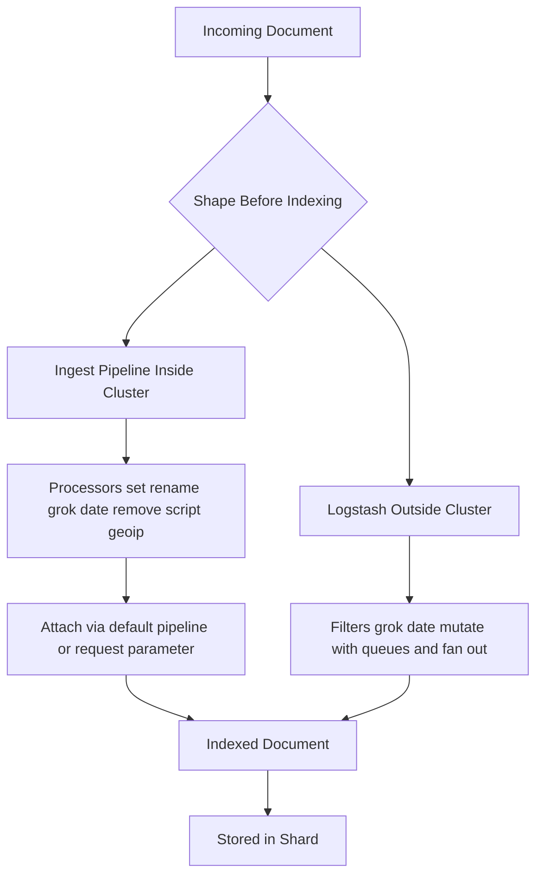

# Ingest Node vs Logstash: Where Data Gets Shaped Before Indexing

## English

Documents rarely arrive in exactly the shape you want to index. Timestamps come in odd formats, fields need enriching from a lookup table, sensitive values need masking, and one incoming record may need to be split into several. Elasticsearch handles a lot of this before the document ever reaches a shard, and the two main places to do it are ingest pipelines (inside the cluster) and Logstash (outside it). Knowing the difference helps you choose the right tool rather than defaulting to one.

An ingest pipeline is a sequence of processors that run on an ingest node (any node with the `ingest` role, which is enabled by default). Each processor does one small transformation: `set` adds or overwrites a field, `rename` moves a field, `grok` parses unstructured text with regex-like patterns, `date` parses a date string into a proper date field, `remove` drops fields, `script` runs a Painless script for anything custom, and `geoip` enriches an IP address with country and city. You attach a pipeline to an index with the `index.default_pipeline` setting, or specify it per request with the `pipeline` parameter on the bulk or index API. Because pipelines live in cluster state, they are versioned and easy to manage alongside index templates.

Logstash is a separate process (the classic L input → filter → output pipeline) that typically sits between your data sources and Elasticsearch. It has a much larger plugin ecosystem, persistent queues for buffering when Elasticsearch is unavailable, and the ability to fan out one input to many outputs. Its filter plugins overlap heavily with ingest processors — `grok`, `date`, `mutate` do much the same work — but Logstash runs outside the cluster, so it consumes its own resources rather than Elasticsearch heap and CPU.

The practical decision usually comes down to scale and topology. For modest enrichment done close to the data, ingest pipelines are simpler: no extra service to run, no extra network hop, and the transformation is visible in the same place as the index definition. For heavy parsing, multiple destinations, or buffering during cluster outages, Logstash (or another external processor such as Beats with processors) is the better fit. A common hybrid is Beats shipping raw logs, an ingest pipeline doing light normalisation, and Logstash reserved for genuinely complex routing.

One operational detail: a failing processor fails the whole document by default, and the error surfaces in the bulk response per item. You can set `ignore_failure` on a processor, or use the `on_failure` block to run fallback processors, but silently ignoring failures hides data-quality problems. Monitoring ingest pipeline failures as a metric is worth the effort, because a broken `grok` pattern can quietly drop or mangle an entire feed.

## 中文

文件很少以你想要的形狀送達。時間戳格式古怪、欄位需要從對照表補充、敏感值需要遮蔽，而一筆傳入記錄可能需要拆成多筆。Elasticsearch 在文件到達分片之前已處理不少這類工作，而兩個主要地方就是 ingest pipeline（叢集之內）與 Logstash（叢集之外）。明白兩者差異，有助你選對工具，而非一味預設用同一個。

Ingest pipeline 是一連串在 ingest node 上執行的 processor（任何具備 `ingest` 角色的節點，此角色預設啟用）。每個 processor 做一件小轉換：`set` 新增或覆寫欄位、`rename` 移動欄位、`grok` 用類正則模式解析非結構化文字、`date` 把日期字串解析成真正的日期欄位、`remove` 刪除欄位、`script` 執行 Painless 腳本處理自訂邏輯、`geoip` 用 IP 位址補充國家與城市。你可以用 `index.default_pipeline` 設定把 pipeline 綁到索引，或在 bulk／index API 請求中用 `pipeline` 參數逐次指定。由於 pipeline 存在叢集狀態中，它們有版本，亦易與索引範本一併管理。

Logstash 是獨立程序（經典的輸入 → 過濾 → 輸出管道），通常位於資料來源與 Elasticsearch 之間。它有龐大得多的外掛生態、可在 Elasticsearch 不可用時緩衝的持久佇列，以及把單一輸入分發到多個輸出的能力。它的過濾外掛與 ingest processor 高度重疊——`grok`、`date`、`mutate` 做的大致相同——但 Logstash 在叢集外運行，消耗自己的資源而非 Elasticsearch 的堆積與 CPU。

實際抉擇通常取決於規模與拓撲。若只是就近做適度的資料補充，ingest pipeline 較簡單：毋須多跑一個服務、毋須多一次網絡跳轉，而且轉換邏輯與索引定義放在同一處可見。若涉及重型解析、多個目的地，或需在叢集中斷時緩衝，Logstash（或其他外部處理器，例如帶 processor 的 Beats）更合適。常見的混合做法是：Beats 運送原始日誌、ingest pipeline 做輕度正規化、Logstash 留給真正複雜的路由。

一個運維細節：processor 失敗時預設會令整份文件失敗，錯誤會逐項顯示在 bulk 回應中。你可以在 processor 上設 `ignore_failure`，或用 `on_failure` 區塊執行備援 processor，但默默忽略失敗會掩蓋資料品質問題。把 ingest pipeline 失敗次數當作指標監控是值得的，因為一個壞掉的 `grok` 模式可以悄悄丟棄或弄壞整條資料流。

## Key Takeaway

Ingest pipelines transform documents inside the cluster with minimal overhead, while Logstash is better for heavy parsing, multi-destination routing, and buffering, so choose based on scale and topology rather than habit.

## Related Concepts
- Grok pattern
- Bulk API

## Diagram

