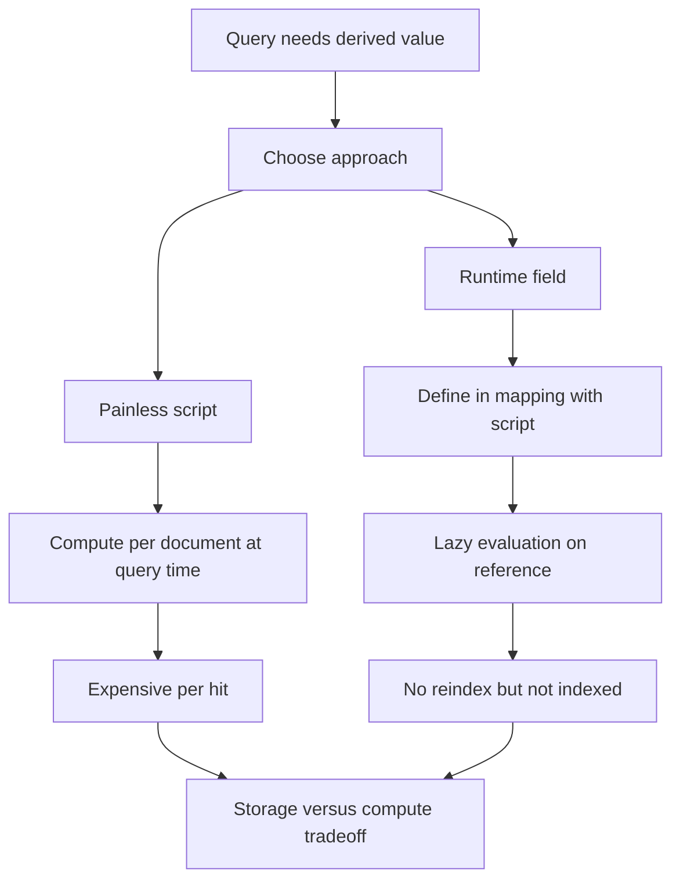

# Scripting and Runtime Fields: Computation at Query Time

## English

Sometimes the value you want to filter or sort on does not exist as a stored field. Elasticsearch lets you compute values on the fly in two main ways: painless scripts and runtime fields. Painless is Elasticsearch's default scripting language — a sandboxed, Java-like language that runs inside the JVM. In a query you can use a script to score documents, filter them, or modify a field's value during an update. For example, a `script_score` query could boost products by a formula like `_score * doc['popularity'].value`, and a `script` inside a `function_score` query can combine several signals into one relevance number. Scripts are powerful but expensive: they run per document, are interpreted (or compiled and cached), and can be blocked by the cluster setting that controls which script contexts are allowed.

Runtime fields take a different angle on the same problem. Instead of computing per hit at query time only, you define a field in the mapping with a `script` that produces its value, and Elasticsearch evaluates it lazily — only when a query, aggregation, or sort actually references that field. The big win is flexibility: you can add a derived field to existing data without reindexing. A classic example is extracting the day of week from a timestamp: define `day_of_week` as a runtime field whose script calls `emit(doc['@timestamp'].value.dayOfWeekEnum.getDisplayName(...))`, and then aggregate on it. The catch is that runtime fields are not indexed, so they cannot use the inverted index; every document that matches the query must be visited and the script executed. That is fine for ad-hoc analysis on a filtered subset, but disastrous for sorting a hundred million documents.

The mental model is a trade-off between storage and compute. A regular indexed field pays storage and indexing cost up front, then query time is fast because the inverted index answers the question directly. A runtime field pays nothing up front but pays compute on every query that touches it. Alongside both sits `_source`, the original document JSON kept for retrieval, and a separate column-oriented store called doc values that backs sorting and aggregations. These are three different structures, and conflating them makes it hard to reason about what a query will actually read. When you choose, ask: is this field queried often, on large result sets, or only occasionally on narrow filters?

A practical pattern is to use runtime fields as a prototyping tool. During exploration, define a runtime field, iterate on the script until the logic is right, then, once the definition stabilises, switch to an ingest pipeline that computes the value at write time and stores it as a real keyword or date field. This mirrors the way developers prototype in a REPL and then move hot code into a compiled path. You get fast iteration without committing to a mapping change, and fast queries once the shape is settled.

There are also safety considerations. Painless scripts are sandboxed and cannot open sockets or read files, but a badly written script can still be a denial-of-service vector — an infinite loop or an expensive regular expression on every document will hammer the cluster. Bound script execution with the `timeout` parameter of the API you are calling (for example the search `timeout`), and tune scripting with the documented settings such as `script.max_compilations_rate`, `script.cache.max_size`, `script.cache.expire` and `script.max_size_in_bytes`; prefer `doc_values` access (`doc['field'].value`) over `_source` parsing inside scripts, and remember that scripts run on the coordinating node or the data node depending on context. Finally, scripts and runtime fields are version-sensitive: features like the `emit` function and some context names have changed across major versions, so check the docs for your exact release.

## 中文

有時你想用來過濾或排序的值，根本不是一個已儲存的欄位。Elasticsearch 讓你用兩種主要方式在查詢時即時計算：Painless 腳本與 runtime fields（執行時欄位）。Painless 是 Elasticsearch 預設的腳本語言——一種在 JVM 內執行、沙箱化的類 Java 語言。在查詢中，你可以用腳本為文件評分、過濾文件，或在更新時修改欄位值。例如 `script_score` 查詢可以用公式如 `_score * doc['popularity'].value` 來提升商品排名，而 `function_score` 查詢內的 `script` 可以把多個訊號組合成單一相關度分數。腳本很強大但代價高：它逐文件執行、以直譯（或編譯後快取）方式運作，而且可能被叢集設定中「哪些腳本情境允許執行」的規則封鎖。

Runtime fields 從另一個角度解決同一個問題。它不只是在查詢時逐命中計算，而是在 mapping 中用 `script` 定義一個欄位如何產生值，Elasticsearch 會惰性求值——只有在查詢、聚合或排序真正引用該欄位時才計算。最大的好處是彈性：你可以為既有資料新增衍生欄位而無需重新索引。經典例子是從時間戳抽出星期幾：把 `day_of_week` 定義為 runtime field，腳本呼叫 `emit(doc['@timestamp'].value.dayOfWeekEnum.getDisplayName(...))`，然後就能對它做聚合。要注意的是 runtime fields 沒有被索引，所以用不到倒排索引；每個符合查詢的文件都必須被拜訪並執行腳本。對於在已過濾的子集上做臨時分析這沒問題，但若要排序一億份文件就是一場災難。

心智模型是「儲存與運算」之間的取捨。一般已索引欄位預先付出儲存與索引成本，之後查詢就快，因為倒排索引直接回答問題。Runtime field 前期零成本，但每次碰到它的查詢都要付運算費。兩者之外還有 `_source`，即保留原始文件 JSON 以供取回；以及一套獨立的直欄式儲存 doc values，支撐排序與聚合。這是三種不同的結構，把它們混為一談，就很難推理查詢實際會讀取什麼。選擇時問自己：這個欄位是否經常被查詢、是否作用於大量結果、還是只在狹窄過濾條件下偶爾使用？

一個實用模式是把 runtime fields 當作原型工具。探索階段先定義 runtime field，反覆調整腳本直到邏輯正確；一旦定義穩定，就改用 ingest pipeline 在寫入時計算並存成真正的 keyword 或 date 欄位。這就像開發者在 REPL 裡原型、再把熱門程式碼搬進編譯路徑。你得到快速迭代而不用改 mapping，形狀確定後又得到快速查詢。

還有安全考量。Painless 腳本在沙箱中執行，不能開 socket 或讀檔案，但寫得差的腳本仍可能是阻斷服務的途徑——每份文件都跑無窮迴圈或昂貴的正規表達式會拖垮叢集。用你所呼叫 API 的 `timeout` 參數（例如 search 的 `timeout`）限制腳本執行時間，並以官方文件記載的設定（如 `script.max_compilations_rate`、`script.cache.max_size`、`script.cache.expire`、`script.max_size_in_bytes`）調整腳本；在腳本內優先以 `doc_values` 取值（`doc['field'].value`）而非解析 `_source`，並記得腳本視情境可能在協調節點或資料節點上跑。最後，腳本與 runtime fields 對版本敏感：`emit` 函式與某些情境名稱在主要版本間有變動，務必查閱你所用版本的官方文件。

## Key Takeaway

Scripts and runtime fields trade storage for compute — great for ad-hoc analysis and prototyping, dangerous for large-scale sorting or filtering.

## Related Concepts
- Painless scripting
- Doc values

## Diagram

