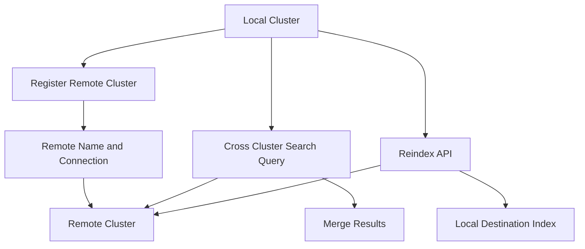

# Cross-Cluster Search and Reindex: Moving Data Between Clusters

## English

A single Elasticsearch cluster has limits: it lives in one region, is operated by one team, and has one set of security policies. Real organisations often end up with several clusters — one per region, one per environment, one per business unit, or one per data sensitivity tier. Two features let you work across those boundaries without merging everything into one giant cluster: cross-cluster search (CCS) and the reindex API.

Cross-cluster search lets a query on one cluster reach into remote clusters that have been registered with it. You register a remote with a name and a connection (seed hosts, plus credentials or an API key), and from then on a query can address indices on the remote using the `cluster_name:index_name` syntax. For example, `GET logs-*,eu-west:logs-*/_search` searches local log indices and the `logs-*` indices on the cluster registered as `eu-west`, and the results are merged by the coordinating node. This is enormously useful for a global view without copying data: a compliance team can query every regional cluster from a central one, or a security team can search across tenancy clusters. The cost is latency — every remote shard must respond over the network, and the coordinating node waits for the slowest — plus the operational burden of maintaining remote registrations and credentials. CCS also respects the remote cluster's own security settings, so the user on the local cluster must be authorised on the remote one too.

Reindex is the opposite approach: rather than querying across clusters, you copy documents from a source (which can be a remote cluster, an index, or an alias) into a destination index on the local cluster. The `_reindex` API takes a source and destination, and it can also take a query to select a subset and a script to transform documents during the copy. Because it uses bulk indexing under the hood, it is efficient for large datasets, but it is not transactional — if it fails halfway, you resume from a checkpoint or rerun with an idempotent destination. A common pattern is to reindex into a new index with a new mapping when you need to change a field type, then atomically swap an alias to point at the new index. That alias-swap trick is the standard way to do zero-downtime mapping migrations.

Choosing between CCS and reindex is a design decision about freshness versus locality. CCS gives you a live view of data that stays where it is — ideal when the remote cluster is the system of record and you just need occasional cross-cutting queries. Reindex gives you a local copy — ideal when you need low-latency queries, heavy aggregations, or a stable snapshot for a downstream system, and you can tolerate some staleness. A hybrid is common: reindex a curated subset into a central analytics cluster nightly, while keeping CCS available for ad-hoc investigations into the full remote data.

Both features have version and licensing caveats worth knowing. Remote cluster registration syntax has changed across versions (the old `cluster.remote` settings versus the newer `_cluster/settings` API and API-key-based registration). Reindexing from a remote needs the remote's connection details under `source.remote`, and the destination cluster must explicitly allow that host through the `reindex.remote.whitelist` node setting — remote-cluster registration is not required, because that registration is for cross-cluster search. And reindex is *not* throttled by default: `requests_per_second` defaults to `-1`, meaning no throttling, so you set it to a positive value yourself if you want protection. Either way, watch the destination's indexing rate and disk headroom. Treat both as tools that move load around rather than eliminate it: CCS moves load to the network and coordinating node, reindex moves load to the destination's indexing path.

## 中文

單一 Elasticsearch 叢集有其極限：它位於一個區域、由一個團隊營運、有一套安全策略。真實組織往往會有多個叢集——每個區域一個、每個環境一個、每個事業單位一個，或每個資料敏感等級一個。有兩個功能讓你跨越這些邊界工作，而不必把所有東西併成一個巨型叢集：跨叢集搜尋（cross-cluster search, CCS）與 reindex API。

跨叢集搜尋讓你對某叢集的查詢延伸到已註冊的遠端叢集。你用名稱與連線資訊（seed hosts，加上憑證或 API key）註冊一個 remote，之後查詢就能用 `cluster_name:index_name` 語法指向遠端索引。例如 `GET logs-*,eu-west:logs-*/_search` 會同時搜尋本地 log 索引與註冊為 `eu-west` 的叢集上的 `logs-*` 索引，結果由協調節點合併。這對「不複製資料也能有全域視野」極為有用：合規團隊可從中央叢集查詢每個區域叢集，資安團隊可跨多租戶叢集搜尋。代價是延遲——每個遠端分片都要在網路上回應，協調節點要等最慢的那個——加上維護 remote 註冊與憑證的營運負擔。CCS 也尊重遠端叢集自身的安全設定，所以本地叢集的使用者也必須在遠端被授權。

Reindex 是相反的策略：不是跨叢集查詢，而是把文件從來源（可以是遠端叢集、索引或 alias）複製到本地叢集的目的索引。`_reindex` API 接受來源與目的，也可帶查詢以選取子集，並帶腳本在複製時轉換文件。底層用 bulk 索引機制，對大量資料很有效率，但它不是交易性的——若中途失敗，你得從檢查點續傳，或用冪等的目的索引重跑。常見模式是：當需要改欄位型別時，reindex 到帶新 mapping 的新索引，再原子性地把 alias 指向新索引。這個 alias 切換技巧就是零停機 mapping 遷移的標準做法。

在 CCS 與 reindex 之間選擇，是關於「新鮮度與本地性」的設計決定。CCS 給你資料留在原地的即時視野——當遠端叢集是紀錄系統、而你只需要偶爾的跨切面查詢時最理想。Reindex 給你本地副本——當你需要低延遲查詢、重度聚合，或給下游系統一個穩定快照，且能容忍一些過時性時最理想。混合做法很常見：每晚把精選子集 reindex 到中央分析叢集，同時保留 CCS 供對完整遠端資料做臨時調查。

兩者都有版本與授權上的細節值得注意。Remote 註冊語法在版本間有變（舊的 `cluster.remote` 設定對比較新的 `_cluster/settings` API 與基於 API key 的註冊）。從遠端 reindex 需要在 `source.remote` 提供遠端的連線資訊，並由目的叢集透過 `reindex.remote.whitelist` 節點設定明確允許該主機——不需要做遠端叢集註冊，因為那套註冊是給跨叢集搜尋用的。而 reindex 預設並不會被節流：`requests_per_second` 預設是 `-1`，即完全不做節流；若想保護叢集，要自行設成正值。無論如何，都要留意目的端的索引速率與磁碟餘裕。把兩者都當作「把負載搬來搬去」而非消除負載的工具：CCS 把負載搬到網路與協調節點，reindex 把負載搬到目的端的索引路徑。

## Key Takeaway

Cross-cluster search gives live remote visibility at network-latency cost, while reindex gives a local copy at storage cost — pick based on freshness versus locality needs.

## Related Concepts
- Remote cluster registration
- Alias swap for zero-downtime migrations

## Diagram

