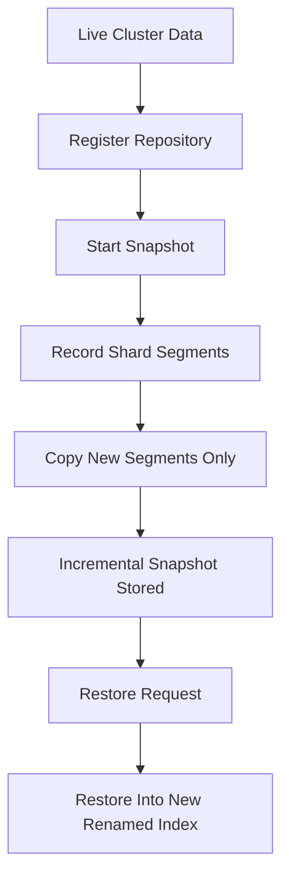

# Snapshot and Restore: Backups That Actually Work

## English

A snapshot in Elasticsearch is not a copy of the live data directory. It is a logical, incremental backup stored in a repository — an external storage location such as a shared filesystem, S3, GCS, Azure Blob, or HDFS. The repository is registered with the cluster using the snapshot repository API (`PUT _snapshot/my_repo` with a `type` and `settings`), and once registered, snapshots are taken with `PUT _snapshot/my_repo/my_snapshot`. The key insight is that snapshots are incremental: each snapshot stores only the segments that are new since the previous one, and the segments themselves are immutable, so older snapshots can share them safely. This is why ten daily snapshots do not cost ten times the disk of one — they cost roughly one full copy plus ten deltas.

Snapshots are not point-in-time in the strict database sense. When a snapshot starts, Elasticsearch records the set of segments in each shard, then copies those segments. Documents indexed after the snapshot began are not included, and a shard that is actively being written to may be snapshotted from a slightly earlier state. For most operational backup purposes this is fine, but it matters if you are trying to capture a transactionally consistent view across multiple indices — there is no cross-index transaction in Elasticsearch, so a snapshot of two indices can reflect slightly different moments. Plan for this by snapshotting related indices together and accepting a small window of inconsistency, or by quiescing writes during the snapshot if strict consistency is required.

Restore is the reverse operation, and it has an important subtlety: you almost never restore over a live index. Restoring into an existing index fails unless you rename it or the index is closed and deleted. The common pattern is to restore into a new index name (`_snapshot/my_repo/my_snapshot/_restore` with an `indices` and `rename_pattern`/`rename_replacement`), verify it, then swap an alias. This keeps the live index serving traffic while you inspect the restored data. Restores can also be partial: you can restore selected indices, and you can restore only certain indices from a snapshot that contains many. Restoring is throttled by `indices.recovery.max_bytes_per_sec` to avoid saturating the cluster, and it competes with normal indexing, so schedule restores like you would schedule a heavy reindex.

A backup is only as good as its restore test. The single most valuable operational habit is to periodically restore a snapshot into a scratch cluster and run a few representative queries against it. Snapshots can silently fail in ways that only surface on restore: a repository that lost write permissions, a snapshot that completed but referenced segments that were later pruned by a concurrent snapshot cleanup, or a version mismatch between the snapshot's Lucene format and the target cluster. Elasticsearch has a snapshot lifecycle management (SLM) feature that automates taking, retaining, and deleting snapshots on a schedule, but SLM does not test restores for you. Pair it with a restore drill.

Finally, snapshots are not a substitute for a replica-based high-availability strategy, and replicas are not a substitute for snapshots. Replicas protect against node failure within a cluster; snapshots protect against cluster-wide disasters, accidental deletion, and corruption. A common failure mode is to have replicas but no off-cluster snapshot, so a bad mapping change or a runaway delete wipes the data on every node at once. Keep snapshots in a repository that is physically separate from the cluster's data path — ideally object storage in a different account or region — and verify that the credentials used by the cluster can write but not delete the repository if you want protection against a compromised cluster.

## 中文

Elasticsearch 的快照並不是即時資料目錄的複本。它是一份邏輯性、增量式的備份，存放在 repository（儲存庫）——一個外部儲存位置，例如共享檔案系統、S3、GCS、Azure Blob 或 HDFS。Repository 用快照儲存庫 API 註冊到叢集（`PUT _snapshot/my_repo`，帶 `type` 與 `settings`），註冊後用 `PUT _snapshot/my_repo/my_snapshot` 建立快照。關鍵洞見是快照是增量的：每份快照只儲存自上一份以來新增的 segment，而 segment 本身不可變，所以舊快照可安全共用它們。這就是為何十份每日快照不會花掉十倍的磁碟——大約是一份完整複本加上十份差異。

快照並不是嚴格資料庫意義上的時間點一致。快照開始時，Elasticsearch 記錄每個分片中的 segment 集合，然後複製那些 segment。快照開始後才索引的文件不會被包含，而正在被寫入的分片可能從稍早的狀態被快照。對多數營運備份用途這沒問題，但若你想跨多個索引捕捉交易一致的視野就有關係——Elasticsearch 沒有跨索引交易，所以兩個索引的快照可能反映略有不同的時刻。因應方式是將相關索引一起快照並接受一小段不一致窗口，或在需要嚴格一致時於快照期間暫停寫入。

還原（restore）是反向操作，有個重要細節：你幾乎不會直接還原到正在運作的索引上。還原到既有索引會失敗，除非你重新命名，或該索引已關閉並刪除。常見模式是還原到新索引名稱（`_snapshot/my_repo/my_snapshot/_restore`，帶 `indices` 與 `rename_pattern`/`rename_replacement`），驗證後再切換 alias。這樣在檢視還原資料時，線上索引仍可服務流量。還原也可以部分進行：你可以只還原選定的索引，也可以從含多個索引的快照中只還原某些索引。還原受 `indices.recovery.max_bytes_per_sec` 節流，以免飽和叢集，且會與正常索引競爭，所以要把還原當作重型 reindex 一樣安排時程。

備份的好壞取決於還原測試。最有價值的營運習慣，是定期把快照還原到一個臨時叢集，並對它跑幾個代表性查詢。快照可能以只在還原時才浮現的方式默默失敗：repository 遺失寫入權限、快照雖完成但引用的 segment 後來被並行的快照清理刪除，或快照的 Lucene 格式與目標叢集版本不符。Elasticsearch 有快照生命週期管理（SLM）功能，可依排程自動建立、保留與刪除快照，但 SLM 不會替你測試還原。要搭配還原演練。

最後，快照不能取代基於副本的高可用策略，副本也不能取代快照。副本防範叢集內的節點故障；快照防範叢集級災難、誤刪與損壞。常見的失敗模式是有副本但沒有叢集外快照，於是一次錯誤的 mapping 變更或失控的刪除就一次抹掉所有節點上的資料。把快照放在實體上與叢集資料路徑分離的 repository——理想上是在不同帳戶或區域的物件儲存——並確認叢集使用的憑證能寫入但不能刪除該 repository，以防叢集被入侵。

## Key Takeaway

Snapshots are incremental, immutable-segment backups stored off-cluster — but they only count as backups once you have actually restored one.

## Related Concepts
- Snapshot lifecycle management
- Repository configuration

## Diagram

