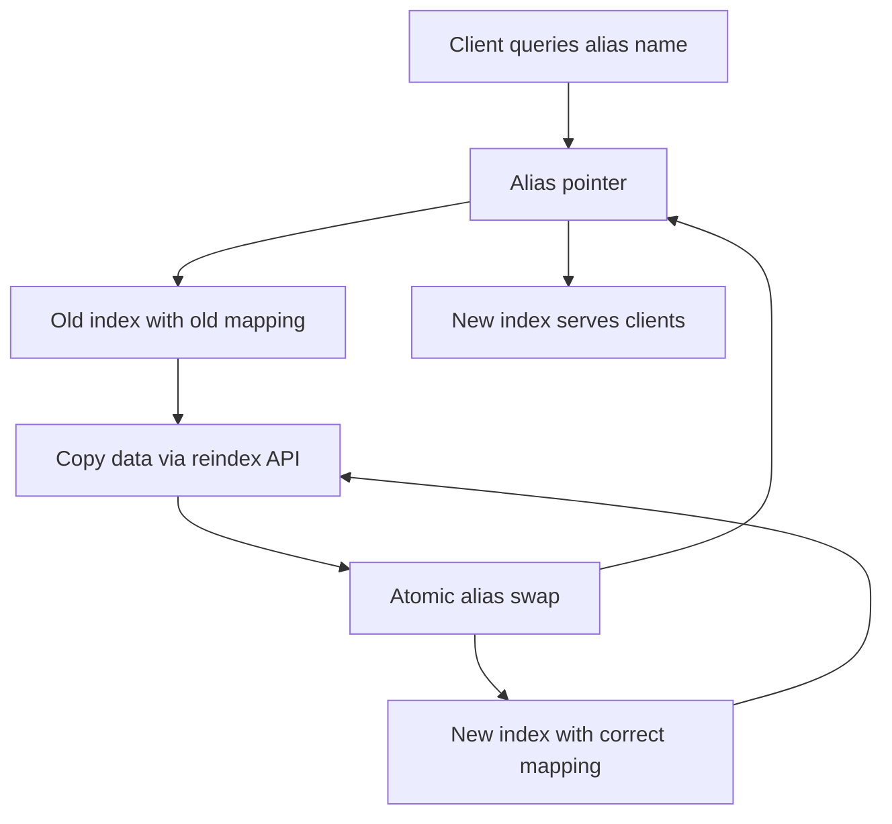

# Index Aliases and Zero-Downtime Reindexing

## English

An index alias is a named pointer that sits in front of one or more real indices. Your application queries the alias name, never the concrete index name, and Elasticsearch resolves the alias to whatever indices are currently attached to it. This indirection is the single most useful operational trick in Elasticsearch, because it lets you swap the data underneath an alias without ever changing a line of client code. Think of it like a DNS record: clients ask for a stable name, and the operator decides what that name points to.

The classic use case is a mapping change. Suppose your index has a field mapped as `text` but you now need it as `keyword`, or you want to add a new analyzer. You cannot change a field's type in place on an existing index — mappings are largely immutable once data exists. Instead you create a brand new index with the correct mapping, copy the data over using the `_reindex` API, and then perform an atomic alias swap in a single `_aliases` POST request that removes the old index from the alias and adds the new one. Because the swap is atomic, clients never see a moment where the alias points at nothing or at both indices.

You can also use aliases for read/write separation. A common pattern is to attach an index to the alias with `is_write_index: true` while other indices are read-only. Writes go to the designated index, but reads span all of them. This is how you can pre-build tomorrow's index, warm it up, then flip the write pointer at midnight without a maintenance window. Filters on aliases let you carve out a subset of one index — for example, an alias that only exposes documents where `tenant_id` equals a particular value, giving lightweight multi-tenancy.

A few practical cautions: aliases are cheap but not free — every alias adds a small amount of cluster-state overhead, and thousands of aliases can slow down cluster-state propagation. Also remember that some APIs behave differently on aliases; for instance, you cannot use an alias as a target for certain index-level settings changes. And when you reindex, watch out for the refresh interval and the `slices` parameter — reindexing with multiple slices parallelises the copy and can dramatically shorten the window during which you are maintaining two copies of the data.

In production, the healthy pattern is: every application-facing index name is actually an alias, the real indices carry a versioned suffix like `products_v7`, and all deploys, mapping changes, and backfills happen by building a new versioned index and swapping the alias. This turns scary schema migrations into a routine, reversible operation.

## 中文

索引別名（index alias）係一個掛喺一或多個真實索引前面嘅具名指針。你嘅應用程式只會查詢別名，永遠唔會直接查實體索引名，而 Elasticsearch 會將個別名解析成目前掛喺佢下面嘅索引。呢種間接層係 Elasticsearch 最實用嘅維運技巧之一，因為佢令你可以喺完全唔改客戶端程式碼嘅情況下，換走別名下面嘅資料。可以想像成 DNS 記錄：客戶端問一個穩定嘅名，由營運者決定個名指向邊度。

最經典嘅用途係改 mapping。假設你個索引有個欄位 map 咗做 `text`，但而家你需要佢做 `keyword`，或者想加個新 analyzer。喺已經有資料嘅索引度，你係唔可以原地改欄位型別嘅——mapping 一旦有咗資料就大致上唔可以改。你要做嘅係：用正確 mapping 開一個全新索引，用 `_reindex` API 將資料抄過去，然後喺一個 `_aliases` POST 請求入面做原子性嘅別名切換，同一個請求入面將舊索引移出別名、將新索引加入。因為切換係原子性嘅，客戶端永遠唔會見到別名指向空氣、或者同時指向兩個索引嘅一刻。

別名仲可以用嚟做讀寫分離。常見做法係將某個索引掛上別名並設 `is_write_index: true`，其他索引就唯讀。寫入去指定索引，但讀取就橫跨晒全部。咁你就可以預先建好聽日嘅索引、預熱佢，然後喺午夜切換寫入指針，完全唔使維護窗口。別名上面嘅 filter 仲可以幫你由單一索引度切出一部分——例如一個只暴露 `tenant_id` 等於某個值嘅文件嘅別名，提供輕量級多租戶。

有幾個實務上要留意嘅位：別名好便宜但唔係免費——每個別名都會加少少 cluster state 開銷，幾千個別名會拖慢 cluster state 嘅傳播。另外要記住有啲 API 喺別名上面行為唔同；例如你唔可以用別名做某啲索引層級設定變更嘅目標。仲有做 reindex 嗰陣，要留意 refresh interval 同 `slices` 參數——用多個 slice 做 reindex 會並行化複製，可以大幅縮短你同時維護兩份資料嘅窗口。

喺生產環境，健康嘅模式係：所有面向應用嘅索引名其實都係別名，真實索引帶版本後綴例如 `products_v7`，所有部署、mapping 變更、回填都係透過建立新版本索引再切換別名嚟做。咁就將可怕嘅 schema 遷移變成例行、可逆嘅操作。

## Key Takeaway

Point your application at an alias, not a concrete index, so mapping changes and reindexing become an atomic alias swap instead of a downtime event.

## Related Concepts
- Reindex API
- Mapping immutability

## Diagram

