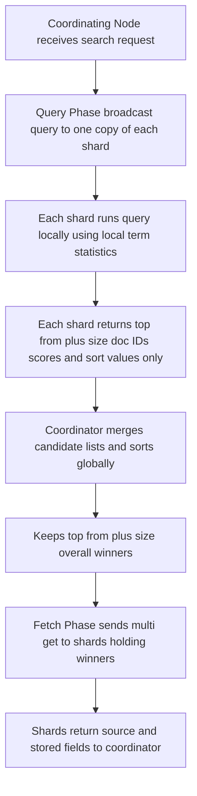

# The Query Then Fetch Two-Phase Search

## English

When you send a search request to a cluster, the coordinating node does not simply ask every shard for its top ten hits and merge the lists. That naive approach would be wrong, because relevance scores computed on one shard are not directly comparable to scores on another — each shard computes its own term statistics. Elasticsearch solves this with a two-phase protocol called query then fetch, and understanding it explains a lot of surprising behaviour around pagination and latency.

In the query phase, the coordinating node broadcasts the query to every shard that the index pattern covers (one copy of each shard, chosen from primary or replica). Each shard runs the query locally, computes scores using its own local statistics, and returns only a lightweight result: the document IDs, the scores, and the sort values of its top N candidates — where N is `from + size`. No document bodies are sent yet. The coordinator then merges all these candidate lists, sorts them globally by score or sort key, and keeps the top `from + size` overall.

In the fetch phase, the coordinator takes those winning document IDs and issues a multi-get to the specific shards that hold them, requesting the actual `_source` and stored fields. Only now do full documents travel across the network. This is why deep pagination is expensive: to return page 1000 with 10 results per page, every shard must still send its top 10,010 candidate IDs and scores in the query phase, even though 10,000 of them will be discarded. The cost grows with `from + size`, not with the number of results you actually display.

This design also explains why `track_total_hits` matters. By default Elasticsearch stops counting total hits accurately after 10,000, because counting every match across every shard would be expensive. If you need exact totals you set `track_total_hits: true`, accepting the cost. It also explains why relevance can seem inconsistent: scores are computed per shard, so if data is unevenly distributed across shards, the same document might score differently depending on which shard it lives on. For most use cases this is fine, but for strict ranking you can use `dfs_query_then_fetch` as the search type, which does a preliminary round to gather global term statistics before scoring.

Finally, this is why `search_after` with a point-in-time (PIT) is the recommended way to paginate deep result sets. Instead of asking for page 1000, you ask for the next 10 documents after a known sort cursor, so every shard only needs to return a small candidate list each time. The mental model to keep: query phase narrows to IDs and scores, fetch phase pulls bodies — and anything that inflates the candidate set inflates your latency.

## 中文

當你送一個搜尋請求去叢集，協調節點並唔係簡單咁問每個分片攞佢頭十個 hit 然後合併清單。呢個天真做法係錯嘅，因為喺一個分片上面計出嚟嘅相關性分數，同另一個分片上面嘅分數唔可以直接比較——每個分片都係用自己嘅詞項統計去計分。Elasticsearch 用一個叫 query then fetch 嘅兩階段協定去解決，明白咗佢就解釋到好多關於分頁同延遲嘅意外行為。

喺 query 階段，協調節點將查詢廣播去 index pattern 覆蓋嘅每個分片（每個分片揀一份副本，主分片或 replica 都得）。每個分片喺本地跑查詢，用自己本地嘅統計計分，然後只回傳輕量結果：文件 ID、分數、同埋佢頭 N 個候選嘅排序值——N 就係 `from + size`。呢個時候文件內容仲未送出。協調節點然後合併晒所有候選清單，按分數或排序鍵做全域排序，保留整體頭 `from + size` 個。

喺 fetch 階段，協調節點攞住贏咗嘅文件 ID，向持有佢哋嘅特定分片發 multi-get，要求真正嘅 `_source` 同 stored fields。到呢一步完整文件先至會經網絡傳輸。呢個就係深分頁咁貴嘅原因：要回傳第 1000 頁、每頁 10 個結果，每個分片喺 query 階段都仍然要送佢頭 10,010 個候選 ID 同分數，雖然其中 10,000 個最後會被丟棄。成本係隨 `from + size` 增長，唔係隨你實際顯示嘅結果數量增長。

呢個設計亦解釋咗 `track_total_hits` 為何重要。預設 Elasticsearch 喺 10,000 之後就唔再準確計總 hit 數，因為跨每個分片去數晒所有匹配會好貴。如果你需要精確總數，你要設 `track_total_hits: true`，接受個成本。佢亦解釋咗為何相關性睇落好似唔一致：分數係逐分片計，所以如果資料喺分片之間分佈唔均勻，同一份文件可能因為住喺邊個分片而得到唔同分數。對大部分用途嚟講冇問題，但若要嚴格排序，你可以用 `dfs_query_then_fetch` 做 search type，佢會先做一輪預備去收集全域詞項統計先至計分。

最後，呢個就係為何用 point-in-time（PIT）配合 `search_after` 係深結果集分頁嘅建議做法。你唔係要求第 1000 頁，而係要求喺一個已知排序游標之後嘅下 10 份文件，所以每次每個分片只需回傳一小份候選清單。要記住嘅心智模型：query 階段收窄到 ID 同分數，fetch 階段先至拉文件內容——任何令候選集膨脹嘅嘢，都會令你嘅延遲膨脹。

## Key Takeaway

Search runs in two phases — query collects only IDs and scores from every shard, fetch pulls the actual documents — so deep pagination cost scales with from + size, not with results shown.

## Related Concepts
- search_after pagination
- Point in time (PIT)

## Diagram

