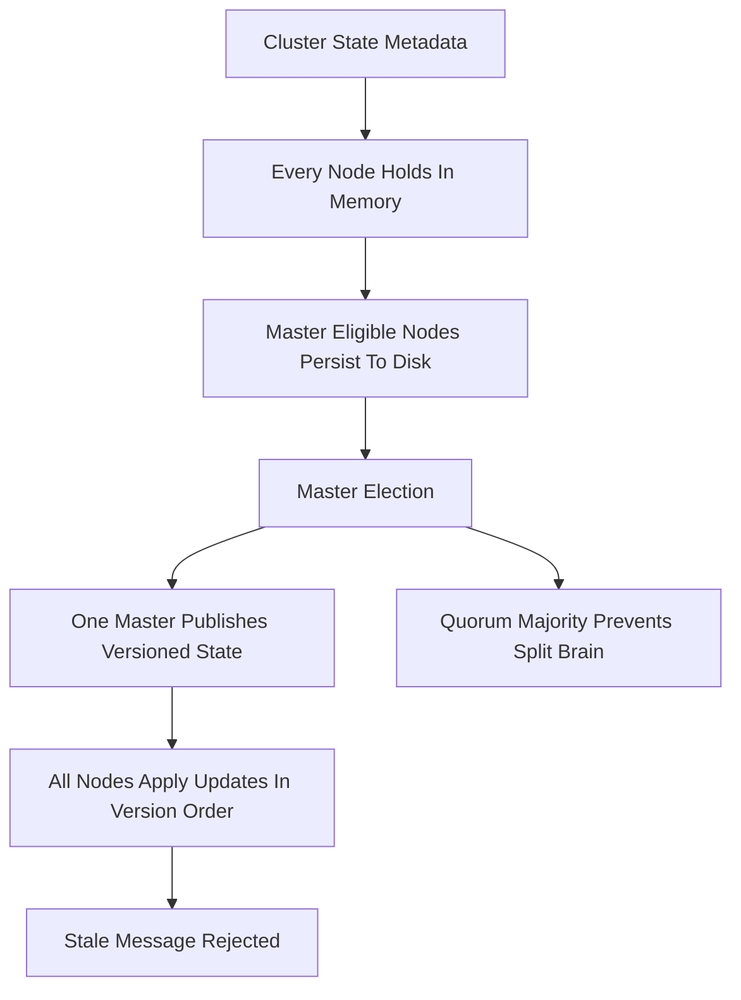

# Cluster State, Master Election, and Split Brain

## English

Every Elasticsearch cluster has a cluster state: a metadata document describing all indices, their mappings and settings, which shards live on which nodes, and which nodes are in the cluster. This state is not stored in a database — it is held in memory by every node and persisted to disk on the master-eligible nodes. Keeping every node's copy consistent is the central coordination problem of the cluster, and the mechanism that solves it is the master election plus a versioned state publication protocol.

Only master-eligible nodes can be elected master. Exactly one node is master at a time; it is the only node allowed to change the cluster state. Other master-eligible nodes are standbys ready to take over. Non-master-eligible nodes (data nodes, ingest nodes, coordinating-only nodes) receive state updates but never vote. When the master publishes a new state, it increments a cluster-state version number and pushes the diff to all nodes. Each node applies updates in version order and rejects anything older than what it already has, which guarantees that a stale message can never roll back a node's view.

The dangerous failure mode is split brain: two nodes both believing they are master, each accepting writes, leading to divergent data that is painful to reconcile. Elasticsearch guards against this with a quorum requirement. The setting `discovery.zen.minimum_master_nodes` was the historical defence — set it to a majority of master-eligible nodes so no minority partition can elect a master. In modern versions this is replaced by the voting configuration managed automatically by the cluster, but the principle is identical: a master must be backed by a majority of master-eligible nodes.

This is why the number of master-eligible nodes matters. With three master-eligible nodes, the cluster tolerates one failure and still elects a master. With two, you have no fault tolerance at all — losing either one leaves no majority, and the cluster cannot elect a master, so it goes read-only or unavailable. This is the classic reason to run an odd number (three or five) of dedicated master-eligible nodes and never exactly two. Running five tolerates two failures; beyond that, election traffic grows without much benefit.

Practically, keep master-eligible nodes small and dedicated. They do not need large heaps or fast disks, but they need stable networking and low latency to each other, because election and state publication are latency-sensitive. Watch the pending cluster-state task queue with `GET /_cluster/pending_tasks`, which lists each queued task with its source and how long it has been waiting — a growing queue of pending cluster-state updates is an early warning that the master is overloaded or that state changes are too frequent (for example, too many shards or too many aliases churning). A healthy cluster has a quiet, stable master and a cluster-state version that advances in small, occasional steps.

## 中文

每個 Elasticsearch 叢集都有一個 cluster state：一份 metadata 文件，描述晒所有索引、佢哋嘅 mapping 同設定、邊個分片住喺邊個節點、以及邊啲節點喺叢集入面。呢個 state 唔係存喺資料庫——佢係由每個節點喺記憶體持有，並喺 master-eligible 節點上面持久化到磁碟。令每個節點嘅副本保持一致，就係叢集嘅核心協調問題，而解決佢嘅機制就係 master 選舉加上有版本嘅 state 發佈協定。

只有 master-eligible 節點可以被選做 master。同一時間只有一個節點係 master；只有佢可以改 cluster state。其他 master-eligible 節點係候補，隨時接手。非 master-eligible 節點（data node、ingest node、coordinating-only node）會收到 state 更新但永遠唔會投票。當 master 發佈新 state，佢會將 cluster-state 版本號加一，並將差異推送去所有節點。每個節點按版本順序套用更新，並拒絕任何比佢已經有嘅更舊嘅嘢，咁就保證咗過時訊息永遠唔可以回滾一個節點嘅視角。

最危險嘅失效模式係 split brain：兩個節點都以為自己係 master，各自接受寫入，導致資料分歧，事後好難對賬。Elasticsearch 用 quorum 要求去防範。`discovery.zen.minimum_master_nodes` 係歷史上嘅防線——將佢設做 master-eligible 節點嘅多數，咁任何少數派分割都冇辦法選出 master。喺現代版本，呢個被叢集自動管理嘅 voting configuration 取代，但原則完全一樣：一個 master 必須獲多數 master-eligible 節點支持。

呢個就係為何 master-eligible 節點嘅數目咁重要。有三個 master-eligible 節點，叢集可以容忍一個失效並仍然選到 master。有兩個，你就完全冇容錯——失去任何一個都冇多數，叢集選唔到 master，於是變唯讀或者不可用。呢個就係經典原因，要跑單數（三或五）嘅專用 master-eligible 節點，永遠唔好啱啱好兩個。跑五個可以容忍兩個失效；再多，選舉流量會增長但冇乜好處。

實務上，要令 master-eligible 節點細細粒同專用。佢哋唔需要大 heap 或者快磁碟，但需要穩定網絡同彼此之間低延遲，因為選舉同 state 發佈對延遲敏感。用 `GET /_cluster/pending_tasks` 觀察 pending cluster-state 任務佇列，佢會列出每個排隊中的任務、其來源同已經等了多久——pending cluster-state 更新嘅隊列越嚟越長，係 master 超載或者 state 變更太頻繁（例如太多分片或者太多別名喺度 churn）嘅早期警號。健康嘅叢集有一個安靜、穩定嘅 master，cluster-state 版本以小而偶爾嘅步伐前進。

## Key Takeaway

One master at a time publishes versioned cluster state, and a majority quorum of master-eligible nodes prevents split brain — which is why you run an odd number (three or five) and never exactly two.

## Related Concepts
- Split brain
- Voting configuration

## Diagram

