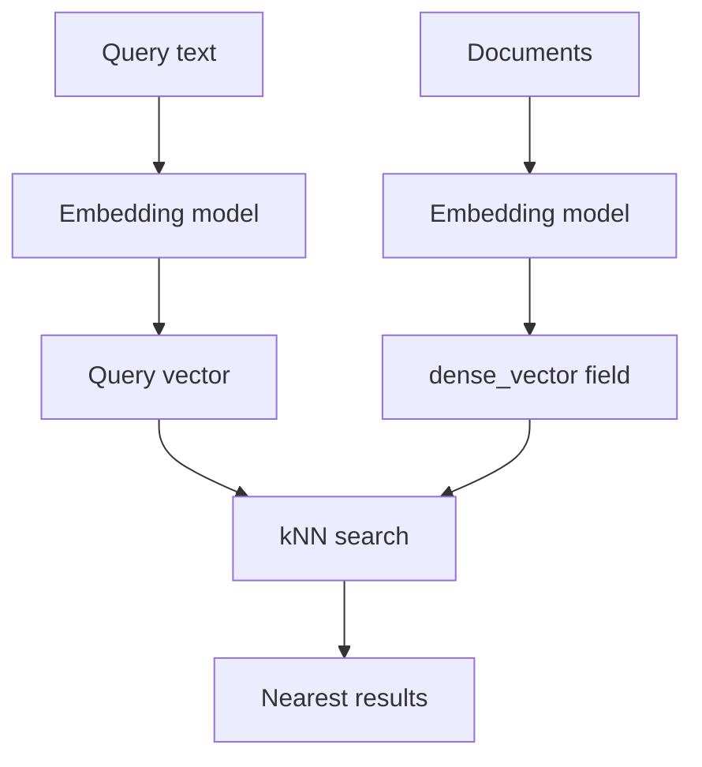

# Vector Search and kNN: When Similarity Isn't About Words

## English

Classic full-text search matches tokens: if you type "laptop", the inverted index finds documents containing that exact token (after analysis). That breaks down when meaning matters more than spelling. A document saying "portable computer for travel" shares almost no tokens with a query for "laptop", yet a human would call them related. Vector search solves this by representing each document and query as a dense vector — a long list of floating-point numbers, typically hundreds or thousands of dimensions — produced by a machine-learning embedding model. Documents with similar meaning end up close together in this vector space, so the search becomes a nearest-neighbour problem: find the vectors closest to the query vector. Distance is usually measured by cosine similarity or dot product, and Elasticsearch exposes this in mappings as a field of type `dense_vector` with a fixed `dims` count and a `similarity` setting such as `cosine` or `dot_product`. Because the number of dimensions is fixed at mapping time, you cannot change the embedding model later without reindexing — a practical gotcha worth internalising.

The naive way to find nearest neighbours is exact: compare the query vector against every stored vector and sort. That is called brute-force or exact kNN, and Elasticsearch supports it with `knn` queries when the field is configured appropriately. It is perfectly accurate but scales linearly with the number of documents, so it becomes expensive on large indices. The alternative is approximate nearest neighbour (ANN) search, which trades a small amount of recall — the fraction of truly nearest results you actually retrieve — for a large speedup. Elasticsearch implements ANN using HNSW (Hierarchical Navigable Small World), a graph structure where each vector is a node connected to a handful of nearby nodes, and the search walks the graph greedily toward the query. HNSW is built incrementally as documents are indexed, which is why you configure it in the mapping with parameters like `m` (number of links per node) and `ef_construction` (search breadth while building the graph).

HNSW is best understood as a multi-layer road network. The top layers are sparse highways connecting distant regions, letting the search jump quickly across the space; the bottom layer is dense local streets, letting it home in on the exact neighbourhood. A search starts at the top, moves to whichever neighbour is closer to the query, drops down a layer, and repeats. The parameter `ef_search` (set per query) controls how many candidates are explored at the bottom layer: higher values improve recall at the cost of latency. This is the central trade-off of approximate search — you are not wrong, you are just occasionally missing a near neighbour, and you can dial that miss rate up or down. Measuring recall against a brute-force baseline on a sample of queries is the honest way to tune it.

In practice, modern Elasticsearch lets you combine lexical and vector search in one request. You can run a `knn` clause alongside a standard `query` clause and merge the scores, either by simple summation or by a rank-fusion method such as reciprocal rank fusion (RRF), which combines result lists by their positions rather than their raw scores. RRF is attractive because BM25 scores and vector similarity scores live on completely different scales, so adding them directly is somewhat arbitrary. Hybrid search is often the best of both worlds: keyword matching catches exact product codes, names, and rare terms where embeddings are weak, while vectors catch paraphrases and synonyms where keywords fail. The engineering cost is real — embedding models must run at both index time and query time, storage grows substantially because each vector is hundreds of floats, and re-embedding an entire index is a heavy operation. Treat the embedding model as part of your schema, version it, and plan for migrations the same way you would for a mapping change.

A few practical cautions round this out. Vectors are expensive to store and to compute, so they are usually paired with filters: you rarely want the nearest neighbour in the whole corpus, you want the nearest neighbour among documents matching a category or date range. Filtering interacts subtly with graph-based ANN because the graph was built without knowledge of your filters, so heavily selective filters can degrade recall or force a different execution strategy. Also remember that vector search does not replace analysis; it complements it. A well-designed system often uses analyzers and keyword fields for precision and structure, and vectors for semantic recall, with the ranking layer deciding how to blend them. Finally, evaluate with real queries and real relevance judgements rather than intuition — the whole point of a hybrid setup is that no single signal is trustworthy on its own.

## 中文

傳統全文搜索是比對詞元（token）：你輸入「laptop」，倒排索引就會找出經過分析後含有這個確切詞元的文件。但當「意思」比「串法」更重要時，這種方法就會失效。一份寫著「portable computer for travel」的文件，與查詢「laptop」幾乎沒有共同的詞元，但人類會認為兩者相關。向量搜索就是為此而生：它把每份文件和查詢都表示成稠密向量（dense vector）——一長串浮點數，通常有數百甚至數千個維度——由機器學習的嵌入模型（embedding model）產生。語意相近的文件在這個向量空間中會靠得很近，於是搜索就變成最近鄰問題：找出離查詢向量最近的向量。距離通常用餘弦相似度（cosine similarity）或點積（dot product）量度，Elasticsearch 在 mapping 中以 `dense_vector` 類型呈現，需指定固定的 `dims` 維度數和 `similarity` 設定，例如 `cosine` 或 `dot_product`。由於維度在建立 mapping 時就固定，日後想換嵌入模型就必須重新索引——這是個值得牢牢記住的實務陷阱。

最直觀的找最近鄰方法是精確比對：把查詢向量與每一個已儲存的向量比較再排序。這叫暴力法（brute-force）或精確 kNN，當欄位設定妥當時，Elasticsearch 可用 `knn` 查詢支援。它完全準確，但成本隨文件數量線性增長，在大型索引上會變得昂貴。另一條路是近似最近鄰（ANN）搜索，用一點召回率（recall，即真正最近的結果中你實際取回的比例）換取大幅加速。Elasticsearch 用 HNSW（Hierarchical Navigable Small World，分層可導航小世界）實作 ANN：這是一種圖結構，每個向量是一個節點，只與少數鄰近節點相連，搜索時沿著圖貪心地朝查詢點走。HNSW 是隨著文件被索引而逐步建立的，所以你要在 mapping 中設定 `m`（每個節點的連結數）和 `ef_construction`（建圖時的搜索廣度）等參數。

HNSW 可以想像成一個多層道路網。上層是稀疏的高速公路，連接相距遙遠的區域，讓搜索能快速跨越整個空間；底層是密集的本地街道，讓它精準地逼近目標鄰域。搜索從頂層開始，移動到離查詢更近的鄰居，再下降一層，如此反覆。每次查詢可設的 `ef_search` 參數，控制底層要探索多少個候選：數值越高，召回率越好，但延遲也越高。這正是近似搜索的核心取捨——你不是錯了，只是偶爾漏掉一個近鄰，而你可以把這個漏掉的比例調高或調低。用暴力法結果作基準，在一批樣本查詢上量度召回率，是調參最誠實的方法。

在實務上，現代 Elasticsearch 讓你在同一個請求中結合詞彙搜索與向量搜索。你可以同時執行 `knn` 子句和標準 `query` 子句，再合併分數，方法可以是簡單相加，也可以是倒數排名融合（reciprocal rank fusion, RRF）之類的排名融合法——後者按結果的排名而非原始分數來合併。RRF 之所以吸引，是因為 BM25 分數和向量相似度分數處於完全不同的尺度，直接相加有點任意。混合搜索往往兩全其美：關鍵字比對能捕捉產品編號、人名和罕見詞這些嵌入模型較弱的地方，向量則能捕捉改寫和同義詞這些關鍵字失手的地方。工程成本卻很真實——索引時和查詢時都要跑嵌入模型，儲存空間因每個向量有數百個浮點數而大幅增加，重新嵌入整個索引更是沉重操作。請把嵌入模型視為 schema 的一部分，為它版本化，並像規劃 mapping 變更一樣規劃遷移。

最後有幾點實務提醒。向量儲存和運算都很貴，所以通常會配合過濾：你很少想要全 corpus 的最近鄰，而是想要符合某個分類或日期範圍的文件中的最近鄰。過濾與基於圖的 ANN 互動微妙，因為圖在建立時並不知道你的過濾條件，所以高度選擇性的過濾可能降低召回率或迫使系統改用其他執行策略。另外要記住，向量搜索並不取代分析，而是相輔相成。設計良好的系統常用分析器和 keyword 欄位追求精確與結構，用向量追求語意召回，再由排名層決定如何混合。最後，請用真實查詢和真實的相關性判斷來評估，而不是憑直覺——混合架構的重點正是：沒有任何單一訊號可以單獨信賴。

## Key Takeaway

Vector search turns meaning into geometry, and HNSW makes nearest-neighbour lookup fast by accepting a tunable, measurable amount of approximation.

## Related Concepts
- HNSW graph index
- Hybrid lexical and vector ranking

## Diagram

