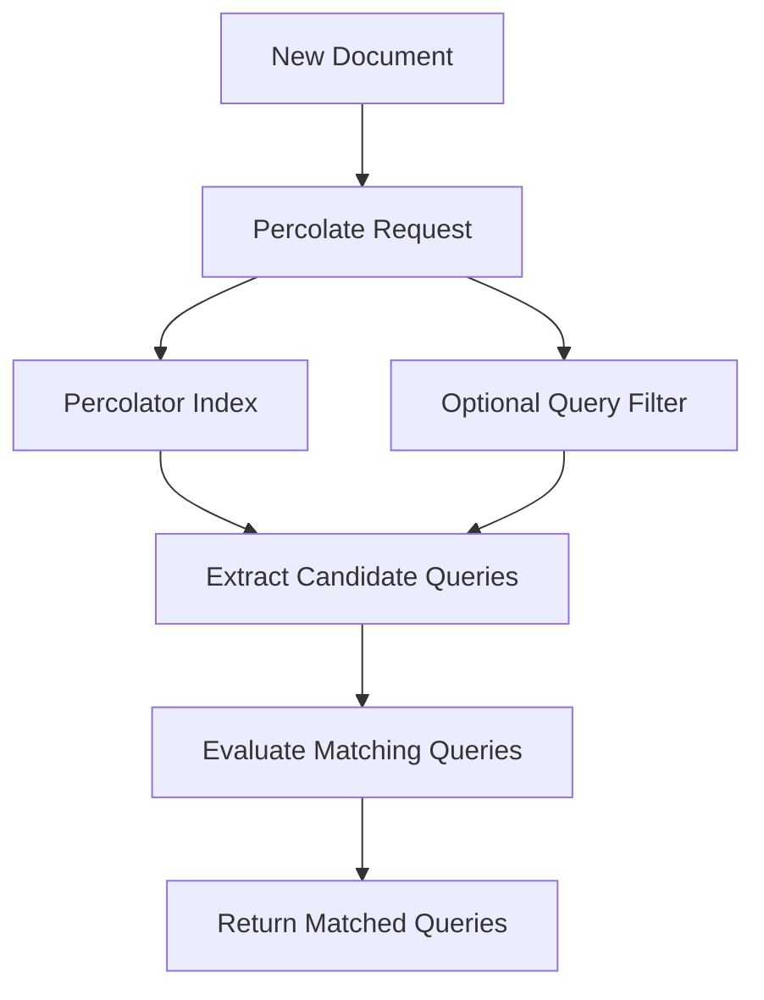

# Percolator: Turning Search Upside Down

## English

In ordinary search you have queries and documents, and you ask: which documents match this query? The percolator feature in Elasticsearch flips the question: given a document, which stored queries match it? This sounds like a curiosity but it maps onto a very common real-world need. Imagine a news alerting system with thousands of saved user subscriptions — "tell me about articles mentioning a specific company", "alert me to recalls in the food industry", "notify me when a listing under a price threshold appears". You could run every subscription as a query against every new article, but that is thousands of searches per article. With the percolator you index those queries once, then send each new document through a single percolate request and get back the list of matching queries. The cost model inverts, and it becomes cheap to add documents and expensive-ish to add queries, which is exactly right for alerting, monitoring, and rule engines.

Mechanically, you register queries in a dedicated index whose mapping includes a `percolator` field. Each stored query is itself a document: the query DSL lives inside that field, and any other fields in the same document act as metadata you can filter on later. When you percolate, Elasticsearch extracts the queries relevant to the incoming document — using an internal structure that narrows candidates by the fields and terms the document actually contains — and evaluates only those, rather than brute-forcing every stored query. You can restrict a percolate call to a subset of queries with a query on the percolator index, so a document about sports need not be checked against finance-only rules. Results tell you which query documents matched, and you can ask for highlighting or scoring if you need to know why.

The percolator has real constraints that shape how you use it. The stored queries must be ones the percolator can handle; some query types are unsupported or have limitations, and very complex queries with heavy scripting are best avoided. Each stored query is a document, so it consumes index space and must be kept in sync with your application's rule definitions — an update to a rule means reindexing that query document. There is also a practical limit on how many queries you can realistically store; millions of tiny rules can work but require care with shard count and memory. Because percolation is a search operation, it inherits the near-real-time model: a newly indexed query is not visible until a refresh, so an alert rule added a second ago may not fire on a document indexed in the same instant. Design your alerting latency budget with that in mind.

A useful analogy is a wall of pigeonholes versus a sorting machine. Normal search is a sorting machine: you feed in a document and it tells you which pigeonhole (query) it belongs to — but only for one pigeonhole at a time. The percolator is the wall itself: you drop a document in and every pigeonhole that matches lights up at once. This is why percolation shines in event-driven pipelines. A stream of log lines, transactions, or sensor readings flows through, and the percolator acts as a rule engine tagging each event with the set of policies it triggers. Combined with ingest pipelines you can enrich, percolate, and route events in one pass, writing matches into a separate index for alerting or dashboards.

When should you reach for it? Use the percolator when you have many relatively stable queries and a high volume of documents, and when the queries are the thing you want to manage as data — with owners, versions, and enable/disable flags. Avoid it when the number of rules is small and the document volume is low, because ordinary search is simpler to reason about. Avoid it too when rules change constantly, since each change is an index write. And be careful with scoring: percolation is fundamentally a matching operation, and relevance ranking across stored queries is less natural than in normal search, so if you need sophisticated ranking of alerts, you may want to post-process the matched rules yourself. Treated as a rule engine over a stream, the percolator is one of the most underused features in the stack.

## 中文

在普通搜尋中，你有查詢和檔案，然後問：哪些檔案符合這個查詢？Elasticsearch 的 percolator（滲透查詢）功能把問題倒轉：給定一份檔案，哪些已儲存的查詢符合它？這聽起來像奇技淫巧，卻對應一個非常常見的現實需求。想像一個新聞警示系統，有數千條使用者訂閱——「有文章提到某間公司就通知我」、「食品業有回收事件就提醒我」、「有低於某價格的放盤就通知我」。你可以把每條訂閱當成查詢，對每篇新文章逐一執行，但那就是每篇文章數千次搜尋。用 percolator，你把這些查詢索引一次，然後每份新檔案只需一個 percolate 請求，就能拿回符合的查詢清單。成本模型反轉了：新增檔案變便宜，新增查詢則相對昂貴——這正好適合警示、監控和規則引擎。

機制上，你把查詢註冊在一個專用索引，其 mapping 包含一個 `percolator` 欄位。每條已儲存的查詢本身就是一份檔案：查詢 DSL 放在該欄位內，同一份檔案的其他欄位則作為日後可過濾的中繼資料（metadata）。執行 percolate 時，Elasticsearch 會先抽出與傳入檔案相關的查詢——利用內部結構，按檔案實際含有的欄位和詞元縮窄候選範圍——然後只評估這些，而不是暴力檢查每一條已儲存的查詢。你可以用對 percolator 索引的查詢，把 percolate 呼叫限制在部分查詢上，這樣一篇體育文章就不必拿去比對只針對財經的規則。結果會告訴你哪些查詢檔案符合，如有需要還可要求 highlighting 或評分，以瞭解符合的原因。

Percolator 有實質限制，會影響你的用法。已儲存的查詢必須是 percolator 能處理的；部分查詢型別不受支援或有限制，牽涉大量 scripting 的極複雜查詢最好避免。每條已儲存的查詢都是一份檔案，會佔用索引空間，也必須與應用程式的規則定義保持同步——更新一條規則就等於重新索引那份查詢檔案。現實中能儲存多少查詢也有限制；數百萬條細小規則可以運作，但需要小心處理分片數目和記憶體。由於滲透查詢本質上是搜尋操作，它繼承了近即時模型：新索引的查詢要等到 refresh 後才可見，所以一秒前才加入的警示規則，可能不會對同一瞬間索引的檔案觸發。設計警示延遲預算時要記住這一點。

一個好用的比喻是鴿子洞牆與分類機。普通搜尋是分類機：你送入一份檔案，它告訴你該放進哪個鴿子洞（查詢）——但一次只能處理一個鴿子洞。Percolator 則是整面牆：你把檔案丟進去，所有符合的鴿子洞同時亮起。這就是為何滲透查詢在事件驅動的管道中大放異彩。一串日誌、交易或感測器讀數流過，percolator 就像規則引擎，為每個事件標上它觸發了哪些政策。配合 ingest pipeline，你可以在同一趟流程中豐富、滲透、再路由事件，把符合結果寫入另一個索引，供警示或儀錶板使用。

何時該用它？當你有大量相對穩定的查詢、檔案流量很高，而且查詢本身是你想當成資料管理的東西——有擁有者、版本、啟用/停用旗標——就用 percolator。當規則數目少、檔案量低時就別用，因為普通搜尋更易理解。規則經常變更時也別用，因為每次變更都是一次索引寫入。評分方面也要小心：滲透查詢本質上是比對操作，在多條已儲存查詢之間做相關性排名，不如普通搜尋自然；若你需要對警示做精細排名，可能要自行後處理符合的規則。把它當成串流上的規則引擎，它是整個技術棧中最被低估的功能之一。

## Key Takeaway

The percolator stores queries as documents and matches incoming documents against them, making it the natural engine for alerting and rule-based event processing.

## Related Concepts
- Inverted matching for stored queries
- Ingest pipelines and stream enrichment

## Diagram

