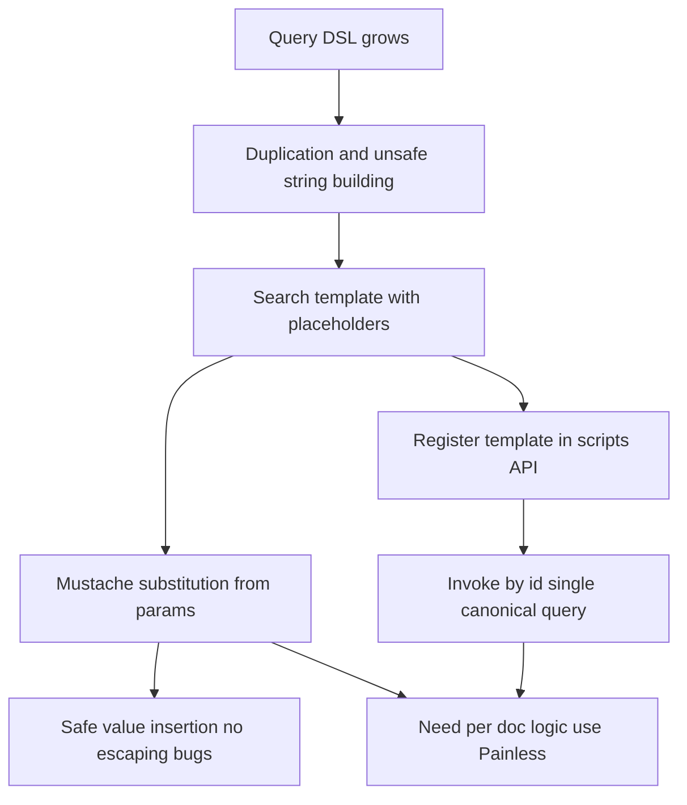

# Search Templates and Painless: Reusing Queries Safely

## English

Once a query DSL grows beyond a few clauses, two problems appear. First, duplication: the same filter logic gets copy-pasted into an application's code, a dashboard, and a scheduled report, and they drift apart. Second, safety: if you build query JSON by string concatenation from user input, you invite malformed requests at best and injection-style manipulation at worst. Elasticsearch addresses both with search templates. A template is a stored or inline query with placeholders, and the placeholders are filled from a `params` object at request time. In the modern form you use a mustache-style template, for example a query whose term value is written as `{{product_id}}`, and you pass `product_id` in the params. The engine substitutes the value as a proper value, not as raw JSON text, which removes a whole class of quoting and escaping bugs. Templates can be registered in the cluster with the `_scripts` API and then invoked by id, so the canonical query lives in one place and every caller uses the same definition.

Mustache templating is deliberately simple: it substitutes values and supports basic conditionals and loops, and that simplicity is a feature because it keeps templates readable. But sometimes substitution is not enough — you need conditional logic that depends on the data, or you need to compute a value that does not exist as a field. That is where Painless comes in. Painless is Elasticsearch's scripting language, a Java-like, sandboxed language used for script fields, script queries, scripted metric aggregations, runtime fields, and ingest processors. It is compiled and cached, so repeated execution is fast, but it is still interpreted work at query time and should be treated as a cost. The rule of thumb: use Painless for logic that genuinely must run per document or per hit, not as a substitute for doing the work at index time.

A concrete example shows the split. Suppose you want a query that filters by a category and boosts results whose stock is above a threshold. The category value is a clean template parameter; the boost could be a static value in the template. But if the boost must depend on a computed margin stored in several fields, a runtime field defined with Painless is the natural home: it computes the margin at query time and the query can sort or filter on it. Runtime fields are attractive because they need no reindex — you add the definition and immediately query it — but they cost CPU on every document examined, so they are best for exploratory work or for fields that change definition often. If a computed field is queried constantly, materialising it at index time with an ingest pipeline is usually faster.

Safety deserves emphasis. Scripts run in a sandbox with an allowlist of methods and types, and cluster settings control which script contexts and languages are enabled and how much work a script may do. Even so, scripts are a resource risk: a runaway loop or an expensive per-document computation can saturate a node. Practical defences include keeping scripts small, avoiding scripts in the hot path of every query, caching compiled scripts by giving them ids, and monitoring script compilation and cache eviction metrics. For templates, the analogous discipline is to treat them as code: version them, review changes, and test them against representative data. A template change silently alters every caller's results, so it deserves the same scrutiny as an API change.

Putting it together, a mature setup looks like this. Query structure lives in named search templates registered in the cluster, with parameters passed explicitly and validated by the application before the request is sent. Expensive derived values are precomputed at index time through ingest pipelines wherever possible. A small number of Painless runtime fields handle genuinely dynamic computations, and scripted aggregations are used sparingly for metrics that cannot be expressed declaratively. The application never concatenates user input into query JSON, and every template has tests. This combination gives you the expressiveness of the query DSL without the fragility of hand-assembled strings, and it makes the query layer something you can reason about, review, and evolve rather than a pile of duplicated fragments scattered across services.

## 中文

當查詢 DSL 超出幾個子句之後，兩個問題就會出現。第一是重複：同一段過濾邏輯被複製到應用程式碼、儀表板和排程報告中，然後各自走樣。第二是安全：如果你用字串串接把使用者輸入拼成查詢 JSON，輕則產生格式錯誤的請求，重則招致注入式的操縱。Elasticsearch 用 search template（搜索範本）同時處理這兩個問題。範本是一段帶有佔位符的已儲存或內嵌查詢，佔位符在請求時由 `params` 物件填入。現代寫法用 mustache 風格範本，例如某個 term 的值寫成 `{{product_id}}`，然後在 params 中傳入 `product_id`。引擎會把值當作正式的值代入，而不是當作原始 JSON 文字，這就消除了一整類引號與轉義的錯誤。範本可用 `_scripts` API 註冊到叢集，之後以 id 呼叫，於是標準查詢只存在一處，所有呼叫者共用同一定義。

Mustache 範本刻意保持簡單：它代入值，支援基本的條件與迴圈，而這份簡單正是優點，因為它讓範本保持可讀。但有時代入並不足夠——你需要依賴資料的條件邏輯，或需要計算一個並非欄位存在的值。這時就輪到 Painless。Painless 是 Elasticsearch 的腳本語言，一種類 Java、跑在沙箱中的語言，用於 script field、script query、scripted metric aggregation、runtime field 和 ingest processor。它會被編譯並快取，所以重複執行很快，但它仍然是查詢時的解釋型工作，應視為一種成本。經驗法則是：只在邏輯真正需要逐文件或逐命中執行時才用 Painless，而不是拿它代替在索引時做好的工作。

一個具體例子可說明分界。假設你想要一個查詢，按分類過濾，並提高庫存高於某門檻的結果的分數。分類值是乾淨的範本參數；加分可以是範本中的靜態值。但如果加分必須取決於分散在幾個欄位中計算出來的利潤率，那麼用 Painless 定義的 runtime field 就是自然的歸宿：它在查詢時計算利潤率，查詢便可據此排序或過濾。Runtime field 吸引人之處在於無需重新索引——加入定義後立即可查——但它在檢查每份文件時都消耗 CPU，所以最適合探索性工作或定義經常改變的欄位。如果某個計算欄位被頻繁查詢，用 ingest pipeline 在索引時把它實體化通常更快。

安全值得強調。腳本在沙箱中執行，只允許清單上的方法和類型，叢集設定可控制啟用哪些腳本上下文和語言，以及腳本可做多少工作。即使如此，腳本仍是資源風險：失控的迴圈或昂貴的逐文件計算可以拖垮一個節點。實務防線包括：讓腳本保持細小、避免在每個查詢的熱路徑中使用腳本、為腳本指定 id 以快取編譯結果，以及監控腳本編譯與快取淘汰的指標。對範本而言，相應的紀律是把範本當成程式碼：版本化、審查變更、用有代表性的資料測試。範本一改，所有呼叫者的結果都會悄悄改變，所以它值得與 API 變更同等的審視。

綜合起來，成熟的配置是這樣的：查詢結構存放在叢集中已註冊的具名 search template，參數明確傳入，並在送出請求前由應用程式驗證。昂貴的衍生值盡可能在索引時透過 ingest pipeline 預先計算。少數 Painless runtime field 處理真正動態的計算，scripted aggregation 則謹慎用於無法以宣告式表達的指標。應用程式絕不把使用者輸入串接進查詢 JSON，每個範本都有測試。這個組合讓你享有查詢 DSL 的表達力，卻沒有手工拼接字串的脆弱，也讓查詢層成為可推理、可審查、可演進的東西，而不是散落在各服務中的一堆重複片段。

## Key Takeaway

Named search templates with validated parameters and sparing, monitored Painless scripts turn the query layer from fragile string assembly into versioned, testable code.

## Related Concepts
- Mustache search templates
- Painless scripting sandbox

## Diagram

