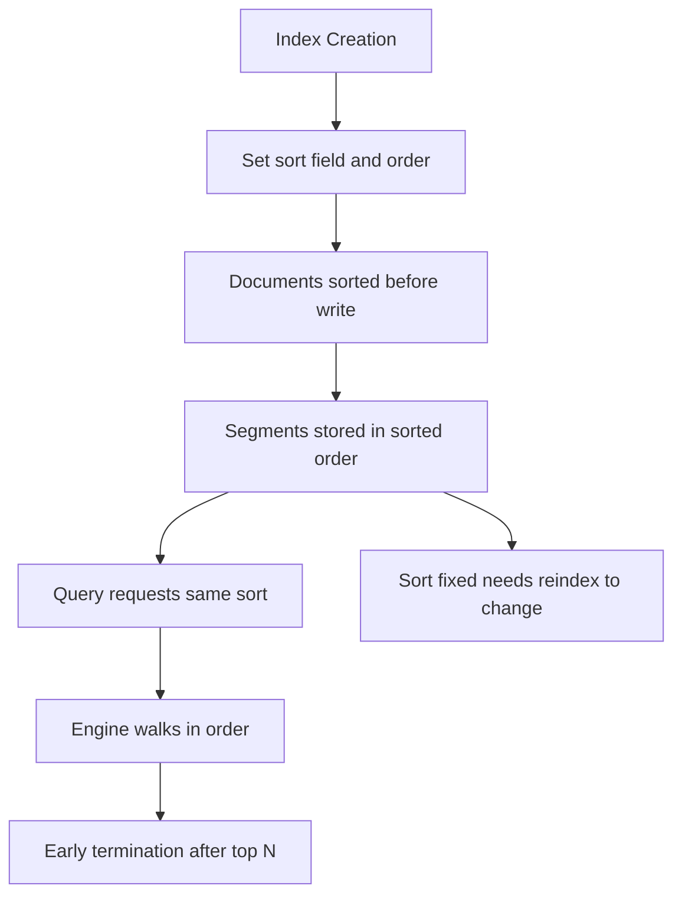

# Index Sorting and Shard Sizing: The Physical Layout You Choose Up Front

## English

Most people treat an index as a logical bag of documents, but Elasticsearch also lets you declare a physical sort order for the documents inside each shard. Index sorting is configured at index creation with index.sort.field and index.sort.order, and it controls the order in which documents are stored on disk within a segment. This matters because queries that request the same sort order can stop early: when a search asks for the top N results by a field, and the shard is already sorted by that field, the engine can walk the documents in order and bail out once it has enough, instead of collecting and sorting everything. It also makes early termination for aggregations more effective, because the sorted layout lets the engine skip whole blocks of documents once a range condition is satisfied. The catch is that sorting is fixed at creation time and cannot be changed without reindexing, and documents must be sorted before they are written, so heavy write throughput can suffer slightly.

A concrete example: an index of log events sorted by timestamp descending lets a query like 'give me the 20 most recent errors' terminate almost immediately, because the newest documents sit at the front of every segment. Contrast that with an unsorted index, where the engine must scan all matching documents and then sort a heap of candidates.

Shard sizing is the other half of the physical layout story. Each shard is a full Lucene index with its own file handles, memory overhead, and merge activity. Too many small shards means lots of per-shard overhead and slower cluster state propagation; too few huge shards means slow recovery and uneven load. A common rule of thumb is to keep shards in the range of a few gigabytes to a few tens of gigabytes, and to size for the future rather than today, since you cannot shrink a shard without reindexing. The number of primary shards is fixed at index creation (though split and shrink APIs exist for controlled resizing).

These two choices interact. If you plan to sort by time, you probably want time-based indices (daily or monthly) with a modest shard count, so each shard holds a contiguous time range and early termination works well. If you plan to sort by a relevance or popularity field, index sorting on that field can help. Either way, the decision is architectural, not a tuning knob you flip later.

The practical lesson is to think about access patterns before you create the index. Ask: what will queries sort by, what will they filter on, how much data arrives per day, and how long must it be retained? The answers determine shard count and sort order. Changing them later means building a new index and reindexing into it, which is doable but costly. Treat index creation as a design decision, not a default.

## 中文

多數人把索引（index）當成一個裝文件的邏輯容器，但 Elasticsearch 其實也讓你為每個分片（shard）內的文件宣告實體的排序方式。索引排序（index sorting）在建立索引時透過 index.sort.field 與 index.sort.order 設定，它控制文件在區段（segment）內寫入磁碟的次序。這件事之所以重要，是因為當查詢要求的排序次序與實體排序一致時，引擎可以提早結束：當搜尋要求依某欄位取前 N 筆結果，而分片本身已按該欄位排好，引擎就能依序走訪文件，湊夠數量便停手，不必收集全部再排序。它亦令聚合（aggregation）的提早終止更有效，因為排序後的佈局讓引擎在滿足範圍條件後可以跳過整塊文件。代價是排序在建立時固定，不重新索引（reindex）就改不了；而且文件必須在寫入前排好序，因此高寫入吞吐量可能略受影響。

具體例子：一個按時間戳遞減排序的日誌事件索引，讓「給我最近 20 筆錯誤」這類查詢幾乎即時結束，因為最新的文件就排在每個區段的最前面。相反，未排序的索引則要掃描所有符合的文件，再從候選堆中排序。

分片大小是實體佈局的另一半故事。每個分片都是一個完整的 Lucene 索引，有自己的檔案句柄、記憶體開銷與合併（merge）活動。分片太多太小，會帶來大量每分片開銷，叢集狀態傳播也變慢；分片太少太大，則恢復緩慢、負載不均。常見經驗法則是讓分片維持在數 GB 到數十 GB 之間，並按未來而非當下的資料量規劃，因為不重新索引就無法縮小分片。主分片（primary shard）數目在建立索引時固定（雖有 split 與 shrink API 可受控調整大小）。

這兩個選擇會互相影響。若打算按時間排序，通常會用按時間切分的索引（每日或每月）配合適中的分片數，讓每個分片涵蓋連續的時間範圍，提早終止才有效。若打算按相關度或熱門程度欄位排序，對該欄位做索引排序會有幫助。無論如何，這是架構決定，不是日後隨手可調的旋鈕。

實用的教訓是：建立索引前先想清楚存取模式。問自己：查詢會按甚麼排序、按甚麼過濾、每天有多少資料進來、要保留多久？答案決定分片數與排序次序。日後要改就得建新索引再重新索引進去，可行但代價高。把建立索引視為設計決策，而非預設值。

## Key Takeaway

Shard count and index sort order are fixed at creation and shape query speed, so decide them from your access patterns before you index a single document.

## Related Concepts
- Index Aliases and Zero-Downtime Reindexing
- The Cost of a Query: Understanding Search Phases and the Request Cache

## Diagram

