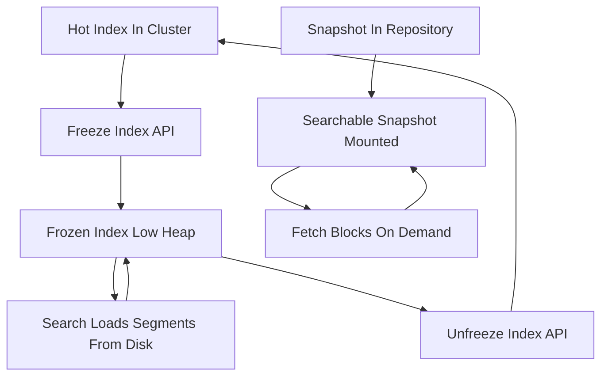

# Frozen Indices and Searchable Snapshots: Cheaper Access to Cold Data

## English

Retention is where search systems quietly get expensive. You accumulate months or years of logs, audit records, or historical documents that are almost never queried, yet every shard of that data still consumes heap, file handles, and cluster state. Elasticsearch offers two related mechanisms for keeping cold data searchable without paying full price: frozen indices and searchable snapshots. They solve different problems and are worth understanding separately.

A frozen index is a regular index marked frozen. The engine keeps it in the cluster and still allows searches, but it stops holding the shard's data structures in memory the way an active index does. Instead, on each search the relevant segment data is loaded from disk as needed and released afterwards. The result is dramatically lower heap usage per shard, at the cost of slower first-touch queries. Frozen indices are a good fit for data you query occasionally, perhaps for compliance or investigation, where a few seconds of latency is acceptable. You freeze with the freeze index API and unfreeze with the unfreeze index API; the index remains part of the cluster and participates in normal routing.

Searchable snapshots go further. A snapshot is a backup stored in a repository (for example, an object store). Normally you restore a snapshot into the cluster, which copies all the data back. A searchable snapshot, by contrast, mounts the snapshot as an index whose data lives in the repository and is fetched on demand. Only a small local cache holds recently accessed blocks. This lets you keep very large historical datasets searchable with a fraction of the local disk, and it is the backbone of the cold and frozen tiers in index lifecycle management (ILM). The trade-off is latency and dependence on the repository's availability and throughput.

The two mechanisms are often confused because both target cold data, but the distinction is where the bytes live. Frozen indices still hold their data on local cluster nodes; searchable snapshots keep the authoritative copy in the repository and cache locally. If your cluster disk is the bottleneck, searchable snapshots help most. If your heap is the bottleneck but disk is plentiful, freezing may be enough.

A practical pattern: hot tier for the last few days on fast local disks, warm tier for weeks on cheaper nodes, cold tier with searchable snapshots for months, and frozen or deleted beyond that. The point is not to memorise tiers but to recognise that 'searchable' and 'fully resident' are different states, and you can choose per dataset which state you need. Ask how often each dataset is actually queried; the answer usually reveals that most of it can live in a cheaper state.

## 中文

資料保留（retention）正是搜尋系統悄悄變貴的地方。你會累積數月甚至數年的日誌、審計紀錄或歷史文件，幾乎從不被查詢，但這些資料的每個分片仍然佔用堆積記憶體（heap）、檔案句柄與叢集狀態。Elasticsearch 提供兩個相關機制，讓冷資料保持可搜尋而不必付全價：凍結索引（frozen index）與可搜尋快照（searchable snapshot）。兩者解決不同問題，值得分開理解。

凍結索引就是把一個普通索引標記為凍結。引擎仍把它留在叢集中並允許搜尋，但不再像活躍索引那樣把分片的資料結構常駐記憶體。相反，每次搜尋時才按需要從磁碟載入相關區段資料，用完即釋放。結果是每分片的堆積用量大幅下降，代價是首次觸及的查詢較慢。凍結索引適合偶爾查詢的資料，例如合規或調查用途，幾秒延遲可以接受。你用 freeze index API 凍結，用 unfreeze index API 解凍；索引仍屬叢集一部分，參與正常路由。

可搜尋快照走得更遠。快照是存放在儲存庫（repository，例如物件儲存）中的備份。平常還原快照會把所有資料複製回叢集；可搜尋快照則是把快照掛載成一個索引，其資料留在儲存庫中按需抓取，只有少量本機快取保存最近存取的區塊。這讓你用一小部分本機磁碟就能讓極龐大的歷史資料集保持可搜尋，也是索引生命週期管理（ILM）中 cold 與 frozen 層級的骨幹。取捨是延遲較高，並依賴儲存庫的可用性與吞吐量。

這兩個機制常被混淆，因為都針對冷資料，但分別在於位元組放在哪裡。凍結索引的資料仍在叢集本機節點上；可搜尋快照的權威副本在儲存庫，本機只做快取。若瓶頸是叢集磁碟，可搜尋快照幫助最大；若瓶頸是堆積而磁碟充裕，凍結可能已足夠。

實用模式：熱層放最近幾天在快速本機磁碟，溫層放數週在較便宜節點，冷層用可搜尋快照放數月，再久就凍結或刪除。重點不是背誦層級，而是認清「可搜尋」與「完全常駐」是兩種不同狀態，你可以按資料集選擇需要哪一種。問問每個資料集實際被查詢的頻率，答案通常會顯示大部分資料可以住在更便宜的狀態。

## Key Takeaway

Frozen indices cut heap by loading segments on demand, while searchable snapshots keep the authoritative data in a repository and cache locally, so pick based on whether heap or disk is your bottleneck.

## Related Concepts
- Snapshot and Restore: Backups That Actually Work
- Data Streams, ILM and Ingest Pipelines: Managing Time-Based Data

## Diagram

