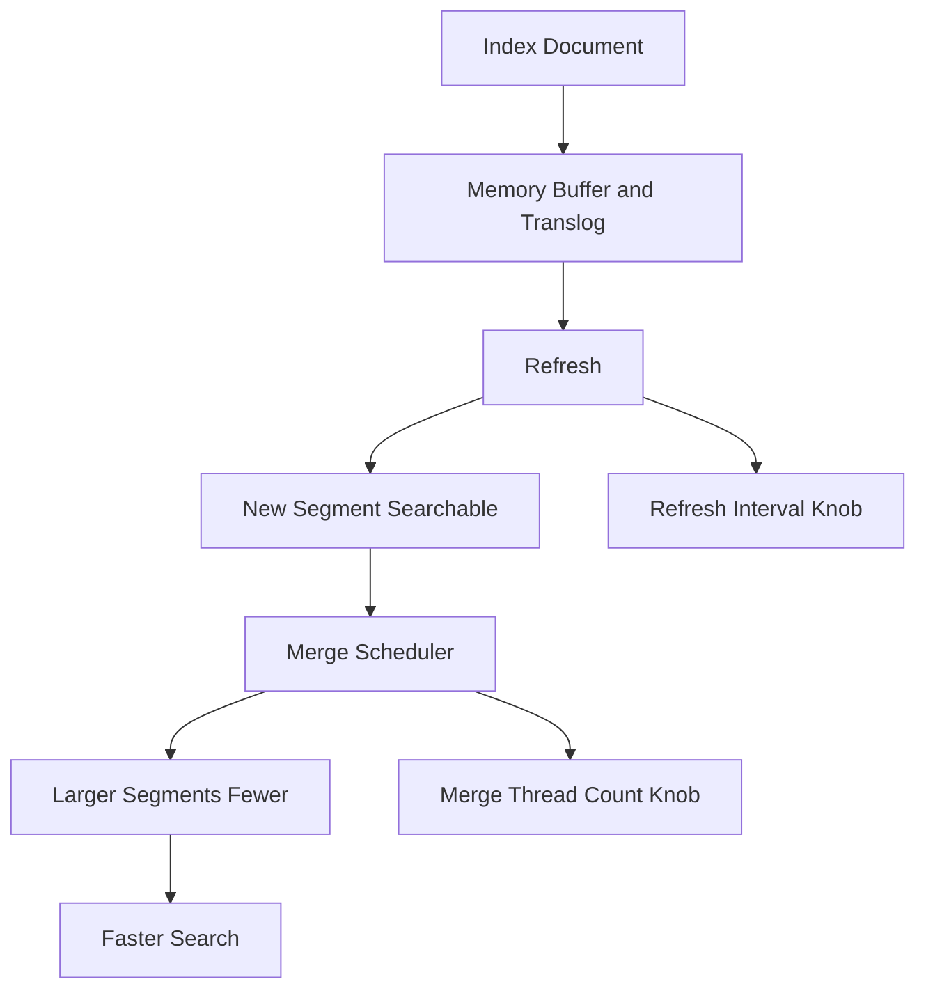

# Tuning the Merge and Refresh Knobs for Write-Heavy Workloads

## English

Elasticsearch is often described as near-real-time, and that phrase hides two independent background processes that dominate write performance: refresh and merge. Understanding them lets you trade latency for throughput deliberately instead of accepting defaults that were chosen for general use.

Refresh is what makes newly indexed documents visible to search. When you index a document, it goes into an in-memory buffer and a transaction log (translog). A refresh takes the buffer, writes it as a new segment, and opens it for searching. By default this happens about once per second, which is where the 'near-real-time' comes from. For a logging pipeline that is fine, but for a bulk import of millions of documents, refreshing every second creates many tiny segments and wastes work. The refresh_interval setting lets you raise this, for example to 30s or 60s during a bulk load, and set it to -1 to disable automatic refresh entirely. When the load finishes, you refresh manually and restore the interval. The trade-off is simple: longer intervals mean higher indexing throughput and lower search freshness.

Merge is the cleanup process. Each refresh creates a segment, and searches must consult every segment, so many small segments slow queries. The merge scheduler periodically combines smaller segments into larger ones, discarding deleted documents along the way. Merges are I/O intensive and run in the background, competing with indexing for disk bandwidth. This is why bulk indexing often shows a pattern of fast progress followed by a pause: the engine is merging. You can influence this with index.merge.scheduler.max_thread_count, and on spinning disks it is often recommended to lower it to reduce seek thrashing.

Two other knobs matter for bulk work. First, use the bulk API rather than indexing documents one at a time, because each single request carries network and coordination overhead. Second, consider disabling replicas during a large initial load (index.number_of_replicas set to 0) and re-enabling them afterwards; replicas double the write work because every document must be copied to each replica. This is safe only if you can tolerate the temporary lack of redundancy.

A realistic scenario: importing a hundred million records into a fresh index. Set replicas to 0, set refresh_interval to -1, use the bulk API with batches sized to a few megabytes (large enough to amortise overhead, small enough not to overwhelm the coordinating node), then after the load restore replicas and refresh interval, and wait for the cluster to go green. The result can be many times faster than the naive approach. The lesson is that defaults are tuned for mixed workloads, and knowing which knob controls which cost lets you shift the balance for the job at hand.

## 中文

Elasticsearch 常被形容為近即時（near-real-time），而這句話掩蓋了兩個主導寫入效能的獨立背景程序：refresh 與 merge。理解它們，你就能刻意用延遲換吞吐量，而不是接受為通用情況選定的預設值。

Refresh 令新索引的文件對搜尋可見。你索引一份文件時，它會進入記憶體緩衝區與交易日誌（translog）。Refresh 把緩衝區寫成一個新區段（segment）並開放搜尋。預設約每秒一次，「近即時」之名由此而來。對日誌管道來說這沒問題，但對匯入數百萬份文件的批量作業，每秒 refresh 會產生大量細小區段，浪費工夫。refresh_interval 設定讓你調高它，例如批量載入期間設為 30 秒或 60 秒，設為 -1 則完全停用自動 refresh。載入完成後手動 refresh 並還原間隔。取捨很簡單：間隔越長，索引吞吐量越高，搜尋新鮮度越低。

Merge 是清理程序。每次 refresh 產生一個區段，而搜尋必須查看每個區段，所以大量細小區段會拖慢查詢。合併排程器會定期把細小區段合併成較大的，過程中丟棄已刪除的文件。合併是 I/O 密集的，在背景執行，與索引爭奪磁碟頻寬。這就是為何批量索引常呈現「快速推進後停頓」的模式：引擎正在合併。你可以用 index.merge.scheduler.max_thread_count 影響它，在傳統硬碟上常建議調低以減少磁頭跳動。

批量工作還有兩個旋鈕要緊。第一，用 bulk API 而非逐份索引文件，因為每個單獨請求都帶著網路與協調開銷。第二，考慮在大型初始載入期間停用副本（把 index.number_of_replicas 設為 0），完成後再啟用；副本令寫入工作量倍增，因為每份文件都要複製到每個副本。只有在你可容忍暫時失去冗餘時才安全。

現實情境：把一億筆紀錄匯入全新索引。把副本設為 0、refresh_interval 設為 -1、用 bulk API 以數 MB 為一批（大到足以攤薄開銷，小到不會壓垮協調節點），載入後還原副本與 refresh 間隔，等叢集轉綠。結果可比天真做法快上多倍。教訓是：預設值為混合工作負載而調，知道哪個旋鈕控制哪種成本，就能為眼前任務轉移平衡。

## Key Takeaway

Refresh controls search freshness and merge controls segment count, so for bulk loads raise refresh_interval, drop replicas temporarily, and batch through the bulk API to shift the trade-off toward throughput.

## Related Concepts
- The Write Path: Refresh, Translog, Bulk and Snapshots
- Near-Real-Time Indexing via Segmented Architecture

## Diagram

