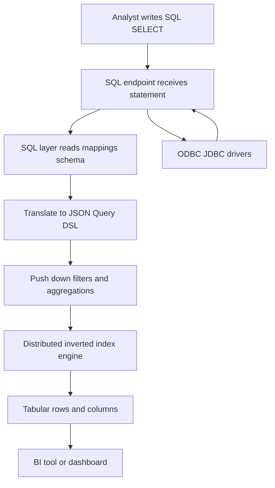

# Elasticsearch SQL and ODBC: Querying Search Data with Familiar Tools

## English

Elasticsearch speaks its own JSON Query DSL, but it also offers a SQL interface that lets people who already know SQL run familiar SELECT statements against indexed data. The SQL endpoint translates your statement into the native query engine behind the scenes, so the results are the same documents the JSON API would return. This matters because a huge number of analysts, BI tools, and reporting platforms already understand SQL and ODBC/JDBC drivers. Instead of learning a new language, a team can point an existing dashboard tool at Elasticsearch and start exploring. The translation is not a naive string replacement: the SQL layer understands schemas (from your mappings), can push down filters and aggregations, and returns results in a tabular shape.

However, SQL is a row-and-column abstraction, and Elasticsearch is fundamentally a document store with a distributed inverted index. Not every SQL feature maps cleanly. Elasticsearch SQL has no JOIN construct at all — there is no join-like fallback in the SQL layer. Joins exist only in the Query DSL (nested queries, plus `has_child` / `has_parent`) and in ES|QL `LOOKUP JOIN`, which is available from Elasticsearch 8.16 onwards. Similarly, transaction semantics (ACID guarantees across many rows) are not what Elasticsearch is designed to provide. So the SQL interface is best treated as a convenience for read-heavy analytics and exploration, not as a promise that Elasticsearch is a relational database. If you need strict relational integrity, a real RDBMS remains the right tool.

A practical example: imagine you have web logs indexed as documents with fields like status, response_time, and url. An analyst who knows SQL can write something like a GROUP BY on status code with an average of response_time, and the SQL endpoint will translate that into an aggregation query. The output comes back as rows and columns, which slots directly into a spreadsheet or BI chart. This lowers the barrier to entry enormously and lets search and analytics teams share one data source.

There are real trade-offs to understand. The SQL translation may not always produce the most efficient query plan compared to a hand-written DSL query, so for latency-critical paths you may still prefer native queries. Some functions and syntax are supported only in a subset of versions, and behaviour can differ between distributions. Always check the documentation for your specific version. Also, because Elasticsearch is near-real-time, a SQL query right after a write may not see the newest documents until a refresh occurs.

The mental model to keep: SQL-on-Elasticsearch is an adapter, not a redefinition. It lets familiar tools talk to a distributed search engine, which is fantastic for democratising access to log and text data. But you should still understand the underlying document model, because that is what determines performance, relevance, and what questions the system can answer well. Use SQL to explore and report; drop into the DSL when you need precision, relevance tuning, or advanced search features.

## 中文

Elasticsearch 講的是自家的 JSON Query DSL，但它同時提供 SQL 介面，讓已經熟悉 SQL 的人可以對已索引的資料執行熟悉的 SELECT 語句。SQL 端點會在背後把你的語句翻譯成原生查詢引擎，所以結果與 JSON API 回傳的文件一模一樣。這件事很重要，因為大量分析師、BI 工具和報表平台本來就懂 SQL 以及 ODBC/JDBC 驅動程式。團隊不必學新語言，就能把現有的儀表板工具指向 Elasticsearch 開始探索。這個翻譯並非單純的字串替換：SQL 層理解 schema（來自你的 mapping），可以把過濾與聚合下推，並以表格形狀回傳結果。

不過，SQL 是列與列的抽象，而 Elasticsearch 本質上是帶有分散式倒排索引的文件儲存。不是每個 SQL 功能都能乾淨對應。Elasticsearch SQL 完全沒有 JOIN 構造，SQL 層裡面也沒有任何類似 join 的替代寫法。Join 只存在於 Query DSL（nested 查詢以及 `has_child` / `has_parent`），以及 ES|QL 的 `LOOKUP JOIN`（由 Elasticsearch 8.16 起提供）。同樣地，跨多列的交易語意（ACID 保證）也不是 Elasticsearch 設計來提供的。所以 SQL 介面最好視為讀取密集分析與探索的便利工具，而不是 Elasticsearch 是關聯式資料庫的承諾。如果你需要嚴格的關聯完整性，真正的 RDBMS 仍然是正確選擇。

一個實際例子：假設你把網站日誌索引成文件，欄位有 status、response_time 和 url。懂 SQL 的分析師可以寫出類似對 status code 做 GROUP BY、並計算 response_time 平均值的語句，SQL 端點會把它翻譯成聚合查詢。輸出以列與欄回傳，可直接放進試算表或 BI 圖表。這大幅降低入門門檻，讓搜尋與分析團隊共用同一份資料來源。

有幾個實際取捨要理解。相較於手寫的 DSL 查詢，SQL 翻譯未必總是產生最有效率的查詢計劃，所以對延遲敏感的路徑你仍可能偏好原生查詢。有些函數與語法只在部分版本支援，行為也可能因發行版而異。務必查閱你所用版本的官方文件。另外，由於 Elasticsearch 是近即時，寫入後立刻執行 SQL 查詢，在 refresh 發生前可能看不到最新文件。

要記住的心智模型：Elasticsearch 上的 SQL 是轉接器，不是重新定義。它讓熟悉的工具能與分散式搜尋引擎對話，這對普及化日誌與文字資料的存取非常棒。但你仍應理解底層的文件模型，因為那決定了效能、相關性，以及系統能好好回答哪些問題。用 SQL 來探索與報表；需要精確度、相關性調校或進階搜尋功能時，再切回 DSL。

## Key Takeaway

Elasticsearch's SQL interface is a convenience adapter over a document engine, great for familiar analytics and BI tools but not a replacement for relational database guarantees.

## Related Concepts
- Query DSL
- Aggregations

## Diagram

