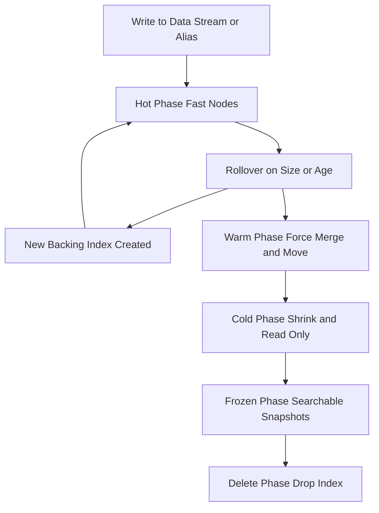

# Index Lifecycle Management: Automating the Journey from Hot to Cold Data

## English

Data has a lifespan. A log entry is intensely queried in the first hour, occasionally checked the next day, and almost never touched after a month — yet it may need to be retained for a year for compliance. Index Lifecycle Management (ILM) is Elasticsearch's framework for automating what happens to an index over time. You define a policy with phases: hot, warm, cold, frozen, and delete. Each phase can have actions like rollover (create a new index when the current one gets too big or too old), force-merge (combine segments to save space), shrink (reduce shard count), allocate (move to cheaper nodes), and finally delete. The cluster then moves indices through these phases automatically based on age or size thresholds.

The core building block is the rollover pattern, usually paired with data streams. Instead of one giant ever-growing index, you write to an alias or data stream that points at a current backing index. When that index hits a size or age limit, rollover creates a fresh index and the alias moves to it. Old indices become read-only candidates for warm or cold treatment. This keeps individual shards at a healthy size, which matters because very large shards are slow to recover and rebalance. It also makes deletion cheap: you just drop whole old indices rather than deleting individual documents.

A concrete flow: a hot phase keeps the current index on fast, memory-rich nodes for a few days while it receives writes. The warm phase might trigger after seven days, force-merging segments into one per shard and moving the index to less powerful hardware. The cold phase after 30 days could shrink shards and mark the index read-only. The frozen phase after 90 days might use searchable snapshots to keep data queryable while living mostly on cheap object storage. Finally, the delete phase removes the index after a year. Every step is declarative: you describe the desired state, and the cluster's lifecycle service executes it.

ILM is powerful but has sharp edges. Phase transitions are not instant; they depend on the lifecycle poll interval, so an index may sit in a phase longer than you expect. Misconfigured rollover (for example, a max_age that never triggers because writes stopped) can leave a tiny index stuck. Force-merge is I/O heavy and should not run during peak load. And deleting data is irreversible, so policies deserve testing in a non-production cluster first. Understanding the difference between a policy, a template that attaches it, and the actual indices is essential for debugging.

The big idea: ILM turns storage economics into code. Instead of manually curating indices, you express intent — keep this hot for three days, warm for a month, delete after a year — and let the cluster enforce it. Combined with data streams and index templates, this is how production systems handle terabytes of time-series data without an army of operators. It is automation for the boring but critical job of deciding where data lives and when it dies.

## 中文

資料有生命週期。一筆日誌在第一小時被密集查詢，隔天偶爾查看，一個月後幾乎沒人碰——卻可能因為法規遵循需要保留一年。Index Lifecycle Management（ILM）就是 Elasticsearch 用來自動化管理索引隨時間變化的框架。你定義一個含階段的策略：hot、warm、cold、frozen 和 delete。每個階段可以有動作，例如 rollover（當目前索引太大或太舊時建立新索引）、force-merge（合併 segment 以節省空間）、shrink（減少分片數）、allocate（搬到較便宜的節點），最後是 delete。叢集便會根據年齡或大小門檻，自動讓索引走過這些階段。

核心積木是 rollover 模式，通常搭配 data stream。你不是寫進一個不斷長大的巨型索引，而是寫進一個指向目前 backing index 的 alias 或 data stream。當該索引達到大小或年齡上限，rollover 會建立新索引，alias 移到新索引上。舊索引變成唯讀，成為 warm 或 cold 處理的候選。這讓個別分片維持在健康大小，這很重要，因為過大的分片在復原與重新平衡時很慢。它也讓刪除變便宜：你直接丟掉整個舊索引，而不是逐筆刪除文件。

一個具體流程：hot 階段讓目前索引留在快速、記憶體充足的節點幾天，同時接收寫入。warm 階段可能在七天後觸發，把 segment force-merge 成每分片一個，並把索引搬到較弱的硬體。30 天後的 cold 階段可以 shrink 分片並把索引標為唯讀。90 天後的 frozen 階段可能使用 searchable snapshots，讓資料仍可查詢但主要住在便宜的物件儲存上。最後，delete 階段在一年後移除索引。每一步都是宣告式的：你描述想要的狀態，叢集的 lifecycle 服務負責執行。

ILM 很強大但有尖銳邊緣。階段轉換不是即時的；它取決於 lifecycle 輪詢間隔，所以索引可能比預期更久才離開某階段。設定錯誤的 rollover（例如 max_age 因為寫入停止而永不觸發）會讓小索引卡住。Force-merge 是 I/O 密集操作，不該在尖峰負載時執行。而刪除資料不可逆，所以策略值得先在非生產叢集測試。理解策略、附加策略的 template，以及實際索引三者之間的差別，對除錯至關重要。

核心概念：ILM 把儲存經濟學變成程式碼。你不必手動整理索引，而是表達意圖——這份資料 hot 三天、warm 一個月、一年後刪除——讓叢集去執行。搭配 data stream 與 index template，這就是生產系統處理數 TB 時間序列資料、又不必養一大群維運人員的方式。它是為「決定資料住哪裡、何時死亡」這件無聊但關鍵的工作所做的自動化。

## Key Takeaway

ILM expresses data retention as declarative phases, automating rollover, merging, shrinking, and deletion so time-series data stays cost-effective without manual curation.

## Related Concepts
- Data Streams
- Index Templates

## Diagram

