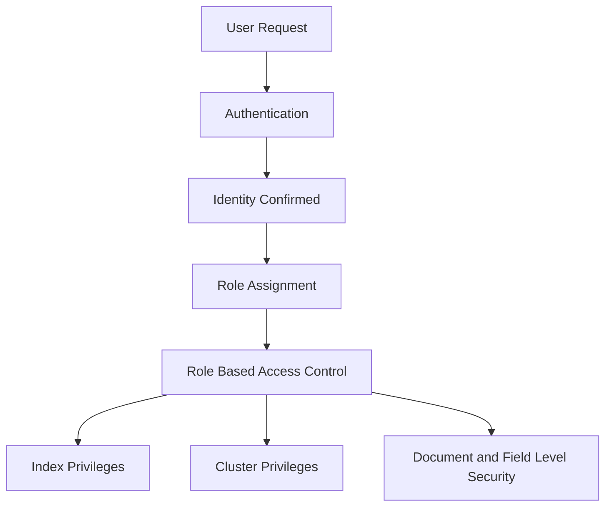

# Security and Access Control: Authentication, Roles, and Document-Level Permissions

## English

A search cluster often holds sensitive data — customer records, internal logs, financial metrics — so who can see what matters as much as how fast queries run. Elasticsearch's security features (available in the default distribution and the managed cloud service) provide authentication (proving who you are) and authorisation (deciding what you may do). Authentication typically uses built-in users, an external identity provider via SAML or OpenID Connect, or an LDAP/Active Directory realm. Once a user is authenticated, role-based access control (RBAC) determines which indices they can read or write, which cluster-level actions they can perform, and even which documents and fields they can see.

Roles are the heart of authorisation. A role bundles privileges: index privileges (like read, write, create_index) scoped to index patterns, cluster privileges (like monitor or manage), and application privileges. You assign roles to users or to groups from your identity provider. For example, an analyst role might allow read on logs-* and view_index_metadata, while an admin role allows manage on all indices. This separation means you can give a data scientist broad read access without accidentally granting the power to delete indices. The principle of least privilege — granting only what is needed — is the guiding rule.

Beyond index-level control, Elasticsearch supports document-level and field-level security. Document-level security uses a query that filters which documents a role can see; a support agent might only see tickets where region matches their own. Field-level security hides or anonymises specific fields, so a role could see a customer's order history but not their credit card number. These are enforced inside the search engine, meaning even an aggregation cannot leak hidden documents or fields. That is far stronger than filtering in application code, where a bug could expose everything.

A practical setup: enable TLS on the transport and HTTP layers so traffic is encrypted, configure an identity provider for single sign-on, define roles that mirror job functions, and map groups to roles. API keys and service accounts handle machine-to-machine access without embedding human credentials. Auditing logs record authentication events and access attempts, which is essential for compliance. Be careful with the built-in superuser and with any account that can manage security itself — compromise of those is catastrophic.

Security is not a checkbox but a layered posture. Encryption protects data in transit; RBAC limits blast radius; document and field security enforce privacy at the source; audit trails provide accountability. The trade-off is complexity: every layer adds configuration and a potential failure point, and overly strict rules can break legitimate workflows. The right approach is to start from least privilege, test roles against real queries, and treat security configuration as code that is reviewed and versioned. When done well, users simply see the data they are allowed to see, and nobody notices the machinery underneath.

## 中文

搜尋叢集常常存放敏感資料——客戶紀錄、內部日誌、財務指標——所以誰能看到什麼，和查詢跑得多快一樣重要。Elasticsearch 的安全功能（在預設發行版與託管雲端服務中提供）提供身分驗證（證明你是誰）與授權（決定你能做什麼）。身分驗證通常使用內建使用者、透過 SAML 或 OpenID Connect 的外部身分提供者，或 LDAP/Active Directory realm。使用者通過驗證後，角色基礎存取控制（RBAC）決定他們能讀寫哪些索引、能執行哪些叢集層級動作，甚至能看到哪些文件與欄位。

角色是授權的核心。一個角色捆綁多項權限：索引權限（如 read、write、create_index）綁定到索引樣式、叢集權限（如 monitor 或 manage），以及應用程式權限。你把角色指派給使用者，或指派給來自身分提供者的群組。例如分析師角色可能允許對 logs-* 的 read 與 view_index_metadata，而管理員角色允許對所有索引的 manage。這種分離意味著你可以給資料科學家廣泛的讀取權限，而不會不小心授予刪除索引的權力。最小權限原則——只授予所需——是指導規則。

除了索引層級控制，Elasticsearch 支援文件層級與欄位層級安全。文件層級安全使用查詢來過濾角色能看到哪些文件；客服人員可能只看到 region 符合自己區域的工單。欄位層級安全隱藏或匿名化特定欄位，所以某角色能看到客戶的訂單歷史，卻看不到信用卡號。這些在搜尋引擎內部強制執行，意味著即使是聚合也無法洩漏被隱藏的文件或欄位。這比在應用程式碼中過濾強得多，因為那裡一個 bug 就可能暴露一切。

一個實際設定：在 transport 與 HTTP 層啟用 TLS 以加密流量、設定身分提供者以支援單一登入、定義反映職務的角色，並把群組對應到角色。API key 與 service account 處理機器對機器存取，不必嵌入人類憑證。稽核日誌記錄驗證事件與存取嘗試，這對法規遵循至關重要。要小心內建超級使用者，以及任何能管理安全設定本身的帳號——這些被入侵是災難性的。

安全不是打勾項目，而是分層態勢。加密保護傳輸中的資料；RBAC 限制爆炸半徑；文件與欄位安全在源頭強制隱私；稽核軌跡提供問責。取捨是複雜度：每層都增加設定與潛在故障點，過嚴的規則可能破壞合法工作流程。正確做法是從最小權限開始、用真實查詢測試角色，並把安全設定當成經過審查與版本控制的程式碼。做得好時，使用者只看到他們被允許看到的資料，沒人會注意到底下的機械。

## Key Takeaway

Security in Elasticsearch is layered — TLS, authentication, RBAC, and document/field-level controls — enforcing least privilege inside the engine so hidden data cannot leak through queries or aggregations.

## Related Concepts
- Role-Based Access Control
- Cluster Security

## Diagram

