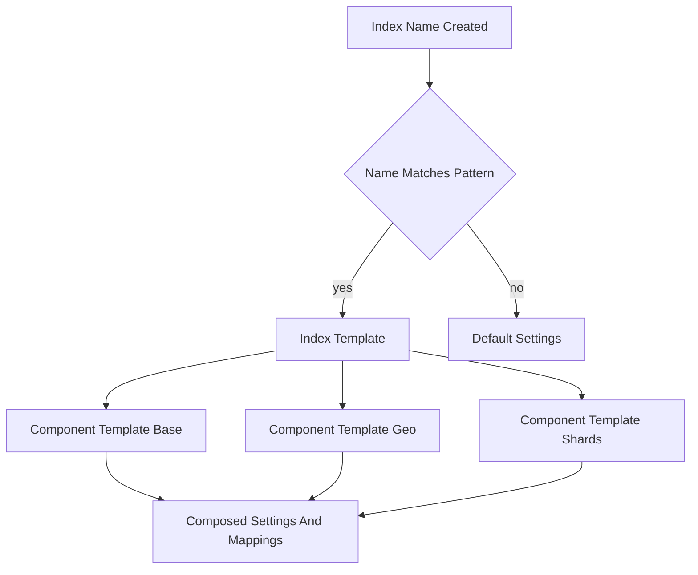

# Index Templates and Component Templates: Governing Many Indices at Once

## English

When you have one index, you can set its settings and mappings by hand. When you have three hundred daily indices, hand-editing becomes impossible, and a single typo in one mapping can break queries across the whole set. Elasticsearch solves this with templates: rules that say 'any index whose name matches this pattern should be created with these settings and mappings.' The modern form is the composable template system, which splits the job into two pieces. A component template holds a reusable bundle of settings, mappings, or aliases — for example, 'all log data gets a timestamp field of type date and a message field analysed with the standard analyser.' An index template then says 'indices matching logs-* are composed from these component templates, in this priority order.'

The power comes from composition. You might have a base component template for common fields, a second one that adds geo fields only for location-aware services, and a third that tightens the number of shards for a high-volume tenant. The index template lists them, and later templates override earlier ones field by field. This is how organisations keep hundreds of indices consistent without copying JSON around: change the component template once, and every index created afterwards picks up the new definition. Note the word 'afterwards' — templates apply at index creation time only. Existing indices keep their old mappings; to change those you must reindex into a new index, which is exactly why aliases and zero-downtime reindexing matter.

There is a subtlety that trips people up: a template that matches an index name does not retroactively fix anything, and if two templates match the same pattern the one with the higher priority wins for conflicting settings. Also, mappings are largely additive — you can add new fields to an existing index, but you cannot change an existing field's type from text to keyword without reindexing. This is why teams treat templates as versioned code, review them like code, and test them against a staging cluster before rolling out. A template is not configuration you tweak casually; it is the schema contract for a whole family of indices.

A practical example: a service emits application logs. You define a component template with the common fields, a second component template with a lifecycle policy reference so old indices roll over automatically, and an index template matching app-logs-* that composes both. The first document written to app-logs-2024.06.01 creates the index, and the template shapes it instantly. If a developer later adds a new field, Elasticsearch's dynamic mapping guesses a type — which may be wrong (a numeric-looking ID becomes a long, then a later alphanumeric value fails to index). Explicit mappings in the template prevent this class of surprise.

Finally, templates interact with data streams and lifecycle management: a data stream needs a matching template to define its backing indices, and the template is where you declare that the data stream should be created. The mental model is a cascade: component templates are the building blocks, index templates are the assembly instructions, and data streams or plain indices are the products. Get the assembly right once and thousands of indices inherit correct behaviour; get it wrong and the mistake multiplies across every index created until you fix it.

## 中文

當你只有一個索引，你可以手動設定它的 settings 同 mappings。但當你有三百個每日索引，手動編輯就變得不可能，而且一個 mapping 打錯字，就可能令整個索引家族的查詢壞掉。Elasticsearch 用模板（template）解決這個問題：模板就是規則，講明「任何名稱符合這個模式的索引，都應該用這套 settings 同 mappings 建立」。現代做法是可組合模板系統（composable template system），將工作拆成兩部分。元件模板（component template）裝住一組可重用的 settings、mappings 或 aliases——例如「所有日誌數據都有一個 date 類型的 timestamp 欄位，以及一個用標準分析器分析的 message 欄位」。索引模板（index template）就講明「符合 logs-* 的索引，按這個優先次序由這些元件模板組合而成」。

威力在於組合。你可能有一個基礎元件模板處理共通欄位，第二個只為位置相關服務加 geo 欄位，第三個為高流量租戶收緊分片數目。索引模板列出它們，後面嘅模板逐個欄位覆寫前面的。這就是機構點樣令幾百個索引保持一致而毋須四處複製 JSON：改一次元件模板，之後建立的每個索引都會套用新定義。留意「之後」這兩個字——模板只在建立索引時生效。現有索引保留舊 mapping；要改就必須 reindex 到新索引，這正正就是為何 alias 同零停機 reindex 這麼重要。

有一個容易踩中的細節：符合索引名稱的模板不會追溯修正任何東西，而如果兩個模板符合同一模式，衝突的設定由優先權較高者勝出。另外，mapping 大致上是疊加式的——你可以為現有索引加新欄位，但不能未經 reindex 就把現有欄位由 text 改成 keyword。所以團隊會將模板當作有版本的程式碼，像審查程式碼一樣審查，並在上正式叢集前先對測試叢集驗證。模板不是你隨便調校的設定；它是一整個索引家族的 schema 契約。

實際例子：某服務發出應用日誌。你定義一個元件模板放共通欄位，第二個元件模板引用生命週期政策令舊索引自動滾動，再定義一個符合 app-logs-* 的索引模板把兩者組合。寫入 app-logs-2024.06.01 的第一份文件會即時建立索引，模板即刻塑造它。如果開發者之後加新欄位，Elasticsearch 的動態 mapping 會猜類型——可能猜錯（一個看似數字的 ID 被定為 long，之後出現含字母的值就索引失敗）。模板內明確的 mapping 可以防止這類意外。

最後，模板同 data stream 及生命週期管理互相扣連：data stream 需要符合的模板去定義它的後備索引，而模板就是你宣告應該建立 data stream 的地方。心智模型是一層層的瀑布：元件模板是積木，索引模板是組裝說明，data stream 或普通索引就是成品。組裝一次做對，幾千個索引都繼承正確行為；做錯就會在每個新索引上重複錯誤，直到你修正為止。

## Key Takeaway

Component templates are reusable building blocks and index templates assemble them into a contract that every newly created index inherits — so version and review them like code.

## Related Concepts
- Index Aliases and Zero-Downtime Reindexing
- Data Streams, ILM and Ingest Pipelines

## Diagram

