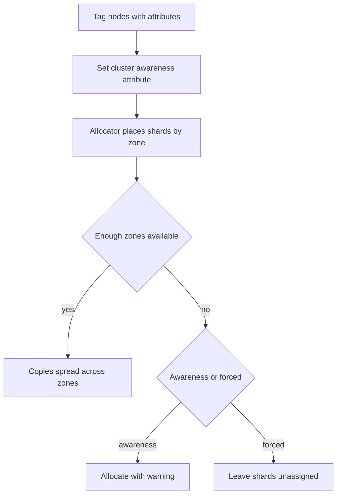

# Shard Allocation Awareness and Forced Awareness: Keeping Copies in the Right Places

## English

A replica shard is only useful if it lives somewhere different from its primary. Elasticsearch decides where each shard goes through a process called allocation, and by default it spreads shards across nodes fairly evenly. But 'evenly across nodes' is not the same as 'safely across failure domains.' If all your nodes sit in one data centre or one cloud availability zone, a power failure takes out primaries and replicas together, and your replicas bought you nothing. Allocation awareness is the mechanism that lets you tell the cluster about the physical topology so it can place copies intelligently.

You configure this with node attributes: each node is tagged with key-value pairs such as a rack ID or an availability zone. Then you set a cluster-level setting naming which attribute the cluster should be aware of. With one awareness attribute, Elasticsearch tries to ensure that no two copies of the same shard land in the same zone. With two attributes, it tries to spread copies across the combination. The cluster is not forced to obey — it prioritises keeping the cluster healthy, so if there are not enough zones it will still allocate, just with a warning. That is the difference between awareness (a strong preference) and forced awareness (a hard rule): with forced awareness, if you declare two zones and only one is available, the cluster refuses to allocate the second copy at all, leaving shards unassigned rather than placing both copies in one zone. Forced awareness protects you from a false sense of safety, at the cost of yellow health when a zone is down.

Allocation also has filters and rules. You can require or exclude nodes by attribute — for example, pinning a small index to a subset of nodes, or keeping a tenant's data on dedicated hardware. There is also disk-based allocation: Elasticsearch uses low and high watermarks (percentages of disk used) to stop placing shards on nodes that are filling up, and it will relocate shards away from nodes crossing the high watermark. These thresholds are why a cluster can suddenly start shuffling shards around: it is not broken, it is rebalancing to avoid a full disk. Understanding the watermarks turns a scary-looking reallocation storm into an expected response.

A concrete scenario: a cluster has six nodes across three availability zones. With awareness on the zone attribute, a primary in zone A will have its replica in zone B or C, never A. Lose zone A and the replica promotes, searches keep working, and the cluster goes yellow while it rebuilds. Without awareness, all six nodes might be treated as interchangeable and both copies could end up in zone A — the same failure now takes the index offline. The configuration is a few lines, but it encodes a real assumption about what 'failure' means in your environment.

One more nuance: allocation is not instantaneous. When a node leaves, the master notices, marks shards as unassigned, and then the allocator decides where to put them, subject to throttling so recovery does not saturate the network. You can inspect the current decisions with the cluster allocation explain API, which tells you why a shard is where it is (or why it is unassigned). Treat allocation settings as part of your disaster-recovery design, not an afterthought: they are the difference between replicas that are real redundancy and replicas that are decorative.

## 中文

副本分片只有在跟主分片身處不同地方時才有用。Elasticsearch 透過一個叫分配（allocation）的過程決定每個分片去哪裡，預設會把分片平均分佈到各節點。但「平均分佈到各節點」不等於「安全地跨越故障域」。如果你所有節點都在同一個數據中心或同一個雲端可用區，一次停電就會同時帶走主分片同副本，你買的副本等於白買。分配感知（allocation awareness）就是讓你告訴叢集實體拓撲、令它可以聰明地放置副本的機制。

你用節點屬性（node attributes）設定：每個節點加上鍵值對，例如機架 ID 或可用區。然後你設定一個叢集層級設定，指明叢集應該感知哪個屬性。有一個感知屬性時，Elasticsearch 會盡量確保同一個分片的兩份副本不會落在同一個區。有兩個屬性時，它會盡量按組合分散。叢集不是被迫遵守——它以保持叢集健康為優先，所以如果區數不夠它仍然會分配，只是發出警告。這就是感知（強烈偏好）同強制感知（硬性規則）的分別：用強制感知時，如果你宣告兩個區但只有一個可用，叢集會完全拒絕分配第二份副本，寧願分片未分配，也不把兩份副本放在同一區。強制感知保護你免於虛假的安全感，代價是當一個區掛掉時健康狀態會變黃。

分配亦有過濾器同規則。你可以按屬性要求或排除節點——例如把一個小索引釘在部分節點，或把某租戶的數據留在專用硬件。另外有基於磁碟的分配：Elasticsearch 用低同高水位線（磁碟使用百分比）阻止把分片放到快滿的節點，並會把分片從超過高水位的節點搬走。這些門檻就是為何叢集會突然開始搬分片：它沒有壞，它在重新平衡以避免磁碟爆滿。明白水位線，就會知道一場看似嚇人的重新分配風暴其實是預期反應。

具體情境：一個叢集有六個節點分佈在三個可用區。開啟按區的感知後，A 區的主分片，其副本會在 B 或 C 區，絕不會在 A。失去 A 區，副本會升為主分片，搜尋繼續運作，叢集變黃並重建。沒有感知的話，六個節點可能被視為可互換，兩份副本都落在 A 區——同一個故障現在會令索引離線。設定只是幾行，但它編碼了你環境中「故障」到底是什麼的真實假設。

還有一個細節：分配不是即時的。節點離開時，master 會察覺、把分片標記為未分配，然後分配器決定放哪裡，並受節流限制以免恢復過程塞爆網絡。你可以用 cluster allocation explain API 檢視目前的決策，它會告訴你某分片為何在該處（或為何未分配）。把分配設定視為災難復原設計的一部分，而不是後補事項：它們就是真正冗餘的副本同裝飾性副本之間的分別。

## Key Takeaway

Tag nodes with topology attributes and enable allocation awareness so replicas live in different failure domains — forced awareness trades availability for honesty when a zone is missing.

## Related Concepts
- Cluster State, Master Election, and Split Brain
- Cluster Operations: Health, Allocation, and Failure Modes

## Diagram

