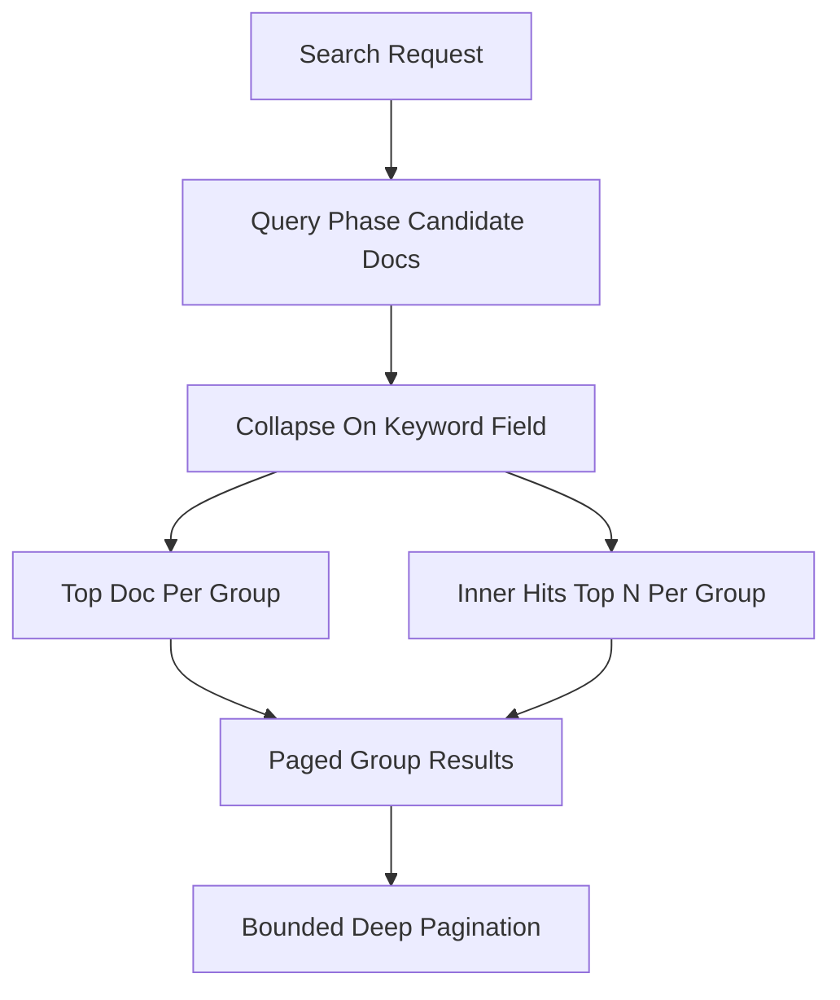

# Field Collapsing and Inner Hits: Grouping Results Without Losing the Detail

## English

A normal search returns documents. But many real questions are about groups: 'show me the most recent order per customer,' 'find the best-matching product per brand,' 'list conversations with their latest message.' If you just sort by recency and page through results, you get duplicates — one row per order rather than per customer — and you have to deduplicate in your application. Field collapsing solves this inside the search engine: you name a field, and Elasticsearch returns only the top document per distinct value of that field, ranked by your sort order. It is conceptually similar to SQL's GROUP BY, but with an important twist — collapsing selects one representative document per group, it does not aggregate the group's values.

The collapsed field must be a keyword or numeric field with doc values enabled, because the engine needs an efficient per-document mapping from group to document. You cannot collapse on an analysed text field, since it has no single value per document to group on. You can also set how many documents per group to keep, and here is where inner hits come in: rather than returning only the winning document, you can ask for the top N documents in each group as 'inner hits,' nested inside the outer result. That is how you get 'the best product per brand, plus the three runners-up' in one request, without a second round trip.

A subtle but crucial point: collapsing happens after the query phase, and the number of groups you can page through is bounded. Because each collapsed group needs its representative document, deep pagination over collapsed results is limited — you cannot scroll arbitrarily far through millions of groups the way you can with ordinary results. The engine also has to compute the full candidate set before collapsing, so a very broad query collapsing into very few groups can still be expensive. Collapsing is a presentation convenience, not a free filter: it reduces what comes back, not what gets evaluated.

Consider a marketplace: a query for 'wireless headphones' across thousands of listings, and you want one result per seller so the page is not dominated by a single vendor. Collapse on the seller ID, sort by relevance, and set the group size to one. The page now shows diverse sellers. If a buyer clicks a seller, you can show that seller's other matching listings using inner hits from the same response, or a follow-up query filtered to that seller. Without collapsing, you would sort and page through every listing, then deduplicate client-side — which breaks pagination counts and wastes bandwidth.

Two practical cautions. First, collapsing interacts with aggregations: aggregations still run over all matching documents, not just the collapsed representatives, which is usually what you want for analytics but can surprise people expecting 'count of groups.' To count groups you would use a cardinality aggregation on the collapse field. Second, collapsing is not deduplication in the data sense — the underlying documents are all still there and still matched; collapsing only selects which ones to return. Think of it as a lens over the result set, not a change to it.

## 中文

普通搜尋返回文件。但很多真實問題其實是關於群組的：「顯示每位客戶最近的訂單」、「找出每個品牌最匹配的產品」、「列出每個對話同它的最新訊息」。如果你只按時間排序再分頁，你會拿到重複——每個訂單一行而不是每位客戶一行——然後要在應用層去重。欄位摺疊（field collapsing）在搜尋引擎內部解決這個問題：你指定一個欄位，Elasticsearch 就只返回該欄位每個不同值中排名最高的一份文件（按你的排序）。概念上近似 SQL 的 GROUP BY，但有一個重要分別——摺疊是每組選一份代表文件，不是把整組的值聚合起來。

被摺疊的欄位必須是啟用了 doc values 的 keyword 或數值欄位，因為引擎需要一份高效的「每份文件對應哪一組」映射。你不能摺疊一個已分析的 text 欄位，因為它每份文件沒有單一值可以分組。你還可以設定每組保留多少份文件，這正是內部命中（inner hits）出場的地方：你可以要求把每組頭 N 份文件以「內部命中」形式巢狀在外層結果內，而不是只返回勝出的那份。這樣就可以一次請求拿到「每個品牌最佳產品，再加三個次佳選擇」，毋須第二次往返。

一個微妙但關鍵的重點：摺疊發生在查詢階段之後，而你可以分頁瀏覽的組數是有上限的。因為每個摺疊組都需要它的代表文件，對摺疊結果做深度分頁是受限的——你不能像普通結果那樣在幾百萬個組之間任意滾動。引擎亦必須在摺疊前計算完整候選集，所以一個很闊的查詢摺疊成很少組，仍然可能很貴。摺疊是呈現上的方便，不是免費的過濾器：它減少返回的東西，不減少被評估的東西。

想像一個市集：在幾千個商品中搜尋「無線耳機」，你想每個賣家只出一個結果，以免整頁被單一賣家霸佔。按賣家 ID 摺疊，按相關性排序，每組大小設為一。頁面就展示多元賣家。如果買家點擊某賣家，你可以用同一個回應內的內部命中顯示該賣家其他匹配商品，或用後續查詢過濾到該賣家。沒有摺疊的話，你要排序並分頁瀏覽每個商品，然後在客戶端去重——這會破壞分頁計數並浪費頻寬。

兩個實務警告。第一，摺疊同聚合互相影響：聚合仍然在全部匹配文件上運行，不只是摺疊後的代表文件，這對分析通常正是你要的，但會令期望「組的數目」的人意外。要數組數，你應該在摺疊欄位上用 cardinality 聚合。第二，摺疊不是數據意義上的去重——底層文件全部仍在，仍然被匹配；摺疊只是選擇返回哪些。把它想成結果集上的一片透鏡，而不是對結果集的改動。

## Key Takeaway

Field collapsing returns one representative document per group value and inner hits expose the runners-up — but it is a presentation lens, not deduplication, and it limits deep pagination.

## Related Concepts
- Relevance Tuning and Deep Pagination: Fuzzy Matching, Highlighting, PIT and search_after
- Aggregations: Turning Search Hits into Analytics

## Diagram

