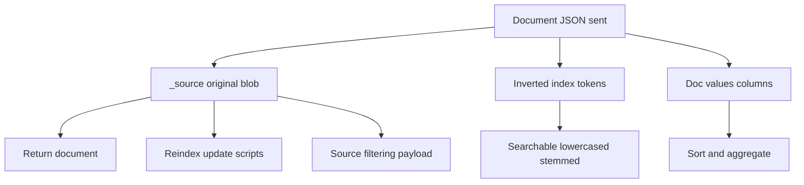

# The `_source` Field, `_reindex`, and the Difference Between Stored and Indexed Data

## English

When you send a JSON document to Elasticsearch, it keeps three loosely related things: the inverted index (searchable tokens), the doc values (columnar structures for sorting and aggregations), and `_source`, which is simply the original JSON you sent, stored compressed as a single blob. `_source` is not indexed at all — it is not searchable. Its job is to let Elasticsearch return your document back to you and to feed the reindex, update, and script APIs. This is why you can search on a `text` field but you cannot get the original capitalisation back from the index alone: the analyzer lowercased and stemmed it, and only `_source` remembers the raw string.

A practical consequence: disabling `_source` (with `"_source": {"enabled": false}` in the mapping) saves disk space, typically a meaningful fraction of the index size, but it is a one-way door. Without `_source` you cannot reindex into a new mapping, cannot run `update` by merge, cannot use `update_by_query` or `reindex`, and highlighting has to fall back to stored fields. For most people the right move is to keep `_source` and instead use `_source` filtering at query time — `"_source": ["title", "price"]` or `"_source": {"includes": ["user.*"], "excludes": ["user.password"]}` — which trims network payload without changing what is on disk.

A related distinction is `store: true` on a field. By default fields are indexed but not stored individually, because `_source` already holds the original. If you explicitly set `store: true`, Elasticsearch writes that field's original value into a separate stored-fields section, retrievable with `"stored_fields": ["myfield"]`. This is occasionally useful when `_source` is disabled, or when a field is huge and you want to fetch just it without pulling the whole document. For nearly everyone, `_source` filtering beats `store`.

`_reindex` is the operation that makes `_source` pay off. It reads documents from a source index and writes them into a destination index, which is how you change a mapping (mappings are largely immutable once a field exists), move data between clusters (with `remote` in the source), or backfill a newly added field. A typical zero-downtime recipe: create `products_v2` with the new mapping, run `_reindex` from `products_v1`, then atomically repoint an alias from v1 to v2. `_reindex` supports `script` to transform documents in flight, `query` to select a subset, and `max_docs` to limit scope.

One caveat worth knowing: `_reindex` is a snapshot-in-time read of the source, not a live sync. Writes arriving during the reindex will be missed, so production migrations usually combine `_reindex` with a follow-up catch-up pass, dual writes, or a change-data-capture feed before flipping the alias.

## 中文

當你把一份 JSON 文件送進 Elasticsearch，它其實保存了三樣彼此鬆散相關的東西：倒排索引（可搜尋的詞元）、doc values（用於排序與聚合的列式結構），以及 `_source`——後者就是你送進去的原始 JSON，以單一 blob 形式壓縮儲存。`_source` 完全沒有被索引，本身不可搜尋。它的職責是讓 Elasticsearch 能把文件原樣回傳給你，並餵養 reindex、update 與 script API。這正是為何你可以對一個 `text` 欄位搜尋，卻無法單靠索引拿回原本的大小寫：分析器已經把它轉小寫並做過詞幹化，只有 `_source` 記得原始字串。

一個實際後果：在 mapping 裡停用 `_source`（`"_source": {"enabled": false}`）可節省磁碟空間，通常是索引大小中相當可觀的一部分，但這是一道單向門。沒有 `_source`，你就無法把資料 reindex 到新 mapping、無法用合併方式做 `update`、無法使用 `update_by_query` 或 `reindex`，highlighting 也得退而依賴 stored fields。對大多數人而言，正確做法是保留 `_source`，改在查詢時做 `_source` 過濾——`"_source": ["title", "price"]` 或 `"_source": {"includes": ["user.*"], "excludes": ["user.password"]}`——這能精簡網路傳輸量，卻不改變磁碟上的內容。

另一個相關區別是欄位上的 `store: true`。預設情況下欄位會被索引，但不會個別儲存，因為 `_source` 已經持有原文。若你明確設定 `store: true`，Elasticsearch 會把該欄位的原始值寫進另一個 stored-fields 區段，可用 `"stored_fields": ["myfield"]` 取回。這在 `_source` 被停用、或某欄位極大而你只想抓它而不拉整份文件時偶爾有用。但幾乎所有人都是 `_source` 過濾勝過 `store`。

`_reindex` 正是讓 `_source` 回本的關鍵操作。它從來源索引讀取文件、寫入目的索引，這是你改變 mapping（欄位一旦存在，mapping 大致不可變）、在叢集間搬資料（來源可用 `remote`）、或回填新欄位的方法。典型的零停機配方是：以新 mapping 建立 `products_v2`，從 `products_v1` 執行 `_reindex`，然後把 alias 原子性地從 v1 指向 v2。`_reindex` 支援 `script` 在傳輸途中轉換文件、`query` 挑選子集、`max_docs` 限制範圍。

一個值得知道的注意事項：`_reindex` 是對來源的某個時間點快照讀取，並非即時同步。reindex 期間進來的寫入會被漏掉，因此生產環境的遷移通常會把 `_reindex` 與後續的追趕補寫、雙寫、或變更資料擷取（CDC）串流搭配使用，最後才切換 alias。

## Key Takeaway

Keep `_source` enabled and filter it at query time; use `_reindex` plus an alias flip to change mappings without downtime, remembering it is a point-in-time copy rather than a live sync.

## Related Concepts
- Index Aliases and Zero-Downtime Reindexing
- The Cost of a Field: Why Mapping Choices Shape Performance

## Diagram

